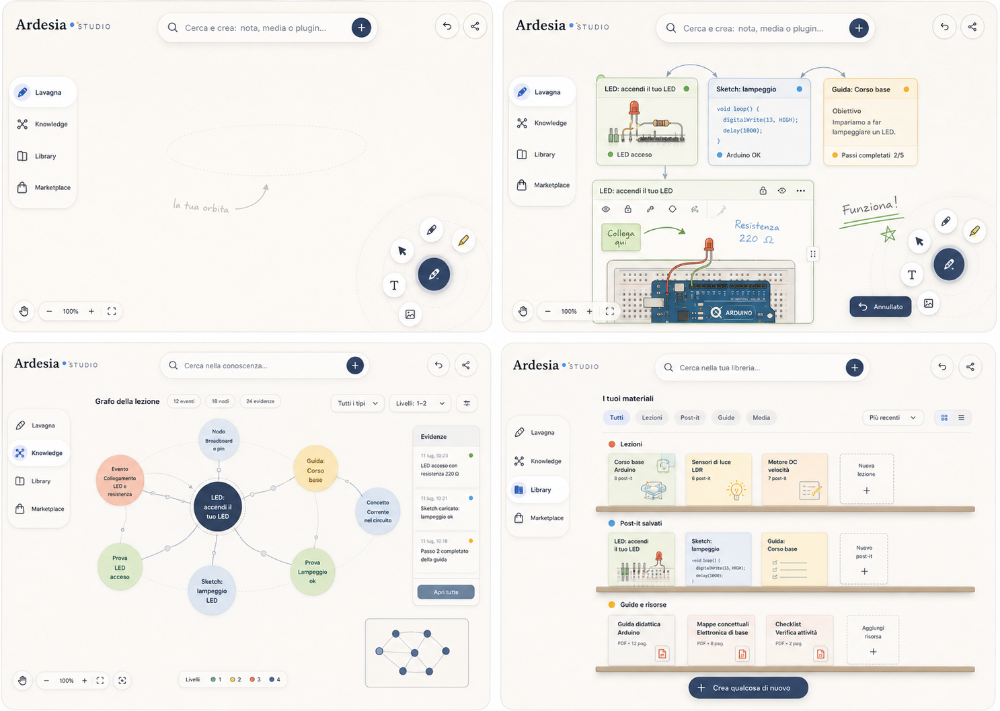

# ARDESIA UI CANON

This four-state composition is the binding visual source of truth for the ARDESIA teacher workspace.

## Canonical States

1. Empty board with one evident next action.
2. Board with three compact live plugin post-its and the same Simulation instance expanded.
3. Interactive LessonOS Knowledge graph.
4. Library organized as lesson materials, saved post-its, guides and resources.

## Binding Rules

- The canvas is dominant. Global navigation has at most four destinations and three persistent actions.
- Every plugin is a post-it. Compact and expanded views are two surfaces of the same live PluginInstance.
- The shared launcher creates notes, media and plugins. Simulation and ELABTutor are not global destinations.
- Primary copy speaks in teacher tasks. IDs, capabilities, board identifiers, hashes, MIME and provider state stay in technical details.
- Plugin runtime remains interactive beneath a persistent annotation layer. No raster replacement is acceptable.
- Matisse contributes functional color fields and rhythm; Calder contributes relations and motion; Haring contributes energetic readable marks; Miro contributes low-friction infinite-canvas interaction. The result is an original ARDESIA system, not an imitation.
- LessonOS remains the source of truth for Knowledge. Visual richness must come from real events and materialization, never invented graph data.
- Desktop, iPad and LIM must preserve the hierarchy, 44px targets, readable post-its and zero incoherent overlap.

Canonical asset SHA-256: `869fd0edaf9fba2dfaf767a25c679d39f912bdae9127a4e98454f6137c711b35`.
