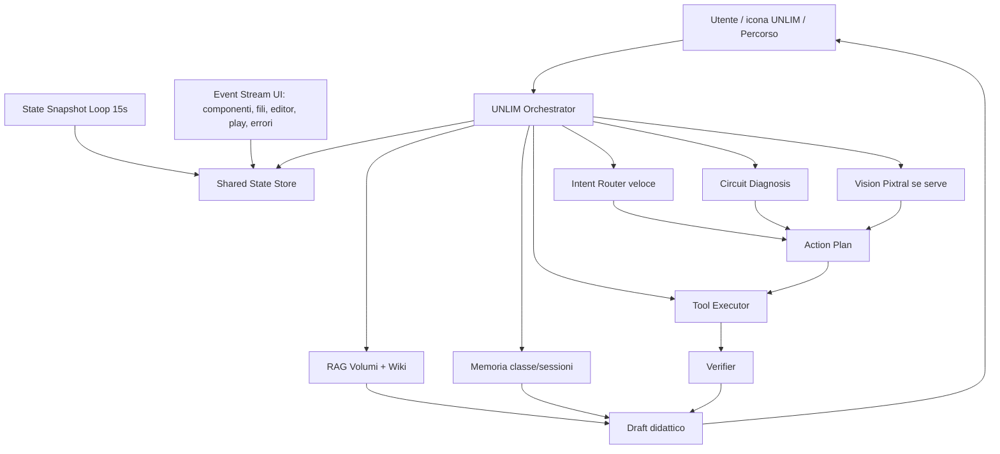

# UNLIM Parallel Agent Architecture

Data: 2026-05-09

## Decisione onesta

UNLIM puo' essere fatto bene, ma non basta allungare il prompt. L'architettura attuale e' un orchestratore ibrido: raccoglie contesto al momento della domanda, passa dal backend, riceve testo/tag, poi il browser prova a eseguire i tag. Questo produce tre difetti strutturali:

- consapevolezza intermittente: vede molto, ma solo quando viene interrogato o quando la narrazione live ha snapshot utili;
- azione indiretta: non usa tool nativi con verifica, emette tag che il frontend interpreta dopo;
- latenza a catena: contesto, RAG, memoria, prompt, modello, parsing, esecuzione avvengono troppo spesso in sequenza.

La direzione corretta e' trasformarlo in un agente con stato condiviso sempre aggiornato e rami paralleli.

## Architettura bersaglio

## Regola fondamentale

UNLIM non deve piu' pensare come una chat. Deve pensare cosi':

1. Leggo lo stato live gia' pronto.
2. Capisco se devo rispondere, agire, diagnosticare, guardare lo schermo o aprire una fonte.
3. Eseguo il ramo necessario in parallelo agli altri dati utili.
4. Verifico cosa e' cambiato.
5. Solo dopo dico alla classe cosa sta succedendo.

## Rami paralleli richiesti

- `state`: snapshot ogni 15s + snapshot immediato su eventi importanti.
- `events`: log strutturato di azioni utente: componente spostato, filo aggiunto, editor cambiato, codice modificato, compile/play.
- `vision`: Pixtral solo quando lo stato testuale non basta o la domanda chiede di guardare.
- `rag`: volumi, Tea, narrative map, album, fumetti e wiki in parallelo, con citazione breve solo quando serve.
- `diagnosis`: circuit solver e stato pin prima della risposta generica.
- `tools`: azioni su simulatore, manuale, video, Scratch, Arduino, compile, report.
- `verifier`: dopo un'azione, rileggere stato e confermare o ammettere fallimento.

## Mistral embeddings

Decisione: usare Mistral embeddings come retrieval server-side, non nel browser e non come scorciatoia per risposte generiche.

- `mistral-embed`: knowledge testuale ELAB, Tea, volumi, narrative map, album, fumetti metadata, cronologia sessione compressa.
- `codestral-embed`: codice Arduino/Scratch/XML Blockly, errori compiler, snippet verificati, tool recipes.
- Indici separati text/code, poi fusione via metadata e Reciprocal Rank Fusion.
- Filtro metadata prima del rerank: volume, capitolo, esperimento, componenti, arco narrativo, stato album, modalita corrente, tool richiesto.
- Cache per hash contenuto + modello + dimensione embedding: se il chunk non cambia, non si paga due volte.
- Ingest solo server/admin: mai embedding live di grandi documenti durante la lezione.
- Query runtime: embedding domanda + stato live sintetico + ultimi eventi, massimo pochi chunk ad alta precisione.

Questo e' come dare a UNLIM una biblioteca con scaffali etichettati, non un mucchio di fogli sul tavolo: il modello deve trovare il pezzo utile in fretta, poi parlare con parole sue.

## Prompt policy nuova

Il system prompt deve descrivere ELAB Tutor come ambiente operativo, non come chat:

- Lavagna con tre modalita': Percorso, Passo Passo, Gia' Montato.
- Manuali/volumi, video, salvataggio e report/fumetto.
- Simulatore circuiti con componenti/fili/stato elettrico.
- Editor Scratch e Arduino con compilazione.
- Memoria sessioni e cronologia.
- Snapshot live e uso Pixtral.

Le citazioni Vol./pag. devono essere ancore autorevoli, non frasi sempre obbligatorie. Se il problema e' operativo, prima diagnosi o azione; poi una citazione breve solo se migliora la spiegazione.

## Confronto con Galileo Nanobot

Repo esaminata: `AndreaMarro/elab-galileo-nanobot` clonata in `/tmp/elab-galileo-nanobot`.

Elementi utili da recuperare:

- Prompt specialistici separati (`circuit.yml`, `code.yml`, `scratch.yml`, `tutor.yml`, `vision.yml`) con regole piu' dure su azione, diagnosi e contesto.
- `brain.py`: router locale con output JSON (`intent`, `entities`, `actions`, `needs_llm`, `response`, `llm_hint`) e modalita' `shadow/active`.
- `server.py`: racing provider + cache + specialist routing. Utile come idea di parallelismo, non come soluzione pronta.
- Regola sana: se UNLIM dice che fa qualcosa, deve emettere azione/tool; risposta solo narrativa = errore.
- Regola sana: quando il circuito e' gia' in costruzione, non ripartire da zero e non aggiungere componenti gia' presenti.

Limiti Nanobot da non reintrodurre:

- Backend FastAPI esterno aggiunge un altro punto di latenza/fallimento se non integrato con stato caldo.
- Provider racing senza verifier puo' produrre risposta veloce ma ancora non verificata.
- Prompt enorme senza state store continuo non crea vera consapevolezza.

Decisione: non "tornare a Nanobot" in blocco. Usare Nanobot come archivio di policy buone, ma ricostruire UNLIM come orchestratore parallelo con stato live, tool verificati e Pixtral come ramo vision.

## Requisiti non negoziabili

- Risposta percepita veloce: feedback immediato `ELABorando`, poi risposta breve.
- Se deve agire, deve usare tool/azioni e poi verificare lo stato.
- Se non puo' agire davvero, deve dirlo.
- Niente coriandoli o musichette automatiche.
- Scratch e Arduino devono essere tool di prima classe, non solo testo.
- Pixtral e' ramo vision, non cervello unico.
- Le risposte devono essere naturali: massimo una citazione breve, poi discorso utile.

## Piano tecnico progressivo

1. Consolidare `Shared State Store` frontend con snapshot/eventi e API stabile.
2. Spostare `collectFullContext()` fuori dalla richiesta chat: deve essere gia' caldo.
3. Introdurre `AgentDecision` JSON: `reply | act | diagnose | vision | rag | clarify`.
4. Eseguire `diagnosis`, `rag`, `memory`, `vision-needed` in parallelo.
5. Convertire tag legacy in tool calls verificabili, mantenendo compatibilita' temporanea.
6. Aggiungere verifier post-azione: `expected`, `observed`, `ok`, `reason`.
7. Fare stress test Playwright con domande vaghe dopo modifiche reali al circuito/codice.
8. Implementare ingest Mistral text/code con pgvector, benchmark recall e fallback BM25.
9. Collegare ramo Pixtral a screenshot sessione solo quando `AgentDecision.vision` e' vero.

## Addendum 200 test Nanobot/Galileo

Suite aggiunta: `tests/unit/unlimNanobotInspired200Hard.test.js`.

Risultato onesto:

- Primo run: 189 PASS / 11 FAIL.
- Fail reali: `blocchetti`, `lampeggiare`, `senza semaforo`, `aiuto non si accende`, `sbagliato`, `highlightpin:nano:D13,nano:GND`, trigger vision `osserva/leggi/schermata`, clarify `quella`.
- Fix applicati in operational response, action bridge e shared state.
- Artifact finale: 200/200 PASS.
- Regressione mirata estesa: 227/227 PASS.

## Addendum tool executor

Primo passo implementato verso il ciclo reale:

`intento -> tool -> esecuzione -> rilettura stato -> verifica -> risposta onesta`

Cambiamento:

- `executeActionTagsVerified` affianca il parser legacy.
- Il flusso chat usa l'executor verificato per i tag azione espliciti.
- L'executor attende Promise e produce record strutturati: `command`, `label`, `ok`, `reason`, `expected`, `observed`.
- `setcode` non e' PASS finche' `getEditorCode()` non rilegge il codice atteso.
- `compile`, `loadblocks`, `exportfumetto`, `addwire`, `addcomponent` non sono PASS se il tool risponde `false`, `null`, `success:false`, `ok:false`, `status:error` o lancia errore.
- Se una verifica fallisce, UNLIM aggiunge un messaggio esplicito: ha provato, ma non dichiara esecuzione.

Prove:

- RED iniziale: 2 fail attesi per funzione mancante.
- Secondo RED: 1 fail atteso su tool void mancante dichiarato per errore come riuscito.
- GREEN bridge: 13/13.
- Regressione: 230/230.
- Playwright runtime hard-mode: 30/30.

Limite: i comandi legacy senza stato osservabile restano fallback best-effort. La forma finale deve essere un executor typed/server-side con verifier dedicato per ogni tool.

## Stato attuale dopo questa sessione

- Il system prompt ora include la mappa operativa parallela di ELAB Tutor.
- Le citazioni sono state ridimensionate: ancore brevi, non risposta intera.
- Il post-processing frontend non appende piu' citazioni a conferme, diagnosi operative o risposte con tag azione.
- Il system prompt ora richiede risposta originale: non copiare il volume come risposta, ma fare sintesi propria.
- Gli effetti celebrativi automatici sono disattivati nel servizio gamification.
- Restano da rifattorizzare l'orchestratore e l'esecuzione tool: oggi UNLIM e' migliorato nel prompt, nello stato caldo, nei contratti testati e nel primo executor async verificato, ma non ancora trasformato in agente pienamente tool-native.
