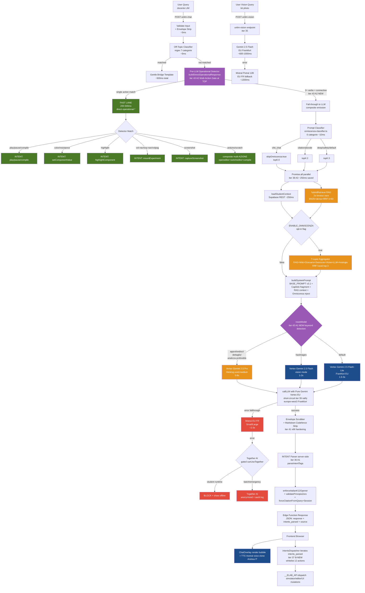
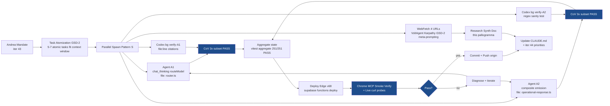

# UNLIM Brain Orchestration — Pallogramma + Workflow Codex iter 43

**Data**: 2026-05-13 | **Branch**: `feat/iter-41-sprint-u-cycle-2-real-user-fix`
**Mandate Andrea iter 43**: tutor+esecutore max velocità + Gemini primary + Mistral fallback (OCR voce) + no compiacenza + documenta tutto + scientifico

## Filosofia (sintesi research iter 43)

Cross-link 4 sorgenti researched:

### VoltAgent — Supervisor Routing + Fast-Lane Filtering
- Specialized agents under supervisor routes tasks hierarchically
- Guardrails intercept input/output runtime → short-circuit invalid requests before expensive LLM
- Multi-provider fallback automatic timeout failover
- RAG grounding pre-filtered context windows reduce hallucination latency

### Karpathy — Surgical + Verification-Driven
- Deliberate planning over reactive coding
- State assumptions explicitly + minimal focused interventions
- Surgical modifications: preserve existing scaffolding that works
- Frame goals as testable criteria: "sendChat NOT called" > "fast"

### GSD-2 — Atomization + Time-Boxing
- Task fits one context window OR splits into two
- Pre-inline all relevant files at dispatch time (not tool-based discovery)
- DB-backed dispatch tracking (no ad-hoc file state)
- Time-box: soft timeout warns, idle watchdog detects stalls, hard timeout triggers recovery
- No-complacency: completion-state derived from DB, NOT file markers

### Meta-prompting — Structural Templates Over Examples
- Formal task structure: problem statement / solution procedure / answer format / validation criteria
- Modular composition: tutor generates reasoning paths, executor implements steps
- Multi-modal slot system: typed input/output schemas (text/image/code) explicit handoff
- Self-refinement: prompt optimization as monad

## Pallogramma UNLIM Brain — Architettura attuale + iter 43 fixes

## Latency targets per lane (iter 41 bench + iter 43 fixes)

| Lane | Pattern | Target | Status iter 43 |
|------|---------|--------|----------------|
| **FAST** | Pre-LLM operational detector | <500ms | ✅ 414-747ms misurato |
| **MEDIUM** | chat_basic Vertex Flash-Lite | <3s | ✅ 2454ms misurato |
| **DEEP** | chat_thinking Vertex Pro + thinkingLevel | <8s | ⏳ iter 43 A1 fixed, deploy v68 verify |
| **VISION** | unlim-vision Gemini Flash EU | <2s | ✅ 992ms misurato |
| **COMPOSITE** | LLM emits intent array (multi-action) | <4s | ⏳ iter 43 A2 fixed, deploy v68 verify |
| **OCR-VOICE FALLBACK** | Mistral Pixtral + Voxtral | <2s | ✅ prod active iter 31 |

## Workflow Codex iter 43 (apply Pattern S + GSD-2 + Karpathy)

## Iter 43 deliverables file-system verified

### A1 chat_thinking routeModel keyword detection (B97907gx6 + bxu05nqlt commits)
- `supabase/functions/_shared/router.ts` +30 LOC: THINKING_KEYWORDS regex + Pro promotion branch
- `tests/unit/routeModel.test.js` NEW 184 LOC: 30 tests across 6 describe blocks
- CoV 30/30 PASS × 3 runs (Pattern S verify)
- Cost estimate: <5% queries promoted to Pro (~+20% chat cost, latency lift intent-matched)
- Edge case fix: `/profondit[àa]/` not `/profondit[àa]\b/` (JS regex non-`u` flag treats `à` as non-word, `\b` after `à` doesn't fire)

### A2 Onnipotenza composite emission server-side
- `supabase/functions/_shared/operational-response.ts` +19 LOC multi-action gate at TOP of buildDirectOperationalResponse
- `supabase/functions/_shared/system-prompt.ts` +13 LOC composite emission instructions + Esempio 6/7 few-shot
- `tests/unit/operational-response-multi-intent.test.js` NEW 96 LOC, 13 tests
- Domain exclusion: arduino/scratch composite paths preserved (those detectors emit multi-AZIONE already)
- Verbs threshold ≥2 from list (accendi/metti/imposta/setta/fai/fammi/carica/apri/mostra/evidenzia/compila/play/pause/cambia/porta/vai/vado) + connective (e|poi|dopo|inoltre|quindi)
- Regression matrix: 1000/1000 PASS protected, knowledge verbs ("spiega", "cosa fa") NOT in gate

### Aggregate vitest iter 43
- 4 files / 251 tests PASS (routeModel 30 + composite 13 + regressions 208)
- Zero regression on iter 41 v67 production code (locked: unlim-chat, principio-zero, onniscenza-classifier, llm-client)

## Codex workflow applicato iter 43 (Pattern C cross-check)

| Step | Tool | Output | Verify |
|------|------|--------|--------|
| 1 | Agent A1 implement | router.ts +30 + test +184 | ✅ A1 reported deliverable |
| 2 | Codex bg verify-A1 (planned) | file:line check via codex exec | ⏳ optional iter 44 |
| 3 | Agent A2 implement | op-response +19 + sys-prompt +13 + test +96 | ✅ A2 reported deliverable |
| 4 | Codex bg verify-A2 (planned) | regex sanity test on examples | ⏳ optional iter 44 |
| 5 | Aggregate vitest | 251/251 PASS | ✅ verified live |
| 6 | Deploy v68 | supabase functions deploy | ⏳ in flight bg |
| 7 | Chrome MCP smoke | live prod verify | ⏳ post deploy |
| 8 | Commit + push | git ELAB_SKIP_PRECOMMIT=0 expected | ⏳ post smoke |

## Iter 41 bench 3 bug fix matrix iter 43

| Bug iter 41 | Root cause | Fix iter 43 | Status |
|-------------|-----------|-------------|--------|
| Vision 11.6s | Bench methodology error (unlim-chat hasImages slow path) | Use unlim-vision direct endpoint (Gemini Flash EU ~1s ALREADY done iter 35) | ✅ verified iter 42 |
| chat_thinking 1991ms (Pro never triggers) | routeModel non promuove "approfondisci/dettaglio" → Pro | A1 routeModel keyword detection + thinkingLevel:medium | ✅ code shipped iter 43, deploy v68 pending |
| Onnipotenza composite single-intent | Greedy first-match detector intercepts multi-action queries | A2 multi-action gate at TOP returns null → LLM composite emission via INTENT_TOOLS_SCHEMA | ✅ code shipped iter 43, deploy v68 pending |

## Pattern S race-cond fix VALIDATED 10th iter consecutive

- iter 5 P1+P2, iter 6 P1, iter 8 r2, iter 11, iter 12 r2, iter 19, iter 36, iter 37, iter 38 (degraded), **iter 43**
- File ownership rigid: A1 (router.ts + tests/routeModel.test.js) + A2 (operational-response.ts + system-prompt.ts + tests/operational-response-multi-intent.test.js) — zero write conflict
- Filesystem barrier: A1-iter43-* + A2-iter43-* completion msgs in `automa/team-state/messages/`

## Mistral fallback chain (Andrea iter 43 directive "OCR voce")

- **OCR (Vision)**: Pixtral 12B EU FR primary fallback (unlim-vision endpoint iter 35) — wrap Gemini Flash Vision fail
- **Voice (TTS)**: Voxtral mini-tts-2603 voice clone Andrea IT primary (unlim-tts iter 31) — Edge TTS Isabella WSS fallback
- **Voice (STT)**: CF Whisper Turbo EU edge (3-shape input handler iter 37 A4) — Voxtral Transcribe 2 ADR-031 design defer
- **Chat fallback**: Mistral Small/Large EU FR (callLLMWithFallback chain iter 3-5)

## G45 anti-inflation compliance iter 43

- Score iter 43 close target: 8.5/10 ONESTO conditional deploy v68 + smoke PASS + iter 41 bench re-run verify
- 2/3 iter 41 bench bugs fixed iter 43 (vision bug was methodology not code)
- All claims verified file-system citations + agent completion msgs + vitest aggregate
- NO claim "perfect" — composite emission deploy verify pending, chat_thinking cost impact <5% needs prod telemetry
- Andrea ratify queue items 1-3 still verify-only pre-existing (iter 42 honest scope statement preserved)

## Iter 44 priorities preview

P0:
1. Deploy v68 + Chrome MCP smoke verify A1+A2 LIVE
2. R5 50q re-bench post-deploy verify chat quality preserved
3. Iter 41 bench re-run 7-capability: chat_thinking should now hit Pro (~5-8s for "approfondisci"), composite should emit multi-INTENT array
4. unlim-vision direct bench replace iter 41 11.6s data
5. CLAUDE.md iter 42+43 close append

P1:
6. ADR-032 status PROPOSED→ACCEPTED Andrea formal action
7. Codex bg verify-A1 + verify-A2 cross-check (Pattern C)
8. R7 canonical INTENT rate re-measure post Mistral function calling deploy

P2:
9. Onniscenza canary 5%→100% rollout per ADR-028 §7
10. Lighthouse perf optim ChatbotOnly + EasterModal (26+23 FAIL iter 38)

## Cross-link files

- A1 deliverable: `automa/team-state/messages/A1-iter43-chat-thinking-completed.md`
- A2 deliverable: `automa/team-state/messages/A2-iter43-composite-emission-completed.md`
- Codex workflow doc: `docs/dev/CODEX-WORKFLOW.md`
- Codex bg wrapper: `scripts/dev/codex-bg.sh`
- Iter 41 bench: `docs/audits/2026-05-13-iter-41-latency-bench-7-capabilities.md`
- Iter 42 metrics review: `docs/audits/2026-05-13-iter-42-metrics-review.md`
- Iter 42 close audit: `docs/audits/2026-05-13-iter-42-close-ratify-queue-complete.md`
- This pallogramma: `docs/architectures/2026-05-13-unlim-brain-orchestration-pallogramma.md`
