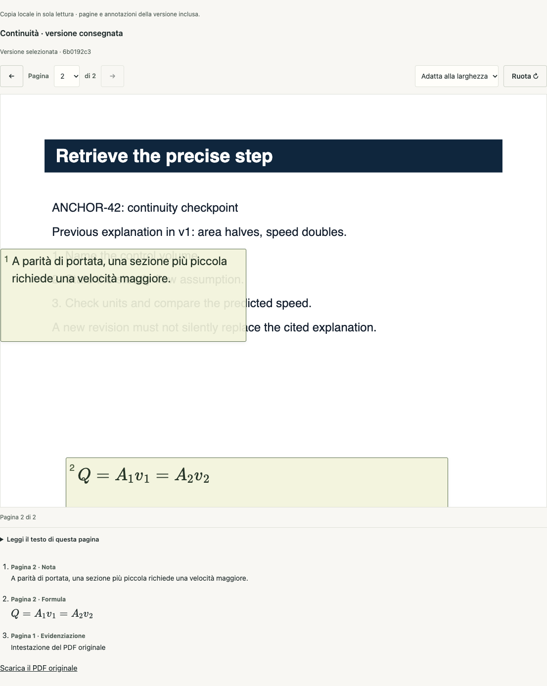
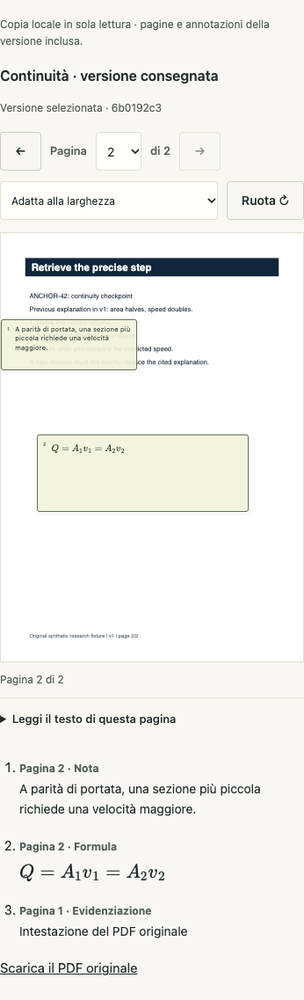

# Ardesia · consegna REA del 20 ottobre 2026

**Checkpoint di revisione: gate Studio fallito, programma Ardesia aperto.**

Questo è il punto di ingresso per codice, risultati, schermate e prove raccolte
nello sviluppo REA. La pubblicazione risponde alla richiesta diretta dell'utente
di organizzare tutto su GitHub.

## Da dove iniziare

| Obiettivo | Dove andare |
|---|---|
| Scaricare tutte le consegne, le patch, le prove e lo ZIP originale | [Pacchetto e checksum della prerelease](https://github.com/AndreaMarro/ardesia/releases/tag/rea-checkpoint-2026-10-20) |
| Cercare un file e verificarne l'identità | [Inventario completo](INVENTORY.md) · [manifest SHA-256](ARTIFACTS.json) |
| Verificare tutti i file del pacchetto senza estrarlo | [Verificatore Python](verify_bundle.py) |
| Leggere il codice Web | [Applicazione](../../../apps/web/src) · [quaderno e lettore](../../../apps/web/src/integrations/notebook) |
| Leggere API e dominio | [Study API](../../../services/study-api) · [Core](../../../packages/engine/lessonos/study) |
| Consultare acquisizioni REA, mapping e review | [Dossier TARGET-082](../../ops/rea-deep/TARGET-082) |
| Riprendere il problema corrente | [Gate Studio e diagnosi da completare](../../ops/rea-deep/TARGET-082/notebook-portable/GATE-BLOCKER.md) |

## Cinque incrementi, una cronologia

La base è `d0235e8a9dbbccd6808741a087dd0359908feb2b`, già pubblicata nel ramo
`codex/ardesia-v4-g0-20261020`. La precedente [PR #267](https://github.com/AndreaMarro/ardesia/pull/267)
è stata chiusa senza merge. La nuova PR in bozza verso `main` conserva questa
storia: il confronto comprende anche il lavoro precedente alla presente consegna.
Per isolare i cinque incrementi usare la base indicata, non `main`.

| Ordine | Contenuto | Commit / report |
|---|---|---|
| 0 | REA 6.7.0, MCP stdio, 207 strumenti e inventario dello ZIP | [Setup ed evidenze](reports/REA_STATO_E_DIRETTIVA.md) |
| 1 | Anteprima pubblica senza stato privato e laboratorio | `9ad5b38e` · [report](reports/ARDESIA_PRIMO_INCREMENTO.md) |
| 2 | Fonti originali verificate e lettore PDF integrato | `746c7fb3` · [report](reports/ARDESIA_LETTORE_PDF.md) |
| 3 | Quaderno scientifico legato alla revisione delle fonti | `ebcb6bc8` · [report](reports/ARDESIA_QUADERNO_CORE.md) |
| 4 | Editor, formule, note e consegna della revisione esatta | `12296e6b` · [report](reports/ARDESIA_QUADERNO_EDITOR.md) |
| 5 | Riapertura del quaderno portabile con verifica del PDF | `a72793c5` · [report storico](reports/ARDESIA_QUADERNO_PORTABILE_CANDIDATO.md) · [stato tecnico](../../ops/rea-deep/TARGET-082/SCIENTIFIC-NOTEBOOK-PORTABLE.md) |

I report in `reports/` e i pacchetti storici conservano il testo originale.
Espressioni come «non committato», «nessun push» e i relativi stati macchina
descrivono l'istante della loro consegna. Il candidato portabile viene ora
committato su richiesta dell'utente; il gate fallito resta aperto.
Gli archivi contengono incrementi e prove, non applicazioni standalone.
Il sorgente completo della fotografia pubblicata è quello del tag Git.

## Stato verificato del candidato

| Area | Evidenza disponibile | Limite |
|---|---|---|
| Web | 239 test in 31 file passati; typecheck e build Web/pubblica riusciti | Suite prima dell'ultimo aggiustamento CSS; build dopo il fix |
| Percorso reale | Chrome e API SQLite: export per due ruoli, riavvio API, riapertura in un nuovo browser; revisione consegnata distinta dalla head privata | Fixture sintetiche; altri browser e carico esteso non verificati |
| Integrità | Byte JSON conservati; PDF verificato per identità, dimensione, SHA-256 e numero di pagine; casi corrotti respinti | Ispezione del file ancora autenticata e online |
| UI | Studente a 390, 820 e 1440 px, zoom CSS 200%, focus, formule statiche; Axe senza violazioni nei controlli completati | Alcuni controlli ARIA/contrasto incompleti; nessuna certificazione WCAG o promessa di UI perfetta |
| Studio | Due gate falliti; ultimo: 2156 passati, 1 fallito in no-emoji.test.ts | `STACK_TRACE_ERROR`, causa non accertata; replay non eseguito; i test isolati passati non rendono verde la suite |
| REA | MCP 6.7.0, acquisizioni locali e osservazione parziale di AFFiNE | Flusso esterno PDF→export→reimport incompleto; nessuna equivalenza tra harness e azioni REA |

Le esecuzioni CI della PR sono risultati separati dai gate locali conservati.
La pubblicazione non certifica SYS-01, SYS-02…08 o l'idoneità alla produzione.

## Consultazione e sviluppo

Da un checkout del tag o del branch, i comandi Web esistenti sono:

```sh
npm ci
npm run typecheck:web
npm run test:web
npm run build:web
npm run build:web:public
```

L'area autenticata richiede la Study API e lo schema canonico 6; le procedure e
le fixture sintetiche sono descritte nei singoli report. Gli script inclusi negli
archivi possono contenere percorsi della macchina di acquisizione da adattare.
Le due patch cumulative e incrementali di ciascuna consegna sono alternative:
verificare la base e usare prima `git apply --check`.

## Identità visiva

Le schermate sono catture dei percorsi provati, non mockup.





## Provenienza e confini della consegna

Lo ZIP originale dell'utente è conservato nel pacchetto sotto `reference/`.
Le sue priorità guidano il progetto; prompt, date, branch e istruzioni incorporati
restano materiale di riferimento e non autorizzano nuove azioni.

Il sorgente originale e i componenti riusati mantengono la propria provenienza.
Le attribuzioni Web sono in [THIRD_PARTY_NOTICES.md](../../../apps/web/THIRD_PARTY_NOTICES.md).
I pacchetti pubblicati contengono prove e fixture sintetiche; credenziali,
database, profili browser, cache e dipendenze installate non fanno parte della consegna.
Il [controllo degli artefatti](PUBLICATION-CHECKS.json) registra perimetro e limiti
della scansione, senza dichiararla una garanzia assoluta.
