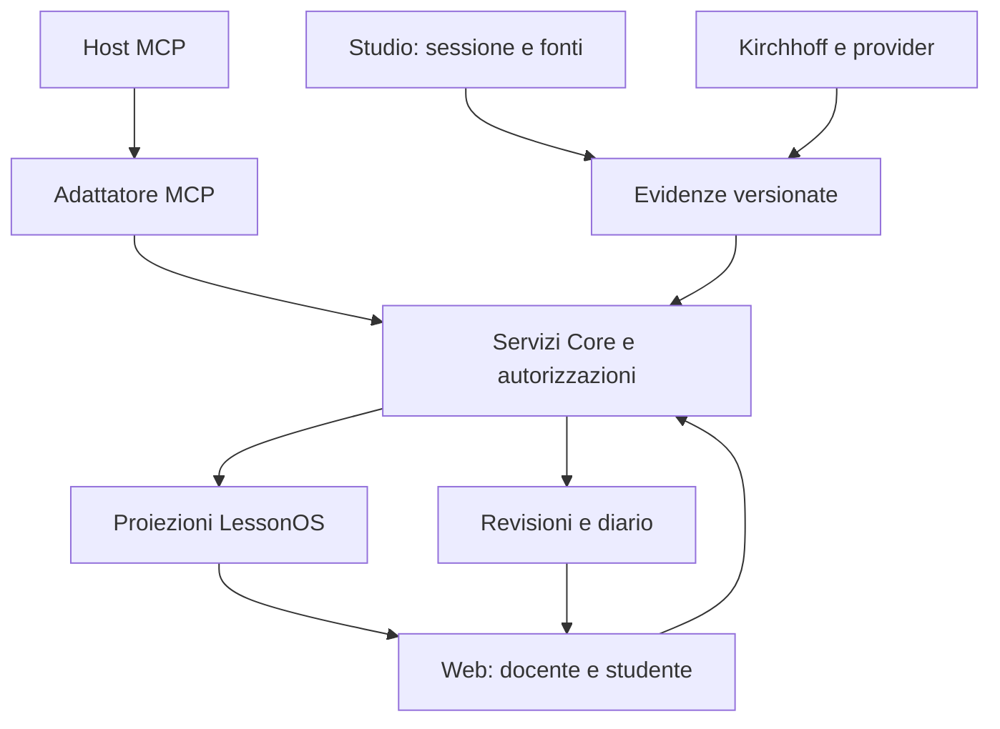

# Lezione, memoria e MCP: contratti del prossimo incremento

**Stato: SPECIFIED.** Data: 24 ottobre 2026. Base di sorgente: `339ab08f4139da0b37e78bbde81e9fe4e83afea0` e diff applicativo della presente consegna. Le correzioni e le prove effettivamente eseguite sono in [validation.md](validation.md); i contratti seguenti non sono annunci di funzionalità disponibili.

## 1. Riutilizzare le autorità esistenti

Il Core mantiene corsi, edizioni, proprietà, fonti versionate, consegne, feedback, diario ed eventi autorizzati. Studio mantiene la sessione locale e le evidenze della lavagna. LessonOS costruisce proiezioni e relazioni riferite a queste fonti. L'adattatore MCP presenta gli stessi servizi a un host; non accede direttamente al database e non inventa un proprio registro dello studente.

Il diagramma descrive responsabilità proposte, non un'integrazione già completata. Non è necessario unificare fisicamente il journal raw e le transazioni Study: occorre che ogni fatto abbia un'autorità, un'identità e riferimenti risolvibili. Le proiezioni possono essere ricostruite; le correzioni producono nuova storia anziché riscrivere retroattivamente la fonte.

## 2. Ponte audio e lavagna: cosa manca realmente

La classe `AudioRecorder` è legacy e usa `raw/audio/` e `session.yaml`. La Room corrente non la istanzia; `JournalRecorder.recordAudioChunk()` rifiuta audio nel journal v2. Il contratto sessione CAS esiste già nel WorkspaceStore, insieme ai path per le sessioni. La riparazione del lifecycle non modifica questi confini.

L'unità minima da integrare è **una registrazione appartenente a una sessione di una lezione**, non un interruttore globale. L'implementazione deve usare l'identità esistente della Room e un adattatore storage scoped ai suoi path. Il consenso persistito descrive una decisione; la riapertura non riavvia la cattura.

### Contratto dei riferimenti proposto

| Dato | Identità/forma necessaria | Proprietario e vincolo |
| --- | --- | --- |
| Sessione | Identità workspace/lesson/session già canonica, versione CAS | WorkspaceStore; nessun fallback a una sessione di altra lezione |
| Registrazione | Recording ID distinto per ogni start/stop | La pausa non diventa audio inesistente; più registrazioni restano distinguibili |
| Segmento media | Asset ref, digest, MIME/codec, indice, tempi nella registrazione e nella lezione | Bytes durabili prima del marker; hash e presenza verificati al replay |
| Evento lavagna | Event ID e riferimento all'oggetto/versione | Il tratto o oggetto può essere rimosso dalla vista senza falsificare il passato |
| Trascrizione | Intervalli media, testo, versione, provenienza dell'estrattore | Testo candidato; conserva incertezza e correzioni del docente |
| Associazione semantica | Segment ref + object/event refs + motivo + autore/revisore | Vicinanza temporale è un indizio, non conferma del significato |
| Materiale derivato | Source refs esatte e versione di trasformazione | Non sostituisce originale, consenso o review di pubblicazione |

Questi sono campi di contratto, da mappare ai tipi effettivi prima di implementarli. Non introdurre ID concorrenti quando esiste un'identità canonica equivalente. Non inserire segnaposto di hash nelle fixture distribuite come se fossero riferimenti validi.

### Tempo e segmentazione

Usare una base temporale dichiarata per la sessione e un mapping esplicito verso il tempo di ogni registrazione. L'epoch permette riferimenti esterni; il tempo trascorso va misurato senza assumere che l'orologio di sistema sia monotono. L'istante in cui il permesso viene richiesto non è l'inizio dell'audio: il fix registra l'inizio effettivo.

La prima integrazione deve verificare tre casi: clip breve senza un chunk periodico, due registrazioni separate da una pausa, seek all'ultimo evento. Non concatenare alla cieca WebM indipendenti come fossero chunk dello stesso stream. Il browser può ritardare eventi; l'ordine di arrivo non dimostra causalità didattica.

Il journal deve ricevere un evento canonico versionato con schema esplicito e decoder/export coerenti. Non riabilitare il vecchio `audio.chunk` aggirando v2. Se una nuova variante rompe consumer, la migrazione deve essere dichiarata e provata con fixture delle versioni precedenti.

### Stop, revoca, errore e chiusura

Lo stop ordinario preserva il segmento finale e termina le tracce subito, poi attende scrittura e marker. La revoca scarta il take, invalida permessi pendenti, attende le scritture già avviate e cancella i media della sessione autorizzata; la UI deve attendere l'esito del purge prima di dire che è completato. Un errore non diventa un successo silenzioso.

`dispose()` è chiusura tecnica dell'istanza. Non equivale a una revoca persistente del consenso e non elimina automaticamente tutto lo storico. La distinzione deve essere visibile al codice chiamante e ai test. Il click “revoca” deve chiamare e attendere il contratto di revoca, anche se la vista viene poi smontata.

La sessione CAS impedisce che un vecchio ON sovrascriva un OFF recente. La cancellazione deve includere media e derivati coperti dalla decisione; eventuali record storici di operazione non devono rendere recuperabili i bytes rimossi. La prova va eseguita anche dopo export, retry e nuova istanza dello store. Questo è un criterio tecnico; non costituisce una certificazione legale complessiva del prodotto.

## 3. Dimostrazione unica: il vincolo nella legge di Poiseuille

Riutilizzare `apps/web/src/components/PhysicsLab.tsx` e `packages/engine/lessonos/study/activities.py`. La previsione viene prima del risultato. Con gli altri parametri fissi, raddoppiare il raggio nel modello produce una portata sedici volte maggiore a differenza di pressione fissata; a portata fissata la pressione richiesta diventa un sedicesimo. Le ipotesi del modello e le unità devono restare visibili.

Il docente disegna la relazione, indica il vincolo e modifica il controllo. La prima dimostrazione può usare un'associazione **esplicita e revisionata** fra il segmento “qui il vincolo è la pressione” e l'oggetto della formula. Non presentarla come riconoscimento semantico automatico.

Lo studente riapre il passaggio, vede la stessa versione, ascolta o legge il testo, poi lavora in un nuovo tentativo. Se confonde il vincolo, il feedback indica il passo osservato e propone una prova diversa: dimezzare il raggio a portata fissata. Il tutor vede l'evidenza e può correggere l'interpretazione. I dettagli e gli oracoli sono nel [modello didattico](product-pedagogy-economics.md#5-la-dimostrazione-poiseuille-che-rende-visibile-lessonos).

### Gate del ponte, tutti necessari per chiamarlo integrato

1. Gesto esplicito, consenso iniziale OFF, una sola traccia per avvio; permesso tardivo non riattiva la sessione revocata.
2. Clip breve decodificabile, riferimenti validi e marker dopo scrittura riuscita; errore di bytes o marker osservabile.
3. Una formula e una modifica del parametro appartengono alla stessa identità e versione della registrazione.
4. Pausa, seek e ultimo istante ricostruiscono correttamente scena e media; testo disponibile quando audio manca.
5. Export→nuova istanza→import conserva i riferimenti, segnala asset mancanti e non contiene media di B nel pacchetto di A.
6. Revoca durante scrittura e permesso pendente elimina i bytes pertinenti e impedisce la loro ricomparsa via retry.
7. Tentativo e feedback riusano Core e diario; una risposta dopo aiuto non diventa prova autonoma.

La sessione corrente prova componenti dei punti 1–2 e il replay della lavagna; **non chiude l'intera lista**.

## 4. Memoria longitudinale senza un nuovo graph database

Recuperare LessonCapsule, StudyDigest, SummaryPack, Path Memory e Diario come fonti e proiezioni esistenti. Prima di aggiungere persistenza, verificare chi scrive e chi legge ogni campo nel candidato. I nomi storici LessonOutcome, StudentTrace, Didactic Delta e Learning Debt sono obiettivi/modelli da mappare, non garanzie che esista già un servizio completo con quel nome.

| Categoria | Esempio | Come può cambiare |
| --- | --- | --- |
| Evidenza | Risposta, aiuti usati, fonte, parametri e tempi | Conservata con versione e provenienza; cancellazione secondo autorizzazioni |
| Controllo deterministico | Rapporto numerico non coerente con il vincolo dichiarato | Ricalcolabile con versione del verificatore |
| Interpretazione proposta | Possibile confusione tra pressione e portata fissata | Confermata, corretta o respinta dal tutor; non è un tratto personale |
| Decisione didattica | Proporre un compito sul cambio di vincolo | Motivata dalle evidenze, rivedibile e non obbligatoria per lo studente |

Un nuovo compito aggiorna la proiezione mostrando se l'errore ricompare, con quanto aiuto e dopo quanto tempo. Una singola risposta non calibra una probabilità di superamento dell'esame. La memoria del metodo docente è una raccolta versionata di scelte approvate e dei relativi esiti; non è training silenzioso sui dati personali.

Implementare prima query e proiezioni sullo storage già presente: “quali errori revisionati richiedono una nuova prova?”, “quali fonti sostengono questa proposta?”, “che cosa è cambiato dall'ultima lezione?”. Aggiungere un database a grafo soltanto se un carico misurato o una query necessaria lo giustificano.

## 5. Produzione di materiali e gestionale

Il compositore usa fonte autorizzata→obiettivo→attività→verifica→anteprima→review. Per il primo tutor può essere assistito; non serve promettere la conversione universale di PDF in corsi. Esercizio, dispensa e scheda di recupero conservano riferimenti alla fonte esatta e stato editoriale. Una modifica della fonte invalida la derivazione dove necessario, senza recuperare silenziosamente la versione più recente.

Riutilizzare edizioni, iscrizioni/posti, presenze, consegne e incassi manuali esistenti. La home docente deve ordinare il lavoro: prossima lezione, correzioni, materiali da approvare, studenti da ricontattare. Non creare un CRM separato per questa vista. I vincoli commerciali temporanei del pilot non sono parametri universali del dominio; generalizzarli solo quando il secondo tutor ne dimostra la necessità.

## 6. MCP: implementato, proposto e verificato sono tre piani distinti

Il server attuale espone quattro strumenti: `course.list_mine`, `lesson.get_context`, `submission.get_receipt`, `catalog.get_teacher`. Sono letture HTTP autorizzate dal Core, con output allowlisted e fallback JSON. `lesson.get_context` richiede tutti e tre gli identificatori context/resource/revision. Una ricevuta di consegna non è una valutazione corretta né il corpo completo dell'elaborato.

Il server è stdio locale e usa una sessione privata per processo verso HTTP loopback. Non espone risorse MCP Apps, HTML, UI interattive o mutazioni. La verifica con SDK ufficiale e protocollo `2026-07-28` descritta nel repository non è una prova di tutti gli host commerciali. Nessun host della tabella seguente è stato collegato ad Ardesia in questa sessione.

### Capacità documentate degli host al 24 ottobre 2026

| Superficie | Tool, trasporto e autorizzazione documentati | UI | Stato di collaudo Ardesia |
| --- | --- | --- | --- |
| ChatGPT | Server MCP e autorizzazione OAuth; discovery, audience/resource e PKCE nelle guide ufficiali [H1–H2] | MCP Apps in iframe, bridge condiviso; estensioni OpenAI opzionali [H1] | NOT_RUN |
| Claude chat/desktop/mobile | Connettori remoti e autenticazione secondo la guida del servizio [H3–H4] | Connettori interattivi documentati sulle superfici indicate [H3] | NOT_RUN |
| Claude Code | stdio locale e HTTP remoto, OAuth; SSE distinto/deprecato nella guida [H5] | Non dedurre una UI grafica nella CLI dal supporto ai tool | NOT_RUN |
| Gemini CLI | Tool/resource MCP, trasporti locali/remoti e OAuth dei server remoti [H6] | Rendering Apps non attestato dalle fonti consultate; non estendere a Gemini consumer | NOT_RUN |
| Cursor | stdio, SSE, Streamable HTTP, resource/tool e OAuth [H7] | Supporto Apps esplicito; fallback a risposta MCP ordinaria [H7] | NOT_RUN |
| Codex / superficie CLI | La documentazione ufficiale della superficie descrive server MCP locali/remoti e auth; versione da fissare [H8] | Non attribuire alla CLI le capacità della chat grafica | NOT_RUN |
| OpenCode | Server locali/remoti e OAuth; schemi di configurazione diversi fra pagina principale e v2 [H9] | Non attestato nella pagina consultata; non equivale a prova d'impossibilità | NOT_RUN |

Le capacità di scrittura di un host non autorizzano un'operazione Ardesia. Ogni write deve passare di nuovo autorizzazioni, versioni e gate del Core. Resources, tools e UI sono superfici distinte: il primo risultato utile deve rimanere leggibile in testo/JSON, con ID, versione, esito, limiti e collegamento autorizzato anche quando non viene renderizzata una UI.

MCP Apps è un'estensione: una UI dichiara una risorsa, il client compatibile la rende nel proprio ambiente e il bridge veicola dati e invocazioni. Non è un protocollo sostitutivo del modello dati Ardesia. [H10] Il percorso documentale OpenAI iniziale `/apps-sdk` ora reindirizza a `/plugins`; questo cambiamento non richiede rinominare il Core o riscrivere i contratti applicativi.

### Test minimo per una compatibilità dichiarabile

Fissare host, versione, protocollo negoziato, trasporto e SHA del server. Provare discovery, lettura propria, negazione altro utente, revoca, errore redatto, risultato strutturato e fallback. Per write: stessa chiave e stesso payload una sola mutazione; chiave riusata con payload diverso rifiutata; versione stale rifiutata; rilettura autorevole dell'esito. Per UI: risorsa, bridge, navigazione, errore e fallback. Registrare identità sintetiche e nessun segreto. Il passaggio di un MCP Inspector o SDK non sostituisce questa prova.

## 7. Scrittura: completare la RFC esistente

Il riferimento resta la [RFC MCP Core reuse #293](https://github.com/AndreaMarro/ardesia/blob/5a4d89312f6a46e3a0dd435e6c040b3c134ba9f5/docs/product/MCP-CORRECTION-WRITE-CORE-REUSE-RFC-2026-10-24.md), inclusa la matrice W01–W18. La lettura di `feedback.py` nella base #290 conferma la candidata `deterministic_fake`, la review del docente e il gap del digest della candidata approvata. Non creare un altro CorrectionDraft ledger.

Il primo write proposto è `feedback.propose_private_revision`: revisione privata di una candidata esistente, con expected submission/candidate revision, source pin, testo/evidenceRefs limitati e idempotenza. Il ruolo non è accettato da argomenti, clientInfo o documento caricato. Il tool non rilascia il feedback né modifica da solo il diario come fatto confermato.

La UI docente legge il riferimento esatto, confronta, modifica e approva quella versione/digest. L'endpoint Core di rilascio esistente viene adeguato, senza duplicarlo; solo la review valida alimenta la proiezione del diario. Un worker/provider propone un risultato, non conferisce autorità. La policy ZERO-LLM del runtime rimane vigente: l'uso di un agente esterno da parte del docente e un'inferenza incorporata nel backend sono decisioni diverse.

### Verticale della fotografia: oggetti, passaggi e oracoli

| Passo concreto | Oggetto/servizio riusato | Test che deve precedere la disponibilità |
| --- | --- | --- |
| Studente carica fotografia sintetica originale | Upload/original asset e submission esistenti | Digest, dimensioni, ownership, revisione e ricevuta; nessuna istruzione dell'immagine cambia i permessi |
| Docente/agente recupera il contesto | Read esistenti + futura lettura privata per review | Fonte esatta e criteri; nessun contenuto di altra edizione |
| Analisi dell'elaborato | Provider esterno autorizzato o trascrizione manuale dichiarata | Distingue testo letto, regioni dell'immagine e inferenze; nessuna promessa OCR non misurata |
| Proposta motivata | Revisione privata della candidata Core | Note ancorate a fonte/regione; versioni CAS e retry idempotente |
| Confronto e correzione docente | UI review esistente completata | Approva il digest visto; una modifica concorrente invalida l'approvazione |
| Rilascio | Servizio review/publish Core | Una sola visibilità studente, nessuna nota privata esposta |
| Memoria e nuova attività | Diario e trasferimento già presenti | Evidenza riferita alla review; una prova distinta, senza soluzione già mostrata |

Questa tabella è una specifica implementabile con dipendenze e test; **il ciclo fotografia→analisi reale→feedback pubblicato non è stato eseguito in questa consegna**. La prova locale `deterministic_fake` non diventa correzione di un'immagine. I primi gate W01–W09 possono partire in SQLite sintetico senza credenziali o provider a pagamento; il remoto richiede una prova separata.

Il cookie operatore per processo non può diventare l'identità condivisa di più utenti remoti. Prima del trasporto remoto servono autenticazione per chiamata, audience/scopes, appartenenza verificata dal Core, revoca, limiti di dimensioni/quote e prova di isolamento sul backend effettivo. Non basta una conferma grafica offerta dal client.

## 8. Kirchhoff, ELABTutor e plugin

Kirchhoff entra attraverso una porta versionata con input strutturato, unità, assunzioni, stato supportato/non supportato, risultato e prove. La UI Ardesia rende il circuito e l'attività, il motore calcola entro la propria copertura. Il README di Kirchhoff osservato dichiara 15 famiglie PARTIAL, 6 NOT_SUPPORTED, 0 COMPLETE: non usare un risultato DC per promettere proof generale AC/Laplace.

ELABTutor può fornire capacità di simulazione e Pack disciplinari con provenienza; non importare nuovamente auth, dashboard, memoria e intero backend AI. Numerical Lab è un donor futuro di attività/runner isolato. I volumi privati restano nella loro sede autorizzata: l'accesso tecnico non è una licenza di pubblicazione.

Il manifest plugin dovrebbe dichiarare schema/versione, capability, risorse, eventi, permessi, dipendenze, contratti didattici, verificatori e compatibilità. Prima estendere il manifest attuale e i suoi test; non introdurre un protocollo parallelo. ToolHost conserva l'autorità del workspace. Un adattatore MCP può esporre alcune capability allowlisted, con limiti e provenienza, senza trasportare automaticamente tutti i comandi interni.

## Fonti e prove

- Codice e contratti locali: [Study MCP](../../../services/study-mcp/README.md), [ADR-0004](../../adr/ADR-0004-study-core-and-provider-boundaries.md), `AudioRecorder.ts`, `JournalRecorder.ts`, `WorkspaceStore.ts`, `sessionState.ts`, `feedback.py`, `submissions.py`, `diary.py`, base #290.
- [H1] [OpenAI, Add UI to your MCP server](https://developers.openai.com/plugins/build/chatgpt-ui).
- [H2] [OpenAI, Authentication](https://developers.openai.com/plugins/build/auth).
- [H3] [Claude, Interactive connectors](https://support.claude.com/en/articles/13454812-use-interactive-connectors-in-claude).
- [H4] [Claude, Remote custom connectors](https://support.claude.com/en/articles/11175166-get-started-with-custom-connectors-using-remote-mcp).
- [H5] [Claude Code, MCP](https://code.claude.com/docs/en/mcp).
- [H6] [Gemini CLI, MCP servers](https://geminicli.com/docs/tools/mcp-server/).
- [H7] [Cursor, MCP](https://cursor.com/docs/mcp).
- [H8] [Documentazione ufficiale della superficie CLI, MCP](https://learn.chatgpt.com/docs/extend/mcp?surface=cli), destinazione osservata di `developers.openai.com/codex/mcp`.
- [H9] [OpenCode, MCP](https://opencode.ai/docs/en/mcp-servers/) e [pagina v2 distinta](https://opencode.ai/v2/docs/mcp-servers).
- [H10] [Specifica MCP 2026-07-28](https://modelcontextprotocol.io/specification/2026-07-28), [MCP Apps, repository ufficiale](https://github.com/modelcontextprotocol/ext-apps).

Consultazione documentale al 24 ottobre 2026. Nessuna matrice di host sostituisce i test Ardesia `NOT_RUN` dichiarati sopra.
