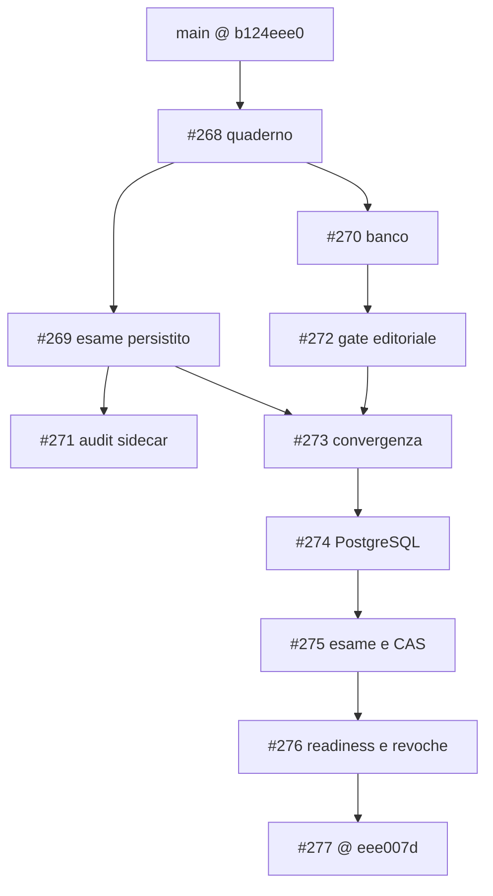
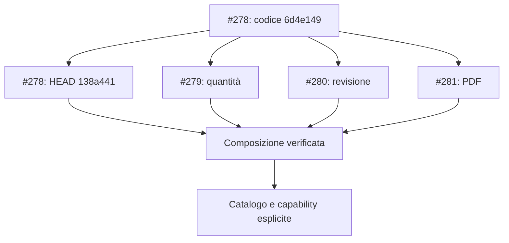

# Ardesia — registro di convergenza e debito tecnico

**Lettura corrente:** le sezioni iniziali conservano il rilievo originario di #281.
La [composizione verificata e l’incremento di catalogo](#convergenza-operativa-del-22-ottobre-2026)
sono documentati in fondo, distinguendo le nuove esecuzioni dalle ricevute storiche.

Data: 22 ottobre 2026. Base verificata: PR #277, `eee007d265f89f55b1ba0d08b092f2de1d3603c8`.
Le evidenze di codice sotto descrivono questa base; i delta della sessione sono distinti nella sezione misure.
**Nessun P0 dimostrato.** P1 indica un errore materiale o un prerequisito per il passo di prodotto successivo; P2 un disallineamento circoscritto.
`PROVATO` richiede codice o riproduzione concreta; `LIMITE` è un vincolo esplicito; `NOT_RUN` non significa difetto del sistema non provato.
Vercel è attualmente **BLOCKED** nel mandato: questo registro non attesta un deploy riuscito o un URL protetto raggiungibile.

## Perimetro e confini verificati

- **Core, Studio, Web:** `apps/web/src/api.ts` riusa contratti Studio e amplia `Edition`, `Workspace` e `ContextPacket`; `integrations/notebook/model.ts` riusa lo snapshot Studio. L'accoppiamento è visibile, ma non rende ogni import o componente una duplicazione difettosa. Il drift di stato dimostrato è R6.
- **Pratica ed esame:** `packages/engine/lessonos/study/question_bank.py:attempt` è stateless; `exam.py` persiste snapshot, ordine, risposte, CAS e risultato. Le diverse responsabilità restano necessarie. La divergenza numerica concreta è R1; non è stato riscritto lo scoring nel browser.
- **SQLite/PostgreSQL:** `store.py`, `postgres.py` e `schema_contract.py` condividono il dominio e riconoscono le forme storiche v7/v8 fino allo schema canonico v9. Le migrazioni PG in `supabase/migrations/` sono operazioni amministrative esplicite. Non è dimostrata una nuova divergenza di schema; manca la prova live ordinaria indicata in R5.
- **Autenticazione e sviluppo/prodotto:** esistono verifica Supabase e sessioni; i vincoli loopback e sintetici di R4 non equivalgono ad assenza di auth. Una build pubblica o una fixture locale verde non certifica il runtime autenticato cloud.
- **Test:** prove deterministiche e sintetiche coprono comportamenti concreti. Skip opt-in, test con mock e gate storici hanno perimetri distinti; non sono automaticamente bug. R3, R5 e R7 identificano i confini verificabili mancanti.
- **REA e portabilità privata:** `apps/studio/src/study/NotebookPanel.tsx` invia il file a `/notebook/inspect` prima della riapertura; `apps/web/src/integrations/notebook/useNotebookDraft.ts` conserva bozze in una Map volatile. Riapertura offline e recupero dopo crash non sono dimostrati. Non è emerso un bypass di revisione, digest o ACL nel perimetro letto.
- **Dipendenze:** licenze e pin sono documentati in `apps/web/THIRD_PARTY_NOTICES.md` e `docs/ops/rea-deep/TARGET-082/`. Nessuna dipendenza è classificata obsoleta o vulnerabile senza una verifica dedicata; il warning di dimensione MathLive non basta a dimostrarlo.

## DAG ricostruito, non sequenza numerica di PR

Snapshot di `main`: `b124eee04acc8062c27284f23c5d9108e3767c27`; #277 era avanti di 93 commit e indietro di 0. Il numero misura distanza d'integrazione, non 93 difetti.



#273 include #269 tramite merge `baafe1cfbafbfcd74cbbf4ba26458bff347407c1`, dopo #272.
**#271 è un sidecar basato su #269, non un antenato di #277**: al confronto, #277 ha 12 commit propri e manca di 2 commit del sidecar.
I delta preview, numerico, notebook e C2-B partono dalla superficie #277; un'integrazione successiva richiede prove della composizione, non la riscrittura delle PR storiche.

## Registro: sette elementi materiali

I riferimenti E1–E7 sotto la tabella sono percorsi relativi alla root del repository e funzioni esatte della base.

| ID / Evidenza | Gravità | Categoria | Causa | Conseguenza | Fix minimo | Test discriminante | Beneficio | Residuo |
|---|---|---|---|---|---|---|---|---|
| R1 — **PROVATO**, E1: `8/2 Pa` e `4.0 Pa` errati con atteso 4; `4 pA` corretto | P1 | Contratto numerico banco/esame | `exact` stringa passato a conversione per numeri; alias casefold precedono le dimensioni; parser numerici con limiti diversi | Falsi negativi e falsa equivalenza fra pressione e corrente | Riutilizzare `parse_rational` per esatto e quoziente; rendere obbligatoria la verifica dimensionale | Banco sintetico → snapshot → autosalvataggio → riapertura SQLite/HTTP → invio; 1/3 esatto, unità incompatibili e limiti numerici | Correzione esatta; eliminato un parser duplicato | Delta verificato separatamente, 62 test; vocabolario unità limitato, PG NOT_RUN, risultati già inviati non ricorretti |
| R2 — **PROVATO**, E2: `APPROVED` determina `PUBLISHED` in `approve` | P1 | Autorità scientifica/editoriale | Un unico comando rappresenta due decisioni umane | Salvare una revisione positiva rende il quesito erogabile | Revisione privata persistita, poi pubblicazione esplicita legata a versione/digest; revoca e retry coerenti | Revisione positiva ancora privata; pubblicazione esplicita; retry idempotente; revoca non annullata da retry tardivo; note escluse dalla vista studente | Controllo deliberato dell'erogazione | C2-B è un nuovo ledger/workflow; prove e migrazione del suo delta vanno valutate separatamente, non conteggiate come codice eliminato |
| R3 — **PROVATO**, E3: entry statica richiede course/evaluate HTTP; CI base non verifica public senza API | P1 | Confine preview/servizi e gate | Il percorso pubblico conserva dipendenze HTTP non fornite dall'hosting statico | Corso o laboratorio indisponibili nella build autonoma | Corso condiviso con HTTP; proiezione finita generata dal Core; build e browser public senza rete | Rifiutare ogni fetch; navigare e variare parametri; alterare un dato generato e richiedere fallimento della verifica di riproducibilità | Preview locale autentica senza secondo motore scientifico; una definizione del corso | Build/test locali non provano Vercel: deploy BLOCKED; nessuna auth o pubblicazione del banco implicita |
| R4 — **LIMITE**, E4: adapter sintetico e runtime loopback; readiness PG segnala backup non verificato | P1 | Prerequisiti del prodotto autenticato | Perimetro G0 locale esplicito, non configurazione cloud attestata | Backend autenticato non dichiarabile pronto al deploy | Runtime staging esplicito, HTTPS, cookie sicuri, confini di trust, backup/ripristino provati | Identità valida/scaduta/revocata; sessione e cookie sul target; restore sintetico e controllo readiness | Evidenza pertinente all'ambiente effettivo | Cloud auth/backup NOT_RUN; non aggirare i vincoli locali per pubblicare la preview; nessuna vulnerabilità inferita |
| R5 — **NOT_RUN**, E5: prove PG saltano senza URL/env opt-in; CI base non li configura | P1 | Copertura di persistenza e migrazioni | Lane ordinaria senza PostgreSQL/Supabase live | CI verde non esercita RLS, ruoli e convergenza reali | Job PostgreSQL isolato con dati sintetici; lane Auth G0 esplicita | Migrare forme v7/v8/v9; confrontare Core SQLite/PG; attore non autorizzato respinto; opt-in effettivamente eseguito | Rende visibili regressioni proprie dell'adapter e delle policy | Nella sessione C2 PostgreSQL locale è stato esercitato: 803 PASS/18 SKIP Supabase; la lane PG CI ordinaria resta da configurare. Nessun nuovo difetto PG dimostrato |
| R6 — **PROVATO**, E6: API serve PUBLISHED/APPROVED, UI tipizza DRAFT/NOT_RUN e mostra “in attesa” | P2 | Contratto e presentazione Web/API | Stato duplicato localmente e testo incondizionato | Lo studente legge uno stato opposto a quello erogato | Allineare tipo e presentazione al contratto effettivo; fixture pubblicata condivisa | Risposta pubblicata nel componente; etichetta coerente; nessuna esposizione di bozze o note private | Stato editoriale comprensibile e drift intercettabile | Corretto e verificato nel delta C2; estrazione generale dei contratti Web/Studio non realizzata né necessaria per questo fix |
| R7 — **PROVATO**, E7: `npm verify` copre Engine/Studio; gate storico punta a `$HOME/lessonos` | P2 | Comandi di verifica e ambiente | Nome aggregato più ampio del suo perimetro; evaluator storico legato a un checkout | Un verde locale può omettere Web/HTTP o verificare un altro checkout | Wrapper prodotto nel checkout corrente che richiami i gate esistenti, preservando l'evaluator congelato | Errore Web e HTTP introdotto in checkout temporaneo: gate prodotto deve fallire | Verifica locale rappresentativa del verticale | CI possiede già job separati; nessuna prova che ogni gate sia inefficace; wrapper ancora da realizzare |

### Percorsi delle evidenze

- **E1:** `packages/engine/lessonos/study/exam_bank.py` (`_numeric`), `exam.py` (`_numeric_answer`, `_completion_matches`), `quantity.py` (`expected_quantity`, `_number` nella base), `question_bank.py` (`parse_rational`, `attempt`). Prove nuove: `packages/engine/tests/study/test_exam_bank.py`, `test_quantity.py`, `services/study-api/tests/test_exam_bank_http.py` nel delta numerico.
- **E2:** `packages/engine/lessonos/study/question_bank_approvals.py`, `ApprovalGate.approve`, assegnazione `EDITORIAL_PUBLISHED if decision == 'APPROVED'` alla riga 197 della base.
- **E3:** `apps/web/src/features/Public.tsx`, `apps/web/src/components/PhysicsLab.tsx`, `apps/web/vite.public.config.ts`, `.github/workflows/ci.yml`; delta: `packages/engine/lessonos/study/public_preview.py`, `bin/web/export_public_preview.py`, `apps/web/e2e-public/`.
- **E4:** `services/study-api/study_api/app.py`, `create_app` righe 28–32, cookie riga 45, readiness riga 218; `runtime.py`, `SupabaseRuntime` righe 19–27.
- **E5:** `packages/engine/tests/study/test_postgres_schema_convergence.py` righe 49–51 (`ARDESIA_TEST_POSTGRES_URL`); `test_postgres_contract.py` righe 64–66 (`ARDESIA_SUPABASE_ENV_FILE`); `.github/workflows/ci.yml` job Engine/Study API.
- **E6:** `services/study-api/study_api/question_bank_routes.py`, `_published` righe 49–56; `apps/web/src/components/PhysicsQuestionBank.tsx` righe 15, 32 e 212.
- **E7:** `package.json` riga 22; `bin/monorepo.sh`, `test_core`, `typecheck_core`, `build_core`, `verify_core`; `packages/engine/eval/gate.sh` riga 6.

## Riuso, consolidamenti e misure effettive

**Due consolidamenti circoscritti**, non una fusione complessiva di Core/Studio/Web:

1. Definizione pura del corso in `public_preview.public_course`, condivisa da HTTP e generazione statica. I 62 risultati finiti del laboratorio sono generati dal Core e verificati; il browser non ospita un nuovo motore di scoring.
2. Parser razionale preesistente condiviso da validazione del banco, proiezione e confronto delle quantità: `_number` duplicato è rimosso. La distinzione fra pratica stateless ed esame persistito rimane.

| Delta | Conteggio dichiarato alla consegna | Interpretazione |
|---|---|---|
| Notebook: due componenti applicativi | +26 / −7, **netto +19**; test +82 | Navigazione annotazione→pagina nel lettore esistente; nessun nuovo formato/store |
| Numerico: tre file applicativi | +19 / −31, **netto −12** | Consolidamento del parser e correzione del contratto |
| Preview: intero delta, 23 file | +568 / −58, **netto +510 totale** | Include generati, test e documentazione: non è un conteggio di LOC applicative né di debito rimosso |
| C2-B: applicazione e migrazioni | **+590 / −33, netto +557** in 12 file; delta testo totale **+1.470 / −63** in 25 file, prima dei link screenshot | Nuovo ledger privato e workflow; non conteggiarlo come sottosistema eliminato |

`NotebookReading` era già condiviso da `NotebookEditor` in lettura e `PortableNotebook`: il salto pagina migliora entrambe le entrate. Non sono stati consolidati due lettori nuovi.
Prova notebook: RED 3 falliti/10 passati → GREEN 18 passati, typecheck e build; dettagli in `docs/ops/rea-deep/TARGET-082/NOTEBOOK-READING-NAVIGATION-2026-10-22.md`.
Prova numerica: RED iniziale 4 falliti; RED del confine parser 4 falliti/7 passati; GREEN finale 62 passati. Review indipendente del confine chiusa; HTTP eseguito dal builder.
Le misure separate non sono una prova di integrazione fra tutti i delta. Nessuna percentuale di debito totale eliminato è deducibile da questi conteggi.

## REA: osservato oggi, evidenza storica e residui

La chiamata live `remote_desktop_commander_list_devices` ha restituito **nessun dispositivo collegato**: nuove acquisizioni REA BLOCKED; nessun setup o riavvio eseguito.
Sono state riusate le evidenze conservate di REA 6.7.0 del 20 ottobre in `docs/deliveries/2026-10-20-rea/` e `docs/ops/rea-deep/TARGET-082/`; non sono prove eseguite oggi.
Il riferimento di annotazione conserva fonte/revisione esatte: resource/revision/asset SHA, non il solo fingerprint PDF. Il salto usa `Annotation.page`, con controlli su originale, revisione e pagine malformate.
AFFiNE è osservato per nota guest, persistenza e menu Export; ciclo PDF/export/reimport non verificato. Nessun suo codice o asset è stato assimilato.
Portabilità privata non equivale a condivisione o pubblicazione: inspect online, identità della revisione e ACL restano vincoli. Nella ricevuta originaria di #281 browser reale, penna/touch e accessibilità completa del nuovo salto pagina erano NOT_RUN; il sottopercorso PDF locale verificato nella composizione è descritto sotto. Penna/touch e accessibilità completa restano NOT_RUN.

## Convergenza operativa del 22 ottobre 2026

### Risultato e perimetro effettivo

Il docente può ora aprire **Mini-corsi → Apri catalogo e copertura**, distinguere
i due programmi configurati dalle otto raccolte di quesiti, cercare argomenti,
obiettivi e prerequisiti, leggere quantità e lacune e risalire a identità,
versione e digest del materiale. Il catalogo è una proiezione dei file canonici;
la consultazione non crea corsi, edizioni, revisioni o pubblicazioni.

Il collegamento programma/laboratorio/banca è esplicito. Un pack sconosciuto,
una revisione futura o una capability esplicitamente nulla/non riconosciuta non
selezionano Poiseuille. Per compatibilità, se il campo `entryActivityId` manca,
Web riconosce soltanto i due pack storici alla versione 1; non estende il fallback
ad altri pack o versioni. Fonti, appunti, quaderno e correzione manuale conservano il loro
perimetro. La review delle prove di trasferimento conserva osservazioni manuali
e ricomparse, senza attribuire un modello dal nome dell’esercizio.

Questo è un incremento locale verificato, non un rilascio produttivo.
I due CoursePack e tutti i 4.000 quesiti reali restano DRAFT; nessuna decisione
scientifica dell’utente è stata simulata. I test di pubblicazione impiegano
soltanto quesiti sintetici. Nessun pagamento, runtime cloud, calendario reale o
contenuto privato dei donor è stato attivato o pubblicato.

### Commit, composizione e ordine di integrazione

Snapshot GitHub riletto: `main` è ancora
`b124eee04acc8062c27284f23c5d9108e3767c27`; #268–#281 risultavano aperte,
draft e non integrate. #271 resta un sidecar di #269. Le 313 branch censite non
sono 313 versioni del prodotto distribuite.

| Origine | HEAD verificato | Ruolo nella composizione |
|---|---|---|
| #278 | `138a4417cc42f4a7f2093fa81202c1bb2e01ef09` | Base corrente, inclusi gli aggiornamenti documentali |
| #279 | `7776a66cdd9e2e3b24ef9d5a823b49dad23f3464` | Razionali, quantità e grading dell’esame |
| #280 | `39d2f2753ae488e331c075275a4d229a33f6c2e5` | Revisione scientifica privata, pubblicazione e revoca distinte |
| #281 | `337cfaa6fa170073e0ed5e6dd091a9e5ceac325a` | Annotazione → pagina PDF e registro del debito |

I tre follow-up nascono dal codice #278 a
`6d4e149d26ba7885e3e45d320402d060e2987270`; il passaggio a `138a4417`
modifica soltanto documentazione. Sono stati composti in un checkout nuovo,
senza conflitti Git. La baseline locale combinata è
`0b2837456d45c2debdfc5093ceadbb4581e9bac2`. Il commit di composizione remoto
con lo stesso albero è `35fff756ad8a95a6d241e58e12caa030bcd79bca`; il codice del nuovo incremento
è `d5aa1605ea5eddb018813049749c5a641008d007`. Gli aggiornamenti successivi a questo
commit sono documentali.

Il commit remoto di composizione ha quattro genitori: la HEAD di #278 e le tre
HEAD parallele. Il suo albero `3389de32ebb62b5a1bcb6630a38c1fc93fa9313b` coincide
con la baseline locale ottenuta dai tre merge. L’albero dell’incremento remoto,
`613a3baa4a9a635abf01e38ad75a467e73a33bec`, coincide byte per byte con il commit
locale collaudato `b2ad00311e0e32a63d52d569ff064192b13583d9`:
`git diff --exit-code b2ad003 d5aa1605` non produce differenze. La pubblicazione
tramite connettore GitHub sostituisce soltanto il trasporto Git locale privo di
credenziali; non riscrive gli antenati né modifica le branch precedenti.



La nuova branch `pro/ardesia-convergence-catalog-20261022` usa il prefisso
già escluso dal deployment Git automatico di Studio in `vercel.json`.
La PR draft ha come base la branch di #278, per rendere leggibile il delta
composto. Non modifica le branch storiche e non richiede merge automatici.
Per arrivare a main occorre prima valutare la catena fino a #277 e #278, poi
la composizione; #279/#280/#281 sono dipendenze parallele, non tre livelli
consecutivi. La CI dei singoli rami non è stata sommata come prova della composizione.

Sono presenti 18 migrazioni; #280 aggiunge
`20261022010000_study_scientific_reviews.sql`. Non sono emerse collisioni di
identificatore. Il nuovo incremento di catalogo/capability non aggiunge migrazioni,
dipendenze o nuovi ledger. Non sono state applicate migrazioni remote.

Misura del solo nuovo incremento rispetto alla composizione, ricavata da
`git show --numstat d5aa1605`; i delta già presenti nelle quattro PR non vengono
riconteggiati:

| Categoria | File | Aggiunte / rimozioni | Interpretazione |
|---|---:|---:|---|
| Applicazione Core/API/Web, inclusi CSS | 14 | +419 / −66, netto +353 | Catalogo derivato, binding e confini di stato; nessun sottosistema generale eliminato |
| Test Core/HTTP/UI/browser | 10 | +957 / −4, netto +953 | Prove di autorizzazione, metadati e percorsi del prodotto |
| Fixture locale sintetica | 1 | +92 / −0 | Riusa seed, membership e dipendenze esistenti |
| Screenshot sintetici | 3 | Binari, 277.942 byte totali | Evidenze locali; esclusi dalle LOC |

Totale testo del commit applicativo: +1.468 / −70. I due documenti di consegna
sono aggiornati separatamente. Queste quantità non misurano ore risparmiate o
una percentuale di debito tecnico eliminato.

### Catalogo derivato e matrice curricolare

Il contratto è `GET /study/admin/coursepacks?includeInventory=true`.
La risposta ordinaria resta `items` e `paymentMode`; soltanto l’opzione esplicita
carica l’inventario. `editions.registry()` autorizza prima il docente; studente
autenticato: 403, sessione assente/revocata: 401, risposta `no-store`.

`curriculum_inventory.py` legge i CoursePack del registry;
`QuestionBank.inventory_collections()` seleziona i record validati attraverso
`descriptors.miniCourseIds`. I conteggi riassuntivi del manifest non sostituiscono
il conteggio dei record. I riferimenti di esempio sono al massimo tre identità
con versione e SHA del contenuto: nessun testo di domanda, risposta o soluzione
viene copiato in questa proiezione. L’endpoint di creazione delle edizioni
rifiuta sia l’ID composto di una raccolta sia il suo miniCourseId.

| Programma configurato | Contenuto disponibile | Capacità e limiti | Stato scientifico/editoriale |
|---|---|---|---|
| `relazioni-fluidi-v1@1` — Fisica: relazioni e fluidi | 4 attività; 24 esercizi; 2 prove di trasferimento con 6 problemi totali; 24 soluzioni | Poiseuille, unità, idrostatica, galleggiamento nel perimetro dichiarato; ingresso Web Poiseuille. Mancano soluzioni per i 6 problemi di trasferimento. Non è l’intero syllabus | DRAFT / NOT_ATTESTED; condizioni delle edizioni in test |
| `taylor-exp-v1@1` — Analisi 1: Taylor e resto | 1 attività; 4 esercizi; 2 problemi di trasferimento; 6 soluzioni | Maclaurin di exp reale, centro 0, x in [-1,1], grado 0–12; stima conservativa del resto. Non è Analisi 1 completa | DRAFT / NOT_ATTESTED; durata didattica non deliberata |

Digest invariati: Fluidi
`3e0589e3647cc8d45e006c58839f2b83b06a13451f5d2985ac01eee8efaa321f`;
Taylor `89ccce46ce08fa7ac8dfa40ff9f3690781746f4fab26a8a66900ab4142b888ca`.
Il titolo può essere mostrato indipendentemente dall’identità; non è stata
introdotta una conversione implicita delle versioni già fissate nelle edizioni.

| Raccolta esistente, non CoursePack | Quesiti | Famiglie | Soluzioni |
|---|---:|---:|---:|
| `sf-u1` — Introduzione ai metodi della fisica | 160 | 10 | 160 |
| `sf-u2` — Meccanica | 928 | 58 | 928 |
| `sf-u3` — Meccanica dei fluidi | 800 | 50 | 800 |
| `sf-u4` — Onde meccaniche | 272 | 17 | 272 |
| `sf-u5` — Termodinamica | 672 | 42 | 672 |
| `sf-u6` — Elettricità e magnetismo | 800 | 50 | 800 |
| `sf-u7` — Fisica delle radiazioni, inclusi i temi di ottica presenti | 368 | 23 | 368 |
| `sf-fisica-simulazioni` — Allenamento trasversale | Gli stessi 4.000 | Le stesse 250 | Le stesse 4.000 |

Tutte le raccolte hanno `creatable=false`, `DRAFT`, `scientificReview=NOT_RUN`.
Le sette unità sommano 4.000 record; il trasversale li riusa. Non ci sono dieci
corsi erogabili né 8.000 quesiti distinti. L’ID è
`bankId@bankVersion:miniCourseId`, non un nuovo courseId. Il digest del manifest
è `15110c78e3b615eb4a3a50c8d33c179a6e35cd9495e2f6764b29cd9485850896`.

La proiezione trova **7 etichette di prerequisiti condivise** tra almeno due
voci, con confronto esatto. Sei provengono dalle raccolte di Fisica; «potenze»
collega i due CoursePack. Non sono sette nuovi moduli di recupero e non è stata
dedotta una equivalenza semantica fra etichette simili.

| Collegamento curricolare richiesto | Autorità già usata | Limite reso esplicito |
|---|---|---|
| Fonte, anno, disciplina e unità | Provenienza del pack; academicYear/taxonomy del bank; binding esplicito della materia | Il contenuto del manifesto non certifica da solo conformità al programma |
| Argomento, obiettivo, prerequisito | taxonomy, descriptors, activities.skill/prerequisites | Conteggi e descrittori non misurano padronanza o difficoltà empirica |
| Attività e quesito | ID/versione/digest, entryActivityId e questionBankIds del registry | Nessun laboratorio o banca dedotti dalla sola materia |
| Incontro e materiale docente/studente | Edizione, sessioni, risorse e visibilità esistenti | Le raccolte non possiedono ancora una sequenza didattica deliberata |
| Verifica, feedback e recupero | Snapshot esame, consegna, feedback, thread del diario | La review umana resta distinta dall’esito numerico |
| Revisione e pubblicazione | Ledger di #280 legati all’edizione e al contenuto | Il catalogo riporta lo stato della fonte, non inventa approvazioni per tutte le edizioni |

Il formato quattro incontri da 90 minuti, capienza 1–10 e prezzi indicativi
in modalità test resta un limite di prodotto. Taylor è un secondo modello reale,
ma non prova quale calendario alternativo sia didatticamente necessario.
Non è stato costruito un pianificatore generale senza tale decisione.

### Opportunità oltre i due programmi

L’inventario ampio non viene trasformato in nuove identità erogabili. I nomi dei
donor sono già censiti in `registry/ASSET_PROPRI.md`; i dettagli e i contenuti
privati letti non sono trasferiti in questo repository pubblico. Tutti gli otto
repository indicati nel mandato erano accessibili in lettura; i loro runtime
non sono stati eseguiti. L’assenza di una licenza globale verificata resta un
limite al trasferimento, non la prova che l’owner non possa autorizzarlo.

Il controllo dei materiali personali è stato limitato ai riferimenti e temi già
presenti in `ASSET_PROPRI.md`. Drive e Library erano accessibili. Sono stati
verificati i metadati di **8 file Drive pertinenti: 7 PDF e 1 foglio nativo**,
relativi a Fisica 1, Elettrostatica, una prova di Fisica II e un taccuino. Tutti
gli otto riportano `shared=false`; la presenza dell’owner nelle ACL non stabilisce
una licenza di riuso. Identità, nomi e collegamenti privati restano fuori da questo
repository pubblico. Non sono stati scaricati o importati i documenti:
estrazione, correttezza del contenuto e diritti di trasferimento sono NOT_RUN /
NOT_ATTESTED, mentre accessibilità e tipo sono verificati a livello di metadati.
Le ricerche Library hanno anche restituito PDF/taccuini e derivati marcati
`model_generated=true`, che non vengono equiparati alle fonti originali.
Una ricerca limitata agli audio con quei temi nel nome non ha restituito
risultati; non prova assenza di audio nelle altre fonti. Questa copertura mirata
non è un inventario completo dei materiali personali.

| Famiglia candidata e obiettivo | Materiale/capacità osservati | Decisione e lavoro mancante |
|---|---|---|
| Fisica per il Semestre Filtro: pratica tematica, confronto fra modelli e recupero | Banca versionata su 7 unità e CoursePack Fluidi; metadati di livello nel bank | Priorità tecnica vicina per riuso effettivo; revisionare un insieme limitato, definirne sequenza e prove. Nessuna domanda commerciale misurata |
| Prerequisiti matematici: frazioni, potenze, formule, grafici e unità | Etichette e problemi già presenti, non un programma completo | Comporre riferimenti esistenti dopo aver scelto livello/obiettivo; evitare duplicazioni dei quesiti. Costo soprattutto editoriale, non nuovo runtime |
| Analisi: limiti, successioni, serie, derivate, integrali | Taylor exp è il solo pack canonico del verticale; donor contengono materiale candidato | Adattamento selettivo dei dati dopo controllo di diritti, correttezza e livello. Analisi 1/2 complete, più variabili ed EDO non sono consegne di questa sessione |
| Algebra lineare, geometria e metodi | Opportunità da collegare ai materiali propri; nessun nuovo pack canonico validato | Nessuna UI/solver generico aggiunto. Prima delimitare corpus, obiettivo e valutazione, distinguendo calcolo numerico e prova simbolica |
| Circuiti, elettronica e segnali | Kirchhoff come donor di kernel/contratti circoscritti; modello e versione da fissare | Valutare estrazione isolata con vettori di prova, non importare intero solver/frontend. DC, AC, transitori e sistemi non ereditano una certificazione comune |
| Programmazione scientifica e calcolo numerico | Numerical Lab Journey, Numeria e Numeria Lab come sorgenti di dati/attività; elementi incompleti o storici distinti dal curriculum | Adattare dati o algoritmi isolati. Nessun runner attivato: isolamento, timeout, memoria e rete sono prerequisiti propri. Costo/incertezza maggiori del riuso dei pack esistenti |
| Preparazioni ad appelli e percorsi trasversali | Filtri del bank, composizione deterministica, diario e prove distinte | Separare selezione, percorso ed edizione; usare un profilo di valutazione per il programma scelto. Non applicare il profilo Fisica ad Analisi o circuiti |

Sono stati preferiti: riuso diretto dei contratti Core e delle componenti Study;
adattamento dei metadati già versionati; mantenimento di PDF.js/MathLive e del
lettore esistente. Non è stato importato un secondo motore quiz, ORM, sistema
di autenticazione, database, canvas o runtime AI dai donor. Nessun risparmio
quantitativo di ore è deducibile da questa decisione.

### Audit del corpus e controesempi scientifici

Controllo strutturale del corpus intero: **4.000 quesiti, 27 shard, 250 famiglie,
16 varianti per famiglia, 142 microaree**. I quattro livelli dichiarati contano
1.000 quesiti ciascuno. Formati: 2.537 scelte multiple con 5 opzioni e 1.463
completamenti. Nessun ID, semanticSignature o prompt normalizzato esattamente
duplicato è emerso; ciò non prova indipendenza semantica delle varianti.
La distribuzione delle risposte corrette A/B/C/D/E è 498/521/508/491/519.

Il campione stratificato usa una domanda per coppia unità × livello (28).
In ciascuno strato è scelta l’identità con minimo
`SHA256('rea-review-20261022:' + questionId)`. Il prefisso è soltanto il seed
deterministico del campione; non indica un’acquisizione REA live.
Il controllo annotato in questa sessione riporta concordanza dei 28 risultati
ricalcolati con le risposte. La ricevuta di selezione, identità, hash e risposte
è stata ricostruita dal banco invariato: non costituisce il log originale del
ricalcolo indipendente di ciascun item. Le risposte estratte dal banco, da sole,
non costituiscono una verifica indipendente. Soltanto tre soluzioni sono state lette
integralmente e approfondite: `u4-beats-envelope-08`, `u6-ohmic-current-03` e
`u7-lens-magnification-07`. Non è una revisione umana del corpus né una stima
statistica del tasso di errore.

Identità del campione, tutte alla versione 1; la regola sopra permette di
ricostruire la selezione senza introdurre un secondo manifest:

| Unità | Base | Facile | Medio | Difficile |
|---|---|---|---|---|
| U1 | `u1-vector-sum-02` | `u1-vector-projection-06` | `u1-scalar-product-10` | `u1-area-conversion-14` |
| U2 | `u2-projectile-range-01` | `u2-incline-friction-07` | `u2-torque-perpendicular-10` | `u2-force-couple-13` |
| U3 | `u3-accelerating-liquid-column-01` | `u3-bernoulli-height-speed-08` | `u3-surface-work-09` | `u3-maximum-payload-14` |
| U4 | `u4-oscillator-max-acceleration-03` | `u4-beats-envelope-08` | `u4-wave-phase-time-10` | `u4-wave-phase-space-16` |
| U5 | `u5-isobaric-work-02` | `u5-engine-average-power-06` | `u5-freezing-time-11` | `u5-compression-heating-15` |
| U6 | `u6-ohmic-current-03` | `u6-faraday-average-emf-05` | `u6-identical-series-resistors-11` | `u6-capacitor-sharing-energy-loss-16` |
| U7 | `u7-beta-minus-atomic-number-01` | `u7-lens-magnification-07` | `u7-projected-image-height-11` | `u7-radioisotope-mixture-14` |

| Finding di contenuto | Evidenza e causa | Decisione minima e rischio residuo |
|---|---|---|
| C-REA01, P2, PROVATO nel testo | `u4-beats-envelope-08`, `questions/U4-02.json`: 3 Hz e 1 Hz sono presentati come frequenze vicine, con condizioni del modello dichiarate valide. La differenza 2 Hz è aritmeticamente corretta, ma Δf/f_media=1 non sostiene una modulazione lenta | Chiarire contesto e parametri nella revisione editoriale. L’identità trigonometrica della somma resta valida; non è un bug di grading o una prova che ogni uso della differenza sia errato |
| C-REA02, P2, AMBIGUITÀ | `u7-lens-magnification-07`, `questions/U7-03.json`: p passa da 3 a 6 cm mentre q resta 6 cm; la lente sottile richiederebbe f da 2 a 3 cm. Il rapporto degli ingrandimenti 1/2 è corretto tra configurazioni compatibili, ma non per una medesima lente invariata | Esplicitare se cambiano lente/configurazione. Non correggere retroattivamente tentativi o approvare il quesito senza decisione umana |

Riferimenti di controllo: [sovrapposizione e battimenti, OpenStax](https://openstax.org/books/university-physics-volume-1/pages/17-6-beats)
e [lenti sottili, OpenStax](https://openstax.org/books/university-physics-volume-3/pages/2-4-thin-lenses).
La conclusione sui parametri è un ricalcolo del campione, non una frase attribuita
ai manuali. Non sono stati modificati i testi o i digest della banca per questa
consegna; il ciclo di authoring di una nuova versione resta da completare.

Il controllo ufficiale 2026/27 ha confrontato le sette unità con il
[programma UniBo](https://www.unibo.it/it/studiare/insegnamenti-competenze-trasversali-moocs/insegnamenti/insegnamento/2026/568106)
e la composizione 31 domande, 21 multiple + 10 completamenti, 50 minuti e
punteggi +1/−0,1/0 con la
[guida Sapienza](https://www.uniroma1.it/it/pagina/semestre-aperto-2026-2027-guida-alla-frequenza-dei-corsi).
Questo riscontro non è una certificazione normativa completa; non sono state
codificate nuove regole o usati i vecchi profili a quattro opzioni come fallback.

### Registro del debito: aggiornamento, non chiusura globale

| ID | Esito sulla composizione | Prova e residuo |
|---|---|---|
| R1 | CORRETTO E COMPOSTO, LOCAL | #279; suite Core/API include confronto razionale, dimensioni e tentativi persistiti. I risultati storici già inviati non vengono ricorretti |
| R2 | CORRETTO E COMPOSTO, LOCAL | #280; revisione privata, pubblicazione esplicita e revoca. Corpus reale non revisionato |
| R3 | CORRETTO E COMPOSTO, LOCAL | #278; build statica riproducibile e 4 test browser senza API. Vercel remoto BLOCKED |
| R4 | LIMITE APERTO | Runtime autenticato cloud, HTTPS/cookie target, backup e ripristino cloud non certificati |
| R5 | PARZIALMENTE VERIFICATO | PostgreSQL 16 locale: 12 test realmente eseguiti e inclusi nella suite finale. Restano 18 skip Supabase e la lane CI ordinaria da completare |
| R6 | CORRETTO E COMPOSTO, LOCAL | Stati API/Web allineati da #280; pubblicazione esplicita provata con fixture sintetiche |
| R7 | DEBITO APERTO, P2 | `npm verify` resta limitato a Engine/Studio; questa consegna usa comandi Study/API/Web espliciti e separati, senza alterare l’evaluator storico |
| R8 | PROVATO E CORRETTO, P1 per estensione | `baseActivity` e `describe_pack` attribuivano laboratorio/banca per fallback. Nuovi binding esatti e default deny; RED Core 16 fail/1 pass → GREEN 17. I due pack esistenti non dimostravano una vulnerabilità in produzione |
| R9 | CONFINE RAFFORZATO, P2 | Stato transitorio legato a identità/ruolo/edizione/pack/versione/digest; retry richiede una consegna dello studente e della stessa attività. Test di rerender non dimostra una fuga nel normale App, che già rimontava per utente/edizione |
| R10 | LACUNA DI CATALOGO RIDOTTA | Inventario derivato e UI docente; RED Core 6 fail → 6 pass, HTTP 1 fail/1 pass → 2 pass, UI 3 fail → 3 pass. Candidati esterni e nuovi programmi non vengono promossi per quantità |
| R11 | REGRESSIONE INTERCETTATA E CORRETTA PRIMA DELLA CONSEGNA, P2 | La prima restrizione Web nascondeva il diario sulle attività transfer. Review indipendente → RED 2 fail/2 pass → GREEN 4: osservazioni manuali e ricomparse conservate, concetti specifici solo con legame noto |

R8 è smentibile aggiungendo un pack senza capability e verificando che riceva
comunque Poiseuille o la banca: i test ora lo impediscono. R9 protegge il contratto
del componente, senza affermare una perdita di dati già osservata in produzione.
R11 riguarda la nostra modifica intermedia; non viene attribuito alla baseline.
Nessun P0 è stato dimostrato. Assenza di nuovi finding nell’ulteriore review non
equivale a un audit di sicurezza esaustivo.

### Matrice funzionale e livello di evidenza

Gli stati sotto riguardano il perimetro indicato, non l’intero prodotto.
`UNIT_TESTED` comprende test deterministici Core/HTTP/UI eseguiti nella suite;
`LOCAL_END_TO_END_VERIFIED` richiede il percorso browser locale. Nessuna riga
è promossa a STAGING_VERIFIED o PRODUCTION_VERIFIED.

| Funzionalità | Stato dimostrato | Autorità/prova e limite |
|---|---|---|
| Catalogo e inventario docente | LOCAL_END_TO_END_VERIFIED | curriculum_inventory, Courses e nuovo E2E; 2 programmi + 8 raccolte, non una disponibilità commerciale |
| Creazione/modifica edizioni | PARTIAL, UNIT_TESTED | editions.py/test_edition_admin; CRUD/revisioni/conferma, formato fisso |
| Calendario e conflitti | PARTIAL, UNIT_TESTED | calendar.py/test_calendar_adapter; DST, conflitti, ICS; provider esterno non live |
| Posti, richieste, iscrizioni, attesa | UNIT_TESTED | groups.py/test_groups; hold, scadenza e idempotenza; pagamenti test |
| Lezioni in gruppo | PARTIAL | Contesto d’edizione, membership e aula presenti; videolezione/collaborazione sincrona non dimostrate |
| Strumenti docente/studente | LOCAL_END_TO_END_VERIFIED nei flussi sotto | Shell/App, Review, Work; identità sintetiche, non utenti reali |
| Materiali, risorse e upload | LOCAL_END_TO_END_VERIFIED per testo/PDF | uploads.py, risorse versionate e nuovo E2E; estrazione universale documenti non attestata |
| PDF, annotazioni e notebook | LOCAL_END_TO_END_VERIFIED | Worker PDF reale, revisione consegnata, salto pagina, SHA originale; penna/touch NOT_RUN |
| MathLive e formule | LOCAL_END_TO_END_VERIFIED per inserimento | Formula inserita nella nota; non equivalenza matematica generale né ergonomia touch |
| Lavagna | PARTIAL | SourceBoard è tavolo di fonti/versioni; canvas libero del plugin resta separato |
| Simulazioni ed esercizi parametrici | LOCAL_END_TO_END_VERIFIED per i due ingressi | Poiseuille e Taylor; altri modelli hanno solo la copertura esplicita dei test Core |
| Banca, scelta multipla, completamenti | UNIT_TESTED; workflow locale su fixture | question_bank; corpus reale DRAFT, niente disponibilità implicita allo studente |
| Generazione/composizione prove | UNIT_TESTED | exam_bank; composizione deterministica da autorizzati, non generazione libera |
| Correzione numerica | UNIT_TESTED | quantity/test_quantity ed esame persistito; grammatica limitata |
| Equivalenza simbolica | PARTIAL | Alias/normalizzazione espliciti; computer algebra ed equivalenza algebrica generale NOT_IMPLEMENTED nel percorso |
| Controllo dimensionale | PARTIAL, UNIT_TESTED | Unità supportate, prefissi e maiuscole; non analisi generale di formule |
| Autosalvataggio | PARTIAL, UNIT_TESTED | Risposte esame e bozze; non ogni superficie salva automaticamente sul server |
| Resume tentativi | UNIT_TESTED | Snapshot, CAS e revisioni; cache UI non è autorità della consegna |
| Timer | UNIT_TESTED | Deadline server e risposte persistite; nessun proctoring |
| Spiegazioni, feedback, revisioni | LOCAL_END_TO_END_VERIFIED nel loop | Feedback umano sulla fonte; correttezza scientifica di tutte le soluzioni non attestata |
| Diario e recupero | LOCAL_END_TO_END_VERIFIED nel loop | Prova distinta e verifica del tutor; nessuna metrica di mastery inventata |
| Export e riapertura | UNIT_TESTED | portable/test_portable_history, lettore portabile; roundtrip browser completo di tutti i formati NOT_RUN |
| Memoria didattica | PARTIAL, UNIT_TESTED | context/test_context_memory, ricerca e citazioni con ACL; non memoria semantica universale |
| Revisione scientifica | LOCAL_END_TO_END_VERIFIED, workflow sintetico | question_bank_reviews; le decisioni reali restano NOT_RUN |
| Pubblicazione editoriale | LOCAL_END_TO_END_VERIFIED, workflow sintetico | Decisione separata e revoca per edizione; zero nuove pubblicazioni reali |
| Analytics e risultati | PARTIAL | Risultati/tentativi Study; dashboard aggregata Studio separata, non unificazione dimostrata |
| Auth, ACL e isolamento | UNIT_TESTED e verifiche browser locali | Sessioni sintetiche, revoca, ruoli e accesso all’inventario; RLS/Auth cloud non provati |
| Backup e ripristino | PARTIAL, UNIT_TESTED | operations/test_operations per SQLite/blob; PostgreSQL cloud backup non verificato |
| Versionamento | UNIT_TESTED | Pin pack e SHA, revisione fonte, snapshot immutabili; authoring nuove versioni ancora limitato |
| API e integrazioni | PARTIAL | Study API locale verificata; calendario/Auth/storage esterni non live |

### Esecuzioni, baseline e riproduzione

Ambiente locale: Python 3.12.14, Node 24.19.0, npm 11.9.0; dipendenze dei lockfile
esistenti, senza aggiornamenti. Web: React 19.2.6, Vite 8.0.12, Vitest 4.1.8,
TypeScript 6.0.2, Playwright 1.60.0, Chrome for Testing 148.0.7778.96,
PDF.js 6.4.299 e MathLive 0.110.0. Il browser è il build richiesto dal Playwright
installato; il primo mirror ha restituito HTML e il download è stato ottenuto
dall’origine ufficiale Chrome for Testing, senza cambiare dipendenze.

| Gate | Baseline combinata | Incremento finale | Interpretazione |
|---|---|---|---|
| Core Study + Study API | 803 PASS, 30 SKIP | 842 PASS, 18 SKIP | Il finale include 27 nuovi test e i 12 PostgreSQL prima opt-in |
| PostgreSQL locale | 12 PASS separati | Inclusi nei 842 | PostgreSQL 16.15 isolato, loopback, dati sintetici; non sommare nuovamente |
| Web | 272 PASS / 38 file | 293 PASS / 42 file | Include catalogo, capability, confini del corso e regressione transfer |
| Typecheck Web | PASS | PASS | Eseguito separatamente dai test |
| Build Web | — | PASS | Warning dimensione chunk MathLive preesistente, non una vulnerabilità dimostrata |
| Build pubblica e generazione | — | PASS | Tutte le 62 configurazioni riprodotte dal Core |
| Browser statico | — | 4 PASS | 390/820/1440 px, navigazione, policy, niente API o rete esterna |
| Journey storico | 4 PASS | 4 PASS | Fixture sintetica con membership esplicita; percorso di feedback/diario persistito |
| Catalogo, due corsi, notebook | Non presenti come test dedicati | 3 PASS | Nuovi percorsi reali Core/API/browser, non mock PDF |
| Revisione/pubblicazione C2-B | 1 PASS | 1 PASS | Soltanto 31 quesiti sintetici, mai approvazione del corpus reale |
| Supabase Auth/RLS live | SKIP | 18 SKIP | `ARDESIA_SUPABASE_ENV_FILE` non disponibile |
| Vercel protetto | BLOCKED | BLOCKED | 403 sullo scope del progetto; READY non certifica accettazione |
| Touch/penna, zoom intera pagina 200% | NOT_RUN | NOT_RUN | Provato solo zoom interno del lettore PDF al 200% e rotazione |

La suite Core/API è stata rieseguita direttamente su
`d5aa1605ea5eddb018813049749c5a641008d007`: 842 PASS, 18 SKIP, zero fallimenti,
103,72 secondi, exit 0; HEAD e tree invariati prima e dopo. Sullo stesso SHA sono
stati rieseguiti Web (293 PASS, 42 file, 11,08 secondi) e typecheck (exit 0), con
comandi separati. Build e browser della tabella riguardano l’identico albero
`613a3baa4a9a635abf01e38ad75a467e73a33bec` già verificato; non vengono dichiarati
nuovi giri browser dopo il solo cambio dell’identità del commit.

Le suite mirate si sovrappongono alle complete e non sono sommate. Il warning
Starlette/httpx della suite Python è preesistente. Il blocco di TestClient dentro
la sandbox è stato confrontato sulla stessa baseline e risolto eseguendo i test
con socket locali autorizzati; non è classificato come difetto di Ardesia.
I primi fallimenti del vecchio journey dipendevano da fixture in stato collecting
senza membership e poi da selezione implicita del corso. Il fixture helper ora
prepara esplicitamente due corsi e membri sintetici; gli URL dei test specificano
Fluidi e le asserzioni identificano la consegna corretta. Non sono stati rimossi
controlli del prodotto per rendere verdi i test.

Il giro browser finale esegue insieme i 3 nuovi casi e i 4 journey: 7/7 PASS in
26,0 secondi. C2-B è separato: 1/1 PASS in 6,3 secondi. Nel percorso dei due corsi
sono prodotte ricevute distinte; Taylor con x=1 e grado 4 restituisce 65/24 e cinque
termini, mantenendo la revisione scientifica NOT_RUN. Al cambio corso le bozze
restano nel proprio contesto; fonte selezionata e risultato transitorio vengono
invalidati e il nuovo invio richiede un nuovo commit.

Il test notebook carica un PDF sintetico effettivo di tre pagine, osserva il
worker PDF.js, inserisce una nota a pagina 3 e una formula MathLive a pagina 2,
salva e consegna la revisione. Una modifica privata successiva non compare
nella revisione letta dal tutor. Il salto annotazione→pagina 3 funziona anche
quando ripetuto, con focus; il download originale conserva lo SHA del file
caricato. Sono verificati zoom interno PDF al 200% e rotazione. La ricomparsa
su attività transfer è verificata fino alla disponibilità e selezione nel form;
non è dichiarato un nuovo POST end-to-end di quella specifica ricomparsa.

Screenshot del medesimo ambiente sintetico:
[catalogo programmi, 1440 px](../deliveries/2026-10-22-convergence/catalog-programmes-1440.png),
[raccolte, 390 px](../deliveries/2026-10-22-convergence/catalog-collections-390.png),
[revisione notebook, 1440 px](../deliveries/2026-10-22-convergence/notebook-review-1440.png).

Comandi distinti, dalla root e dopo il sync dei lockfile:

```sh
uv sync --project services/study-api --frozen
npm ci --ignore-scripts --no-audit --no-fund
PYTHONPATH=packages/engine:services/study-api services/study-api/.venv/bin/python -m pytest packages/engine/tests/study services/study-api/tests -q -rs
npm run test:web
npm run typecheck:web
npm run build:web
npm run build:web:public
npm run e2e:public --workspace @ardesia/web
```

Per esercitare anche PostgreSQL, impostare `ARDESIA_TEST_POSTGRES_URL` su un
database locale usa-e-getta prima di pytest. Non puntare i test di migrazione a
un database condiviso o produttivo. Nella sessione è stato usato PostgreSQL 16.15
su 127.0.0.1:55439; i 18 test Supabase richiedono invece il loro ambiente distinto.

Per i nuovi browser test, `bin/study-demo/seed_course_capabilities.py` crea due
edizioni, membership sintetiche e un PDF sintetico di tre pagine, con le
dipendenze già esistenti. I token restano nel file locale generato, non nel report.
Usare una directory nuova per il giro completo; i test conservano intenzionalmente
le proprie consegne. Esempio per la fixture:

```sh
export ARDESIA_QA_DIR="$(mktemp -d /tmp/ardesia-course-qa.XXXXXX)"
services/study-api/.venv/bin/python bin/study-demo/seed_course_capabilities.py --data-dir "$ARDESIA_QA_DIR"
```

Avviare la normale factory Study API nel terminale della fixture:

```sh
PYTHONPATH=packages/engine:services/study-api services/study-api/.venv/bin/python - <<'PY'
import os
from pathlib import Path
import uvicorn
from study_api.app import create_app
app = create_app(Path(os.environ["ARDESIA_QA_DIR"]) / "study.sqlite", demo=True)
uvicorn.run(app, host="127.0.0.1", port=5321)
PY
```

In un secondo terminale, dalla stessa root, Vite usa il proxy esistente:

```sh
npm run dev --workspace @ardesia/web -- --host 127.0.0.1 --port 5210
```

In un terzo terminale, esportare `ARDESIA_QA_DIR` con lo stesso percorso creato
prima e `ARDESIA_BROWSER` con l’eseguibile Chrome compatibile installato, poi:

```sh
ARDESIA_WEB_URL=http://127.0.0.1:5210 \
ARDESIA_DEMO_ACCESS="$ARDESIA_QA_DIR/demo-access.json" \
ARDESIA_NOTEBOOK_PDF="$ARDESIA_QA_DIR/synthetic-notebook.pdf" \
node node_modules/playwright/cli.js test \
  --config apps/web/playwright.config.ts \
  apps/web/e2e/catalog-course-capabilities.spec.ts \
  apps/web/e2e/journey.spec.ts \
  --output "$ARDESIA_QA_DIR/artifacts"
```

Il caso C2-B usa un altro database e 31 quesiti sintetici. Dopo aver fermato
soltanto il server API precedente sulla porta 5321, avviare il harness esistente
con una directory nuova, mantenendo Vite attivo:

```sh
export ARDESIA_REVIEW_QA_DIR="$(mktemp -d /tmp/ardesia-review-qa.XXXXXX)"
services/study-api/.venv/bin/python bin/study-demo/serve-review.py \
  --data-dir "$ARDESIA_REVIEW_QA_DIR" --port 5321
```

In un altro terminale, con lo stesso `ARDESIA_REVIEW_QA_DIR` e `ARDESIA_BROWSER`:

```sh
ARDESIA_WEB_URL=http://127.0.0.1:5210 \
ARDESIA_C2B_ACTORS="$ARDESIA_REVIEW_QA_DIR/review-actors.json" \
node node_modules/playwright/cli.js test \
  --config apps/web/playwright.config.ts \
  apps/web/e2e/question-review-c2b.spec.ts \
  --output "$ARDESIA_REVIEW_QA_DIR/artifacts"
```

Questi server e database costituiscono soltanto un ambiente sintetico loopback;
non sono la configurazione del servizio autenticato cloud.

### REA, riuso e limiti del collegamento

**REA_LIVE=BLOCKED**: nell’ambiente di questa sessione non sono esposti strumenti
REA e non sono disponibili `rea`/`rea-cli` nel PATH. Nessuna nuova acquisizione,
installazione o scansione remota è stata eseguita. La precedente chiamata con
zero dispositivi descritta sopra appartiene alla ricevuta storica di #281,
non viene ripresentata come chiamata odierna.

Il registro conserva 139 target, tutti con runtime_status NOT_RUN, e le priorità
storiche 37 P0 / 69 P1 / 33 P2. I dossier separati documentano osservazioni storiche
di PDF.js, MathLive e AFFiNE; la lettura del registro non equivale a 139 runtime
verificati. Lo screening per questa missione ha privilegiato i confini realmente
modificati, senza avviare ricerche dedicate alle materie escluse.

| Candidato | Decisione motivata in questa sessione | Esperimento minimo e arresto |
|---|---|---|
| PDF.js / TARGET-082 | Mantenere adattatore e lettore; comporre #281 e provare pagina/revisione nel browser | Originale sintetico, annotazione, revisione storica, salto e download SHA. Nessuna nuova cattura donor; fermarsi se basta il contratto esistente |
| MathLive / TARGET-081 | Mantenere il pin 0.110.0; il dossier donor 0.111.1 non trasferisce automaticamente i test | Inserimento formula nel notebook reale; undo e touch completi restano da verificare |
| AFFiNE / TARGET-097 | Evidenza storica parziale, nessun codice/asset importato | Export/reimport PDF non dimostrato; nessuna sostituzione giustificata del notebook |
| Numbas/PrairieLearn/Doenet, SymPy/Pint | Opportunità successive per una lacuna circoscritta, non nuovi runtime | Prima dimostrare un caso non supportato e licenza/contratto; arresto se il parser/modello corrente è sufficiente |
| Memoria/recupero e gestionali/calendari | Mantenere diario e calendario esistenti; confronto futuro su bisogno concreto | Nessuna metrica di mastery o integrazione esterna dedotta da screenshot/README |
| Kirchhoff e asset propri | Lettura mirata e valutazione di estrazione/adattamento, non importazione | Fissare modello/versione, diritti e vettori di prova prima del primo componente |

Il trasferimento concreto riusato è #281, ora composto e provato nel browser
locale. Upload, navigazione e screenshot sono stati eseguiti con Playwright,
non da REA. PDF.js npm 6.4.299 coincide con il pin Web; la pagina esterna storica
6.5.260 è una versione differente. Tiptap 3.32 non è una dipendenza introdotta.
Il prerequisito minimo per nuove acquisizioni è rendere disponibile il collegamento
REA già autorizzato e fissato di versione, non reinstallare la catena.

### Vercel, decisioni mantenute e prossimo incremento

La [ricevuta preview aggiornata](../deliveries/2026-10-22-preview/README.md#convergence-observation-22-october-2026)
conserva l’incidente precedente e registra il deployment fornito dal mandato:
READY con `target=null`, ma senza Git source restituita. Le letture successive
di progetto/lista nello scope osservato restituiscono 403. Ultimo deployment,
pause/SSO attuali e navigazione remota autenticata restano non verificabili.
Non è stata pubblicata una nuova preview né esposto il backend sintetico.

Sono mantenuti tutti i confini tecnici del mandato: un solo Core, digest e snapshot,
ruoli, privacy, separazione scientifica/editoriale, comandi di verifica distinti,
branch isolata e PR draft. Chimica e Biologia restano fuori dal lavoro dedicato;
nessun dato preesistente è stato eliminato. Nessun obiettivo di 21 corsi è introdotto.

Confermate: parallelismo #279–#281, fallback impropri per nuovi pack, patrimonio
DRAFT e necessità di distinguere raccolta/programma/edizione. Non confermate:
un guasto dei due pack esistenti dovuto al fallback, una fuga di bozze nel normale
App, una necessità già deliberata di calendario generale, la completezza scientifica
del corpus o l’accettazione remota della preview. Domanda commerciale, competenza
di revisione disponibile e risparmio di lavoro non sono stati misurati.

Il prossimo incremento di maggior valore è completare **un percorso didattico
limitato** con soluzioni dei transfer, revisione umana e un insieme di quesiti
componibile secondo il profilo scelto. Sul piano tecnico occorre rendere esplicito
il ciclo di correzione/versione del contenuto, con nuovi digest e mantenimento
degli snapshot precedenti, prima di aumentare i corsi. Per il cloud manca in
parallelo l’accesso autorizzato allo scope Vercel e la verifica distinta del runtime
Study autenticato; il catalogo locale non risolve questi prerequisiti.
