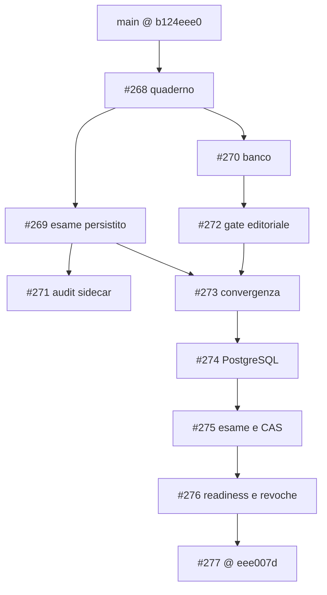

# Ardesia — registro di convergenza e debito tecnico

Data: 22 ottobre 2026. Base verificata: PR #277, `eee007d265f89f55b1ba0d08b092f2de1d3603c8`.
Le evidenze di codice sotto descrivono questa base; i delta della sessione sono distinti nella sezione misure.
**Nessun P0 dimostrato.** P1 indica un errore materiale o un prerequisito per il passo di prodotto successivo; P2 un disallineamento circoscritto.
`PROVATO` richiede codice o riproduzione concreta; `LIMITE` è un vincolo esplicito; `NOT_RUN` non significa difetto del sistema non provato.
Vercel è attualmente **BLOCKED** nel mandato: questo registro non attesta un deploy riuscito o un URL protetto raggiungibile.

## Perimetro e confini verificati

- **Core, Studio, Web:** `apps/web/src/api.ts` riusa contratti Studio e amplia `Edition`, `Workspace` e `ContextPacket`; `integrations/notebook/model.ts` riusa lo snapshot Studio. L'accoppiamento è visibile, ma non rende ogni import o componente una duplicazione difettosa. Il drift di stato dimostrato è R6.
- **Pratica ed esame:** `packages/engine/lessonos/study/question_bank.py:attempt` è stateless; `exam.py` persiste snapshot, ordine, risposte, CAS e risultato. Le diverse responsabilità restano necessarie. La divergenza numerica concreta è R1; non è stato riscritto lo scoring nel browser.
- **SQLite/PostgreSQL:** `store.py`, `postgres.py` e `schema_contract.py` condividono il dominio e riconoscono le forme storiche v7/v8 fino allo schema canonico v9. Le migrazioni PG in `supabase/migrations/` sono operazioni amministrative esplicite. Non è dimostrata una nuova divergenza di schema; manca la prova live ordinaria indicata in R5.
- **Autenticazione e sviluppo/prodotto:** esistono verifica Supabase e sessioni; i vincoli loopback e sintetici di R4 non equivalgono ad assenza di auth. Una build pubblica o una fixture locale verde non certifica il runtime autenticato cloud.
- **Test:** prove deterministiche e sintetiche coprono comportamenti concreti. Skip opt-in, test con mock e gate storici hanno perimetri distinti; non sono automaticamente bug. R3, R5 e R7 identificano i confini verificabili mancanti.
- **REA e portabilità privata:** `apps/studio/src/study/NotebookPanel.tsx` invia il file a `/notebook/inspect` prima della riapertura; `apps/web/src/integrations/notebook/useNotebookDraft.ts` conserva bozze in una Map volatile. Riapertura offline e recupero dopo crash non sono dimostrati. Non è emerso un bypass di revisione, digest o ACL nel perimetro letto.
- **Dipendenze:** licenze e pin sono documentati in `apps/web/THIRD_PARTY_NOTICES.md` e `docs/ops/rea-deep/TARGET-082/`. Nessuna dipendenza è classificata obsoleta o vulnerabile senza una verifica dedicata; il warning di dimensione MathLive non basta a dimostrarlo.

## DAG ricostruito, non sequenza numerica di PR

Snapshot di `main`: `b124eee04acc8062c27284f23c5d9108e3767c27`; #277 era avanti di 93 commit e indietro di 0. Il numero misura distanza d'integrazione, non 93 difetti.

#273 include #269 tramite merge `baafe1cfbafbfcd74cbbf4ba26458bff347407c1`, dopo #272.
**#271 è un sidecar basato su #269, non un antenato di #277**: al confronto, #277 ha 12 commit propri e manca di 2 commit del sidecar.
I delta preview, numerico, notebook e C2-B partono dalla superficie #277; un'integrazione successiva richiede prove della composizione, non la riscrittura delle PR storiche.

## Registro: sette elementi materiali

I riferimenti E1–E7 sotto la tabella sono percorsi relativi alla root del repository e funzioni esatte della base.

| ID / Evidenza | Gravità | Categoria | Causa | Conseguenza | Fix minimo | Test discriminante | Beneficio | Residuo |
|---|---|---|---|---|---|---|---|---|
| R1 — **PROVATO**, E1: `8/2 Pa` e `4.0 Pa` errati con atteso 4; `4 pA` corretto | P1 | Contratto numerico banco/esame | `exact` stringa passato a conversione per numeri; alias casefold precedono le dimensioni; parser numerici con limiti diversi | Falsi negativi e falsa equivalenza fra pressione e corrente | Riutilizzare `parse_rational` per esatto e quoziente; rendere obbligatoria la verifica dimensionale | Banco sintetico → snapshot → autosalvataggio → riapertura SQLite/HTTP → invio; 1/3 esatto, unità incompatibili e limiti numerici | Correzione esatta; eliminato un parser duplicato | Delta verificato separatamente, 62 test; vocabolario unità limitato, PG NOT_RUN, risultati già inviati non ricorretti |
| R2 — **PROVATO**, E2: `APPROVED` determina `PUBLISHED` in `approve` | P1 | Autorità scientifica/editoriale | Un unico comando rappresenta due decisioni umane | Salvare una revisione positiva rende il quesito erogabile | Revisione privata persistita, poi pubblicazione esplicita legata a versione/digest; revoca e retry coerenti | Revisione positiva ancora privata; pubblicazione esplicita; retry idempotente; revoca non annullata da retry tardivo; note escluse dalla vista studente | Controllo deliberato dell'erogazione | C2-B è un nuovo ledger/workflow; prove e migrazione del suo delta vanno valutate separatamente, non conteggiate come codice eliminato |
| R3 — **PROVATO**, E3: entry statica richiede course/evaluate HTTP; CI base non verifica public senza API | P1 | Confine preview/servizi e gate | Il percorso pubblico conserva dipendenze HTTP non fornite dall'hosting statico | Corso o laboratorio indisponibili nella build autonoma | Corso condiviso con HTTP; proiezione finita generata dal Core; build e browser public senza rete | Rifiutare ogni fetch; navigare e variare parametri; alterare un dato generato e richiedere fallimento della verifica di riproducibilità | Preview locale autentica senza secondo motore scientifico; una definizione del corso | Build/test locali non provano Vercel: deploy BLOCKED; nessuna auth o pubblicazione del banco implicita |
| R4 — **LIMITE**, E4: adapter sintetico e runtime loopback; readiness PG segnala backup non verificato | P1 | Prerequisiti del prodotto autenticato | Perimetro G0 locale esplicito, non configurazione cloud attestata | Backend autenticato non dichiarabile pronto al deploy | Runtime staging esplicito, HTTPS, cookie sicuri, confini di trust, backup/ripristino provati | Identità valida/scaduta/revocata; sessione e cookie sul target; restore sintetico e controllo readiness | Evidenza pertinente all'ambiente effettivo | Cloud auth/backup NOT_RUN; non aggirare i vincoli locali per pubblicare la preview; nessuna vulnerabilità inferita |
| R5 — **NOT_RUN**, E5: prove PG saltano senza URL/env opt-in; CI base non li configura | P1 | Copertura di persistenza e migrazioni | Lane ordinaria senza PostgreSQL/Supabase live | CI verde non esercita RLS, ruoli e convergenza reali | Job PostgreSQL isolato con dati sintetici; lane Auth G0 esplicita | Migrare forme v7/v8/v9; confrontare Core SQLite/PG; attore non autorizzato respinto; opt-in effettivamente eseguito | Rende visibili regressioni proprie dell'adapter e delle policy | Nella sessione C2 PostgreSQL locale è stato esercitato: 803 PASS/18 SKIP Supabase; la lane PG CI ordinaria resta da configurare. Nessun nuovo difetto PG dimostrato |
| R6 — **PROVATO**, E6: API serve PUBLISHED/APPROVED, UI tipizza DRAFT/NOT_RUN e mostra “in attesa” | P2 | Contratto e presentazione Web/API | Stato duplicato localmente e testo incondizionato | Lo studente legge uno stato opposto a quello erogato | Allineare tipo e presentazione al contratto effettivo; fixture pubblicata condivisa | Risposta pubblicata nel componente; etichetta coerente; nessuna esposizione di bozze o note private | Stato editoriale comprensibile e drift intercettabile | Corretto e verificato nel delta C2; estrazione generale dei contratti Web/Studio non realizzata né necessaria per questo fix |
| R7 — **PROVATO**, E7: `npm verify` copre Engine/Studio; gate storico punta a `$HOME/lessonos` | P2 | Comandi di verifica e ambiente | Nome aggregato più ampio del suo perimetro; evaluator storico legato a un checkout | Un verde locale può omettere Web/HTTP o verificare un altro checkout | Wrapper prodotto nel checkout corrente che richiami i gate esistenti, preservando l'evaluator congelato | Errore Web e HTTP introdotto in checkout temporaneo: gate prodotto deve fallire | Verifica locale rappresentativa del verticale | CI possiede già job separati; nessuna prova che ogni gate sia inefficace; wrapper ancora da realizzare |

### Percorsi delle evidenze

- **E1:** `packages/engine/lessonos/study/exam_bank.py` (`_numeric`), `exam.py` (`_numeric_answer`, `_completion_matches`), `quantity.py` (`expected_quantity`, `_number` nella base), `question_bank.py` (`parse_rational`, `attempt`). Prove nuove: `packages/engine/tests/study/test_exam_bank.py`, `test_quantity.py`, `services/study-api/tests/test_exam_bank_http.py` nel delta numerico.
- **E2:** `packages/engine/lessonos/study/question_bank_approvals.py`, `ApprovalGate.approve`, assegnazione `EDITORIAL_PUBLISHED if decision == 'APPROVED'` alla riga 197 della base.
- **E3:** `apps/web/src/features/Public.tsx`, `apps/web/src/components/PhysicsLab.tsx`, `apps/web/vite.public.config.ts`, `.github/workflows/ci.yml`; delta: `packages/engine/lessonos/study/public_preview.py`, `bin/web/export_public_preview.py`, `apps/web/e2e-public/`.
- **E4:** `services/study-api/study_api/app.py`, `create_app` righe 28–32, cookie riga 45, readiness riga 218; `runtime.py`, `SupabaseRuntime` righe 19–27.
- **E5:** `packages/engine/tests/study/test_postgres_schema_convergence.py` righe 49–51 (`ARDESIA_TEST_POSTGRES_URL`); `test_postgres_contract.py` righe 64–66 (`ARDESIA_SUPABASE_ENV_FILE`); `.github/workflows/ci.yml` job Engine/Study API.
- **E6:** `services/study-api/study_api/question_bank_routes.py`, `_published` righe 49–56; `apps/web/src/components/PhysicsQuestionBank.tsx` righe 15, 32 e 212.
- **E7:** `package.json` riga 22; `bin/monorepo.sh`, `test_core`, `typecheck_core`, `build_core`, `verify_core`; `packages/engine/eval/gate.sh` riga 6.

## Riuso, consolidamenti e misure effettive

**Due consolidamenti circoscritti**, non una fusione complessiva di Core/Studio/Web:

1. Definizione pura del corso in `public_preview.public_course`, condivisa da HTTP e generazione statica. I 62 risultati finiti del laboratorio sono generati dal Core e verificati; il browser non ospita un nuovo motore di scoring.
2. Parser razionale preesistente condiviso da validazione del banco, proiezione e confronto delle quantità: `_number` duplicato è rimosso. La distinzione fra pratica stateless ed esame persistito rimane.

| Delta | Conteggio dichiarato alla consegna | Interpretazione |
|---|---|---|
| Notebook: due componenti applicativi | +26 / −7, **netto +19**; test +82 | Navigazione annotazione→pagina nel lettore esistente; nessun nuovo formato/store |
| Numerico: tre file applicativi | +19 / −31, **netto −12** | Consolidamento del parser e correzione del contratto |
| Preview: intero delta, 23 file | +568 / −58, **netto +510 totale** | Include generati, test e documentazione: non è un conteggio di LOC applicative né di debito rimosso |
| C2-B: applicazione e migrazioni | **+590 / −33, netto +557** in 12 file; delta testo totale **+1.470 / −63** in 25 file, prima dei link screenshot | Nuovo ledger privato e workflow; non conteggiarlo come sottosistema eliminato |

`NotebookReading` era già condiviso da `NotebookEditor` in lettura e `PortableNotebook`: il salto pagina migliora entrambe le entrate. Non sono stati consolidati due lettori nuovi.
Prova notebook: RED 3 falliti/10 passati → GREEN 18 passati, typecheck e build; dettagli in `docs/ops/rea-deep/TARGET-082/NOTEBOOK-READING-NAVIGATION-2026-10-22.md`.
Prova numerica: RED iniziale 4 falliti; RED del confine parser 4 falliti/7 passati; GREEN finale 62 passati. Review indipendente del confine chiusa; HTTP eseguito dal builder.
Le misure separate non sono una prova di integrazione fra tutti i delta. Nessuna percentuale di debito totale eliminato è deducibile da questi conteggi.

## REA: osservato oggi, evidenza storica e residui

La chiamata live `remote_desktop_commander_list_devices` ha restituito **nessun dispositivo collegato**: nuove acquisizioni REA BLOCKED; nessun setup o riavvio eseguito.
Sono state riusate le evidenze conservate di REA 6.7.0 del 20 ottobre in `docs/deliveries/2026-10-20-rea/` e `docs/ops/rea-deep/TARGET-082/`; non sono prove eseguite oggi.
Il riferimento di annotazione conserva fonte/revisione esatte: resource/revision/asset SHA, non il solo fingerprint PDF. Il salto usa `Annotation.page`, con controlli su originale, revisione e pagine malformate.
AFFiNE è osservato per nota guest, persistenza e menu Export; ciclo PDF/export/reimport non verificato. Nessun suo codice o asset è stato assimilato.
Portabilità privata non equivale a condivisione o pubblicazione: inspect online, identità della revisione e ACL restano vincoli. Browser reale, penna/touch e accessibilità completa del nuovo salto pagina sono NOT_RUN.
