# Inventario PR CONVERGENCE — baseline 25 ottobre 2026

Fonte di verità: main `b124eee04acc8062c27284f23c5d9108e3767c27`, candidato #304 `1898b633e26f99710535c94e25fa28241f0f45b3`. **37 PR open; 30 head esatte già nello stack #304; 7 offchain; 0 head già in main.** Nessuna azione remota eseguita da questo agente.

Le sette offchain sono #264, #265, #271, #291, #293, #295 e #296: 22 commit esclusivi, tutti `+` in `git cherry`; nessuno è patch equivalente. #279–281 e #283 sono ancestor native, non semplici somiglianze. Il grafo usa ancestralità reale, non ordine numerico o soli target dei branch.

**Gate GitHub:** tutte le 37 review sono vuote. Main richiede una review indipendente, approvazione dell’ultimo push, risoluzione conversazioni e tre check strict con enforceAdmins; nessun bypass. La nuova autorizzazione dell’owner risolve il vecchio divieto operativo di integrazione, ma non può sostituire la review GitHub.

**Conteggi:** derivati dai log scaricati sulla head esatta; `P/F/S` = pass/fail/skip. Il checkout sintetico PR è registrato nel JSON. Engine/API si sovrappongono: nessuna somma. Il retarget a main e i nuovi import richiedono nuova CI; un vecchio verde non si trasferisce.

| PR / titolo | Autore / branch → base | Head / aggiornamento | Natura / moduli / file | Dipendenze vere | CI esatta e test dal log | Consumer / rischio | Esito proposto e azione |
|---|---|---|---|---|---|---|---|
| [264](https://github.com/AndreaMarro/ardesia/pull/264) RFC: Ardesia universale, semestre filtro Fisica 2026/27 e primo debranding | AndreaMarro / product/medical-filter-v1-decouple-20261017 → main | b41380e32dee962599dc0bc02ac7cd1d8342590f / 2026-10-20T01:21:26Z | docs, content / README.md, docs/product, package.json, packs / 5 file | main | [success](https://github.com/AndreaMarro/ardesia/actions/runs/39029444491) studio: 2149P/5S; engine: 2042P/9S | Autore/editor del CoursePack; nessun consumer runtime del manifest alternativo; HIGH: RFC modifica politica IA rispetto a ZERO-LLM; pack non wired e non certificato; README/package confliggono | CLOSED_SUPERSEDED (condizionato). Non applicare README/package/pack in blocco. Preservare RFC come proposta storica e mappare al CoursePack/Core corrente. IA opzionale richiede decisione separata, non necessaria alla convergenza tecnica. |
| [265](https://github.com/AndreaMarro/ardesia/pull/265) P0-A: inventario legacy di sorgenti e build, con prove e registro di convergenza | AndreaMarro / audit/legacy-inventory-20261017 → main | 4117382b0a9bd4666e848d49d7ef6beaf5258741 / 2026-10-19T19:36:59Z | infra, test, docs / .github/workflows, bin/audit, docs/ops / 4 file | main | [success](https://github.com/AndreaMarro/ardesia/actions/runs/39046104633) studio: 2149P/5S; engine: 2042P/9S | QA del candidato: sorgenti tracciate e artifact Studio costruito; MEDIUM: scanner lessicale non prova assenza legacy; symlink rifiutati; snapshot documentale vecchio | CLOSED_SUPERSEDED (condizionato). Integrare solo scanner, 15 test e documento con addendum; consumer QA reale. Non duplicare workflow CI. Preservare provenienza; fixture temp canonica per Mac. |
| [268](https://github.com/AndreaMarro/ardesia/pull/268) Ardesia REA: quaderno scientifico e consegna organizzata — checkpoint | AndreaMarro / codex/ardesia-public-rea-20261020 → main | 61e7f00be9fc4ecfdf5eb362275b3b8a566d92bf / 2026-10-20T18:01:49Z | runtime, test, security, docs, infra, content / .github/workflows, .gitignore, README.md, apps/studio, apps/web, bin/study-demo, bin/study-public, contracts, docs/adr, docs/ardesia-v4, docs/deliveries, docs/ops, docs/study, factory, infra, package-lock.json, package.json, packages/engine, packages/engine/lessonos/study, registry, services/study-api, services/study-mcp, state, supabase, vercel.json / 539 file | main | [success](https://github.com/AndreaMarro/ardesia/actions/runs/39471171857) web: 239P; study-api: 664P/18S; studio: 2157P/5S; engine: 2471P/27S | Docente e studente Aula/Web; Study API/Core, fonti e notebook; HIGH: 539 file; introduzione del verticale e autorità di dati/sessione | CLOSED_SUPERSEDED (condizionato). Preservare genealogia esatta nel candidato #304; validare suite e isolamento sul candidato completo. |
| [269](https://github.com/AndreaMarro/ardesia/pull/269) feat(study): prova di fisica del Semestre filtro | AndreaMarro / codex/semestre-filtro-exam-20261021 → codex/ardesia-public-rea-20261020 | b9764d2e1785c26893f424ea547d2df081e0aca2 / 2026-10-21T01:52:47Z | runtime, test, content, security / apps/web, docs/study, packages/engine/lessonos/study, packages/engine, services/study-api, supabase / 19 file | #268 | [success](https://github.com/AndreaMarro/ardesia/actions/runs/39529756744) engine: 2478P/27S; study-api: 674P/18S; web: 240P; studio: 2157P/5S | Studente membro che svolge esame; docente che rivede tentativi; HIGH: grading, autosave e schema iniziali superati dalle correzioni successive | CLOSED_SUPERSEDED (condizionato). Inclusa per ancestry nativa; non integrare il vecchio esame separatamente da gate #272, convergenza #273/#274 e CAS #275. |
| [270](https://github.com/AndreaMarro/ardesia/pull/270) Fisica 2026/27: 4.000 quesiti con soluzioni e integrazione Ardesia | AndreaMarro / codex/physics-bank-4000-20261021 → codex/ardesia-public-rea-20261020 | e9c87b072913744f6cc6df21217b8856cddfef1f / 2026-10-21T07:22:37Z | content, runtime, test, docs / apps/web, bin/content, packages/engine, packages/engine/lessonos/study, packs, services/study-api / 86 file | #268 | [success](https://github.com/AndreaMarro/ardesia/actions/runs/39560985915) studio: 2157P/5S; study-api: 696P/18S; web: 243P; engine: 2500P/27S | Banca privata di 4.000 quesiti e vista autorizzata dello studente; HIGH: 4.000 DRAFT senza approvazione umana; correttezza scientifica non dedotta da conteggi | CLOSED_SUPERSEDED (condizionato). Incorporata esattamente nello stack. Mantenere pubblicazione fail closed e fonti/versioni; nessuna approvazione di corpus implicita. |
| [271](https://github.com/AndreaMarro/ardesia/pull/271) [PRO-REGIA-INTEGRAZIONE] Inbox 4.000 senza perdita e regressioni dei gate | AndreaMarro / codex/ardesia-pro-regia-20261021 → codex/semestre-filtro-exam-20261021 | fe245fd803aaf072721d3f27beeea3bf9f9da9d5 / 2026-10-21T07:52:58Z | test, security, docs, infra / bin/pro-regia, docs/ops / 48 file | #269 | [success](https://github.com/AndreaMarro/ardesia/actions/runs/39565132969) study-api: 674P/18S; engine: 2478P/27S; studio: 2157P/5S; web: 240P | Regia QA: intake privato senza perdita e prove avversariali; MEDIUM: tool di audit, nessun consumer prodotto; report ExamV1 hardcoded obsoleto; probe RED fuori CI generale | CLOSED_SUPERSEDED (condizionato). Selezionare adapter puro, 5 test e README QA; aggiungere ref Git esplicita e receipt aggiornata. Non importare 48 file/probe storici in blocco. Conservare le evidenze originali nello snapshot. |
| [272](https://github.com/AndreaMarro/ardesia/pull/272) feat(study): gate physics bank publication by exact revision | AndreaMarro / codex/physics-bank-approval-gate-20261021 → codex/physics-bank-4000-20261021 | 73121ef0a1835495cef173749c77a5969831302d / 2026-10-21T10:49:37Z | runtime, security, test, docs / docs/study, packages/engine, packages/engine/lessonos/study, services/study-api, supabase / 15 file | #270 | [success](https://github.com/AndreaMarro/ardesia/actions/runs/39587343155) web: 243P; engine: 2511P/27S; study-api: 714P/18S; studio: 2157P/5S | Core/API di approvazione editoriale, docente e proiezione studente; HIGH: autorizzazione su revisione/digest esatti e confine DRAFT/PUBLISHED | CLOSED_SUPERSEDED (condizionato). Preservare gate e test nel candidato, senza aggirare le approvazioni scientifiche umane. |
| [273](https://github.com/AndreaMarro/ardesia/pull/273) Convergenza Study: gate editoriale v7 + esame v8 | AndreaMarro / codex/study-schema-convergence-20261021 → codex/physics-bank-approval-gate-20261021 | fdd67fc6344d7d11e6241aee80d81cb1b3bd4e27 / 2026-10-21T13:35:47Z | runtime, security, content, test, docs / apps/web, docs/study, packages/engine, packages/engine/lessonos/study, services/study-api, supabase / 24 file | #269, #272 | [success](https://github.com/AndreaMarro/ardesia/actions/runs/39609291641) study-api: 733P/18S; studio: 2157P/5S; engine: 2527P/27S; web: 244P | Stesso Core per banca approvata ed esame persistente; HIGH: convergenza v7/v8 con due linee di migrazione | CLOSED_SUPERSEDED (condizionato). Ancestry contiene #269 e #272 con merge baafe1cf; usare schema finale con #274/#275, non ordine numerico. |
| [274](https://github.com/AndreaMarro/ardesia/pull/274) PostgreSQL: convergenza v7/v8 retryable e trigger d'esame | AndreaMarro / codex/study-pg-convergence-20261021 → codex/study-schema-convergence-20261021 | d7783b5b9442d143342eba8651c29b39dba29bfb / 2026-10-21T15:39:16Z | infra, security, test, docs / docs/study, packages/engine, supabase / 8 file | #273 | [success](https://github.com/AndreaMarro/ardesia/actions/runs/39625672499) studio: 2157P/5S; engine: 2527P/28S; study-api: 733P/26S; web: 244P | Runner migrazioni PostgreSQL/SQLite e tentativi esame; HIGH: migrazioni additive, retry e trigger; skip CI non prova PG remoto | CLOSED_SUPERSEDED (condizionato). Mantenere migrazioni finali e prove; classificare PostgreSQL/RLS live come non attestato dagli skip. |
| [275](https://github.com/AndreaMarro/ardesia/pull/275) feat(study): approved 31-question exam, gate fail-closed and CAS | AndreaMarro / codex/study-exam-integrated-20261021 → codex/study-pg-convergence-20261021 | 178a737c3b5089352ba548a78ef28c8550451219 / 2026-10-21T18:49:05Z | runtime, security, test, content / apps/web, packages/engine/lessonos/study, packages/engine, services/study-api, supabase / 24 file | #274 | [success](https://github.com/AndreaMarro/ardesia/actions/runs/39655549143) study-api: 747P/27S; engine: 2539P/28S; web: 246P; studio: 2157P/5S | Esame 31 quesiti da banca approvata; autosave CAS; HIGH: tentativi persistenti, grading e concorrenza | CLOSED_SUPERSEDED (condizionato). Incorporare insieme ai fix quantità/review successivi; conservare rifiuto revisioni stale e pubblicazione esplicita. |
| [276](https://github.com/AndreaMarro/ardesia/pull/276) fix(study): C1 exam validity, truthful readiness and browser proof | AndreaMarro / codex/study-exam-c1-20261021 → codex/study-exam-integrated-20261021 | 6b87e447cc681011074bdfaa28f915213ce5747d / 2026-10-21T19:39:21Z | runtime, test, docs / .gitignore, apps/web, bin/study-demo, docs/study, packages/engine/lessonos/study, packages/engine, vercel.json / 10 file | #275 | [success](https://github.com/AndreaMarro/ardesia/actions/runs/39663466224) studio: 2157P/5S; engine: 2542P/28S; study-api: 750P/27S; web: 246P | Studente esame e readiness docente; MEDIUM: validità esame e stato UI | CLOSED_SUPERSEDED (condizionato). Fix C1 già ancestor; mantenere prova browser e limiti come evidenze storiche. |
| [277](https://github.com/AndreaMarro/ardesia/pull/277) C2-A: protect review metadata and align exam quantities | AndreaMarro / codex/study-exam-c2a-20261021 → codex/study-exam-c1-20261021 | eee007d265f89f55b1ba0d08b092f2de1d3603c8 / 2026-10-21T21:09:17Z | security, runtime, test, infra, docs / docs/study, packages/engine/lessonos/study, packages/engine, supabase, vercel.json / 13 file | #276 | [success](https://github.com/AndreaMarro/ardesia/actions/runs/39676421693) studio: 2157P/5S; web: 246P; study-api: 777P/27S; engine: 2569P/28S | Docente che salva review privata; comparatore quantità; HIGH: metadati privati e unità numeriche | CLOSED_SUPERSEDED (condizionato). Preservare ledger privato e quantità; non usare sola CI verde come certificazione scientifica. |
| [278](https://github.com/AndreaMarro/ardesia/pull/278) [A] Ardesia Fisica: protected static preview from canonical Core | AndreaMarro / pro/ardesia-fisica-preview-20261022 → codex/study-exam-c2a-20261021 | 138a4417cc42f4a7f2093fa81202c1bb2e01ef09 / 2026-10-23T08:32:55Z | runtime, infra, test, docs, content / .github/workflows, apps/web, bin/web, docs/deliveries, packages/engine/lessonos/study, services/study-api, vercel.json / 23 file | #277 | [success](https://github.com/AndreaMarro/ardesia/actions/runs/39689468698) web: 263P; studio: 2157P/5S; study-api: 777P/27S; engine: 2569P/28S | Visitatore della preview pubblica statica proiettata da Core; HIGH: proiezione pubblica e dati statici; incidenti hosting storici | CLOSED_SUPERSEDED (condizionato). Incorporata per ancestry. Le tre sorelle nascono da suo precedente commit prodotto 6d4e149d, non dalla tip documentale corrente. |
| [279](https://github.com/AndreaMarro/ardesia/pull/279) [B1] Fix persisted exam rational grading and case-sensitive units | AndreaMarro / pro/ardesia-exam-numeric-20261022 → pro/ardesia-fisica-preview-20261022 | 7776a66cdd9e2e3b24ef9d5a823b49dad23f3464 / 2026-10-21T22:53:48Z | runtime, test, docs / docs/ops, packages/engine/lessonos/study, packages/engine, services/study-api / 7 file | #277 | [success](https://github.com/AndreaMarro/ardesia/actions/runs/39688964895) study-api: 789P/27S; studio: 2157P/5S; web: 263P; engine: 2580P/28S | Studente esame con numeri razionali e unità case sensitive; HIGH: grading persistente e Pa/pA | CLOSED_SUPERSEDED (condizionato). Ancestor esatta tramite merge 35fff756, non mera somiglianza di patch; preservare parser razionale canonico e regressioni. |
| [280](https://github.com/AndreaMarro/ardesia/pull/280) [B3] Private scientific review with separate publication and revocation | AndreaMarro / pro/ardesia-teacher-review-20261022 → pro/ardesia-fisica-preview-20261022 | 39d2f2753ae488e331c075275a4d229a33f6c2e5 / 2026-10-21T22:53:51Z | runtime, security, infra, test, docs / apps/web, bin/study-demo, docs/deliveries, docs/study, packages/engine/lessonos/study, packages/engine, services/study-api, supabase / 29 file | #277 | [success](https://github.com/AndreaMarro/ardesia/actions/runs/39689231905) engine: 2575P/29S; web: 268P; study-api: 791P/30S; studio: 2157P/5S | Docente: revisione scientifica privata, pubblicazione e revoca separate; HIGH: ledger, schema10/RLS e due atti di pubblicazione | CLOSED_SUPERSEDED (condizionato). Ancestor esatta tramite merge 35fff756; bug endpoint legacy ulteriormente chiuso da #283/#284. |
| [281](https://github.com/AndreaMarro/ardesia/pull/281) [B2] Open the exact PDF page from notebook annotations | AndreaMarro / pro/ardesia-notebook-navigation-20261022 → pro/ardesia-fisica-preview-20261022 | 337cfaa6fa170073e0ed5e6dd091a9e5ceac325a / 2026-10-21T22:53:52Z | runtime, test, docs / apps/web, docs/ops / 5 file | #277 | [success](https://github.com/AndreaMarro/ardesia/actions/runs/39689366768) study-api: 777P/27S; studio: 2157P/5S; engine: 2569P/28S; web: 267P | Lettore notebook che apre pagina PDF dell’originale esatto; MEDIUM: focus, revisione e navigazione stale | CLOSED_SUPERSEDED (condizionato). Ancestor esatta tramite merge 35fff756. I test componenti non certificano pen/touch o PDF.js reale. |
| [282](https://github.com/AndreaMarro/ardesia/pull/282) Convergenza #279–#281: catalogo docente e capability esplicite | AndreaMarro / pro/ardesia-convergence-catalog-20261022 → pro/ardesia-fisica-preview-20261022 | 68af43a6c7fd0e072fea1c3b12f9ea96a1a93f30 / 2026-10-22T11:13:27Z | runtime, security, content, test, docs / apps/web, bin/study-demo, docs/deliveries, docs/ops, docs/study, packages/engine/lessonos/study, packages/engine, services/study-api, supabase / 69 file | #278, #279, #280, #281 | [success](https://github.com/AndreaMarro/ardesia/actions/runs/39767156142) web: 293P; study-api: 830P/30S; studio: 2157P/5S; engine: 2609P/29S | Catalogo docente con capability esplicite e consumer banca/esame/notebook; HIGH: confini corso e autorizzazione delle capability | CLOSED_SUPERSEDED (condizionato). Merge nativo di #278/#279/#280/#281, più catalogo; preservare confini invece di sovrascrivere con una sorella. |
| [283](https://github.com/AndreaMarro/ardesia/pull/283) [PRO-REGIA] RED: legacy publication requires recorded scientific review | AndreaMarro / pro/ardesia-regia-review-ledger-20261023 → pro/ardesia-convergence-catalog-20261022 | a7091f9fec086bd994e129857d9172705c4e164b / 2026-10-23T07:33:44Z | test, security, docs / docs/ops, services/study-api / 2 file | #282 | [failure](https://github.com/AndreaMarro/ardesia/actions/runs/39914709447) web: 293P; studio: 2157P/5S; study-api: 830P/2F/30S; engine: 2609P/29S | Regressioni HTTP reali del vecchio endpoint di pubblicazione; HIGH: CI originale API 2 FAIL dimostra bypass scientific review | CLOSED_SUPERSEDED (condizionato). Conservare RED storico e test incorporati; #284 chiude il bypass. Non chiamare verde la head originale. |
| [284](https://github.com/AndreaMarro/ardesia/pull/284) fix(study): block unreviewed legacy publication, preserve two-act gate | AndreaMarro / pro/ardesia-review-publication-gate-fix-20261023 → pro/ardesia-convergence-catalog-20261022 | 57c492af2bc391652f8c243107cfe8f00a22820d / 2026-10-23T09:04:27Z | runtime, security, test, docs / docs/ops, services/study-api / 4 file | #283 | [success](https://github.com/AndreaMarro/ardesia/actions/runs/39929191394) engine: 2609P/29S; web: 293P; study-api: 832P/30S; studio: 2157P/5S | Docente che pubblica tramite route legacy; HIGH: blocco pubblicazione senza review privata registrata | CLOSED_SUPERSEDED (condizionato). Già include head #283 e correzione API; CI API 832 PASS/30 SKIP, contro 2 FAIL/830 PASS di #283. |
| [285](https://github.com/AndreaMarro/ardesia/pull/285) feat(study): versioned physics pathways in teacher catalog and MCP | AndreaMarro / pro/ardesia-m01-physics-pathways-20261023 → pro/ardesia-review-publication-gate-fix-20261023 | c43f5b9d52fec10d554059be9ae63ed87a4c15aa / 2026-10-23T15:30:12Z | runtime, content, test, docs / apps/web, packages/engine/lessonos/study, packages/engine, services/study-api, services/study-mcp / 18 file | #284 | [success](https://github.com/AndreaMarro/ardesia/actions/runs/39976319049) study-api: 844P/30S; engine: 2620P/29S; web: 294P; studio: 2157P/5S | Docente nel catalogo percorsi; letture Study MCP; MEDIUM: mapping percorsi/versioni e projection MCP | CLOSED_SUPERSEDED (condizionato). Preservare percorsi versionati e letture MCP; writer nuovo resta fuori da questa capacità. |
| [286](https://github.com/AndreaMarro/ardesia/pull/286) ci(web): gate teacher physics pathways on the real Study API | AndreaMarro / d01/ci-physics-pathways → pro/ardesia-m01-physics-pathways-20261023 | 8f903a68588a6f616ea3df7110f45008b05ca1ba / 2026-10-23T18:14:31Z | infra, test / .github/workflows, apps/web, bin/ci, bin/study-demo / 5 file | #285 | [success](https://github.com/AndreaMarro/ardesia/actions/runs/40000993436) web: 294P; engine: 2620P/29S; studio: 2157P/5S; study-api: 844P/30S | CI Web con browser contro Study API SQLite usa e getta; MEDIUM: prova E2E e isolamento risorse del runner | CLOSED_SUPERSEDED (condizionato). Già ancestor; testare col successivo hardening #287 e non invocare su un servizio reale. |
| [287](https://github.com/AndreaMarro/ardesia/pull/287) ci(web): harden physics-pathway runner isolation | AndreaMarro / d01r/runner-safety → d01/ci-physics-pathways | 870b515ef6b598fb8e617b7fbed903561f334fd2 / 2026-10-23T19:10:31Z | infra, security, test / .github/workflows, bin/ci / 2 file | #286 | [success](https://github.com/AndreaMarro/ardesia/actions/runs/40009290613) engine: 2620P/29S; web: 294P; studio: 2157P/5S; study-api: 844P/30S | Runner E2E CI e self-test contenitori sentinella; HIGH: distruzione accidentale di risorse concorrenti | CLOSED_SUPERSEDED (condizionato). Preservare hardening del runner e self-test; nessun rilassamento delle protezioni. |
| [288](https://github.com/AndreaMarro/ardesia/pull/288) feat(marketing): standalone Ardesia physics microcourse interest page | AndreaMarro / pro/ardesia-marketing-01-20261023 → d01r/runner-safety | 863521a47515960f6b01158f817bb599bb382994 / 2026-10-23T20:05:30Z | runtime, infra, content, test, docs / .github/workflows, apps/marketing-01 / 13 file | #287 | [success](https://github.com/AndreaMarro/ardesia/actions/runs/40016520314) studio: 2157P/5S; engine: 2620P/29S; web: 294P; study-api: 844P/30S | Visitatore marketing interessato ai microcorsi Fisica; MEDIUM: funnel interesse non equivale a iscrizione/account/pagamento | CLOSED_SUPERSEDED (condizionato). Già ancestor; consumer pubblico evoluto da #289/#290/#299–301. Nessun lancio implicito dal merge. |
| [289](https://github.com/AndreaMarro/ardesia/pull/289) Ardesia GO-LIVE UX01: landing mobile, percorsi e contatto verificati con REA | AndreaMarro / pro/ardesia-golive-ux-01-20261023 → pro/ardesia-marketing-01-20261023 | fff5ebebc403d1154e4f014f1fffac328fd240ee / 2026-10-23T21:26:09Z | runtime, content, infra, test, docs / .github/workflows, apps/marketing-01 / 22 file | #288 | [success](https://github.com/AndreaMarro/ardesia/actions/runs/40025431898) engine: 2620P/29S; studio: 2157P/5S; web: 294P; study-api: 844P/30S | Visitatore mobile, percorso e CTA contatto; MEDIUM: accessibilità, copia commerciale e destinazione contatto | CLOSED_SUPERSEDED (condizionato). Mantenere percorso/contatto verificati, nessun messaggio esterno inviato nell’inventario. |
| [290](https://github.com/AndreaMarro/ardesia/pull/290) feat(marketing): add reviewed lesson previews and prepare Ardesia release | AndreaMarro / pro/ardesia-golive-02-20261024 → pro/ardesia-golive-ux-01-20261023 | 339ab08f4139da0b37e78bbde81e9fe4e83afea0 / 2026-10-23T22:58:30Z | runtime, content, infra, test, docs / .github/workflows, apps/marketing-01 / 14 file | #289 | [success](https://github.com/AndreaMarro/ardesia/actions/runs/40034887180) study-api: 844P/30S; studio: 2157P/5S; web: 294P; engine: 2620P/29S | Preview di quattro esempi didattici selezionati; HIGH: quattro DRAFT e approvazione scientifica/editoriale separata | CLOSED_SUPERSEDED (condizionato). Preservare gate digest e limiti; non trasformare hosting live/protetto in autorizzazione di pubblicazione. |
| [291](https://github.com/AndreaMarro/ardesia/pull/291) [AUDIT] Ardesia convergence protocol, adversarial review and next tasks (24 Oct) | AndreaMarro / audit/ardesia-convergence-20261024-0600 → main | 690e158615cc3c4fb3a3a7f2578122d465a43297 / 2026-10-25T05:14:39Z | docs / AGENTS.md, docs/ops / 4 file | main | [success](https://github.com/AndreaMarro/ardesia/actions/runs/40062844244) studio: 2149P/5S; engine: 2042P/9S | Agenti e revisori del processo di convergenza; MEDIUM: protocollo proposto duplicato; audit su fonte vecchia; AGENTS confligge | CLOSED_SUPERSEDED (condizionato). Preservare audit storico e trasferire soltanto gate mancanti nel canone corrente; non installare seconda normativa AGENTS. |
| [293](https://github.com/AndreaMarro/ardesia/pull/293) [PRO-DELTA] Reuse Study Core for MCP corrections; REA donor licensing and live pilot | AndreaMarro / audit/ardesia-mcp-write-reuse-20261024 → main | 5a4d89312f6a46e3a0dd435e6c040b3c134ba9f5 / 2026-10-24T05:04:29Z | docs, security / docs/ops, docs/product / 2 file | main | [success](https://github.com/AndreaMarro/ardesia/actions/runs/40064818732) engine: 2042P/9S; studio: 2149P/5S | Progettista MCP: prima revisione privata su Core e gate licenze donor; MEDIUM: RFC proposta, nessuna capacità write implementata; fonte #285 storica | CLOSED_SUPERSEDED (condizionato). Importare/indicizzare i due documenti PROPOSED già citati dal RUNLOG/NEXT, senza attivare writer o nuove authority. |
| [295](https://github.com/AndreaMarro/ardesia/pull/295) [AUDIT P0] Post-revocation microphone lifecycle race — evidence and RED gates | AndreaMarro / audit/ardesia-audio-consent-race-20261024 → main | 15fa8176e6ede03a4430b4bccf03dc25ec5595b3 / 2026-10-24T05:37:10Z | docs, security / docs/ops / 1 file | main | [success](https://github.com/AndreaMarro/ardesia/actions/runs/40066944901) engine: 2042P/9S; studio: 2149P/5S | Revisore consenso/microfono e gate lifecycle; HIGH storico: pending getUserMedia dopo revoca, distinto dal tail stop | CLOSED_SUPERSEDED (condizionato). Preservare nota originale e collegare correzioni/test #297/#298. L’issue #294 resta aperta finché l’integrazione effettiva non è provata. |
| [296](https://github.com/AndreaMarro/ardesia/pull/296) docs(study): indice pubblico dei quattro kit Fisica (DRAFT) | AndreaMarro / docs/editorial-physics-kits-20261024 → main | 65d843898a23737eaf8f1abc5689133cbb5ecc90 / 2026-10-24T07:20:01Z | docs, content / docs/study / 1 file | main | [success](https://github.com/AndreaMarro/ardesia/actions/runs/40073695876) engine: 2042P/9S; studio: 2149P/5S | Editor dei quattro kit e relativi sidecar privati; HIGH editoriale: contenuti privati DRAFT, archivio 16 parti/10 presenti | CLOSED_SUPERSEDED (condizionato). Preservare indice 4 percorsi/7 unità senza importare testi privati o nuovo motore quiz; review scientifica e checksum restano gate. |
| [297](https://github.com/AndreaMarro/ardesia/pull/297) fix(studio): preserve audio tail and restore isolated lesson replay | AndreaMarro / pro/ardesia-living-lesson-audio-20261024 → pro/ardesia-golive-02-20261024 | ae25b93bec826539940e0226da1f0cd8cebff0b1 / 2026-10-24T09:56:04Z | runtime, test, security, docs / AGENTS.md, apps/studio, docs/ARCHITECTURE-CANON.md, docs/CANON-INDEX.md, docs/PRODUCT-CANON.md, docs/deliveries, docs/ops, docs/reviews / 102 file | #290 | [success](https://github.com/AndreaMarro/ardesia/actions/runs/40083877844) study-api: 844P/30S; engine: 2620P/29S; web: 294P; studio: 2201P/5S | Docente Studio che termina audio, revoca consenso e riapre replay; HIGH: privacy, tail MediaRecorder e isolamento lezioni | CLOSED_SUPERSEDED (condizionato). Già ancestor; preservare negativi lifecycle e separare audio sintetico da microfono fisico non provato. |
| [298](https://github.com/AndreaMarro/ardesia/pull/298) feat: session audio and a linked Poiseuille learning episode | AndreaMarro / codex/ardesia-audio-v2-poiseuille-20261024 → pro/ardesia-living-lesson-audio-20261024 | f456ade218acee1a8b65f5dc24e9220681658b11 / 2026-10-24T11:20:13Z | runtime, test, security, docs / apps/studio, apps/web, docs/CANON-INDEX.md, docs/PRODUCT-CANON.md, docs/deliveries, docs/ops, packages/engine, packages/engine/lessonos/study, services/study-api / 220 file | #297 | [success](https://github.com/AndreaMarro/ardesia/actions/runs/40089052314) study-api: 852P/30S; engine: 2626P/29S; web: 299P; studio: 2232P/5S | Docente con AUDIO-V2 e studente nell’episodio Poiseuille; HIGH: consenso/import/revoca, identità dei media e bundle reader2 | CLOSED_SUPERSEDED (condizionato). Preservare SessionAudioRecorder/Core; import esplicito tra browser non è trasporto media remoto. |
| [299](https://github.com/AndreaMarro/ardesia/pull/299) feat: continuous Poiseuille demo and living lesson handoff | AndreaMarro / codex/ardesia-convergence-rea-deep-20261024 → codex/ardesia-audio-v2-poiseuille-20261024 | 6f19b1956cedbebf36a5cf097af66e47ed8acecd / 2026-10-24T14:29:48Z | runtime, test, content, security, infra, docs / .github/workflows, apps/marketing-01, apps/studio, apps/web, bin/build_teaching_candidate.py, bin/study-demo, bin/tests, bin/web, docs/CANON-INDEX.md, docs/deliveries, docs/ops, package-lock.json, packages/engine, packages/engine/lessonos/study, services/study-api / 513 file | #298 | [success](https://github.com/AndreaMarro/ardesia/actions/runs/40102192875) web: 312P; study-api: 854P/30S; studio: 2273P/5S; engine: 2626P/29S | Visitatore demo continua Poiseuille e ponte Aula–Studio; HIGH: passaggio fonte/oggetto/media e ownership canale | CLOSED_SUPERSEDED (condizionato). Già ancestor; nessun donor codice/asset da copiare. Mantenere prova sintetica e diritti distinti dalla disponibilità REA. |
| [300](https://github.com/AndreaMarro/ardesia/pull/300) fix: validate Poiseuille release and preserve tutor continuity | AndreaMarro / codex/ardesia-r1-marketing-beta-20261024 → codex/ardesia-convergence-rea-deep-20261024 | 6a81d870fd1f390444ef5acbe6bc42203104fa63 / 2026-10-24T16:31:44Z | runtime, test, content, security, infra, docs / .github/workflows, apps/marketing-01, apps/web, bin/build_teaching_candidate.py, bin/study-demo, bin/tests, bin/web, docs/CANON-INDEX.md, docs/deliveries, docs/ops, packages/engine, packages/engine/lessonos/study, services/study-api / 220 file | #299 | [success](https://github.com/AndreaMarro/ardesia/actions/runs/40111558218) engine: 2630P/29S; web: 324P; study-api: 924P/30S; studio: 2273P/5S | Tutor e studente nella continuità Poiseuille; pacchetto pubblico; HIGH: provenienza build/release e separazione artifact pubblico/privato | CLOSED_SUPERSEDED (condizionato). Preservare correzioni e binding artifact; nessuna beta remota dedotta da preview. |
| [301](https://github.com/AndreaMarro/ardesia/pull/301) feat(study): compose reusable experiences and visual physics labs | AndreaMarro / codex/ardesia-r2-experiences-20261024 → codex/ardesia-r1-marketing-beta-20261024 | fd81ef3f2f1bf4dd77458c33d25e901fb20ef56c / 2026-10-25T05:18:39Z | runtime, test, content, docs / apps/studio, apps/web, bin/web, docs/CANON-INDEX.md, docs/deliveries, docs/ops, packages/engine/lessonos/study, packages/engine, services/study-api / 339 file | #300 | [success](https://github.com/AndreaMarro/ardesia/actions/runs/40141313132) web: 354P; engine: 2654P/29S; studio: 2276P/5S; study-api: 951P/30S | Docente/studente in Idrostatica compositiva, Taylor e replay responsive; HIGH: receipts versione/digest, diario CANDIDATE, media locali | CLOSED_SUPERSEDED (condizionato). Già ancestor; #302 aggiunge cold reopen e #303/#304 leggibilità fonte. Quattro DRAFT e review umana restano bloccanti per lancio. |
| [302](https://github.com/AndreaMarro/ardesia/pull/302) fix(study): cold-reopen composable episodes from exact Core receipts | AndreaMarro / audit/ardesia-r2-resume-receipts-20261025 → codex/ardesia-r2-experiences-20261024 | 5909e100a7cb1405c97717ece5651b773c15ec85 / 2026-10-25T05:23:31Z | runtime, test, docs / apps/web, docs/ops / 5 file | #301 | [success](https://github.com/AndreaMarro/ardesia/actions/runs/40165327617) study-api: 951P/30S; web: 357P; engine: 2654P/29S; studio: 2276P/5S | Studente che riapre un percorso da receipt Core già emesse; HIGH: recupero cross-actor/stale digest e duplicazione invii | CLOSED_SUPERSEDED (condizionato). Preservare pin attore/activity/experience/version/digest/step e verifica browser sul candidato; nessun ledger parallelo. |
| [303](https://github.com/AndreaMarro/ardesia/pull/303) fix(study): present lesson-passage sources as readable teaching content | AndreaMarro / audit/ardesia-readable-lesson-sources-20261025 → audit/ardesia-r2-resume-receipts-20261025 | 2f6eef42913f07e2437cbe2113fbd369d56211cc / 2026-10-25T05:57:17Z | runtime, test / apps/web / 5 file | #302 | [failure](https://github.com/AndreaMarro/ardesia/actions/runs/40167340851) study-api: 951P/30S; web: 360P/1F; studio: 2276P/5S; engine: 2654P/29S | Studente/docente che leggono fonte lesson-passage e selezionano offset originali; MEDIUM: JSON tecnico esposto come didattica; offset/revisione esatti | CLOSED_SUPERSEDED (condizionato). Applicazione incorporata; head originale Web 360 PASS/1 FAIL. #304 corregge solo asserzione revisione; non attribuirle un fix di runtime. |
| [304](https://github.com/AndreaMarro/ardesia/pull/304) test(web): verify exact lesson-source revision in provenance rather than abbreviated header | AndreaMarro / audit/ardesia-303-ci-revision-assertion-20261025 → audit/ardesia-readable-lesson-sources-20261025 | 1898b633e26f99710535c94e25fa28241f0f45b3 / 2026-10-25T06:20:34Z | test, docs / apps/web, docs/ops / 2 file | #303 | [success](https://github.com/AndreaMarro/ardesia/actions/runs/40168410978) study-api: 951P/30S; studio: 2276P/5S; engine: 2654P/29S; web: 361P | QA di SourceViewer con provenienza esatta; candidato unico di integrazione; HIGH integrazione: nuova base main e review GitHub indipendente obbligatoria | MERGED (condizionato). Retarget main, integrare solo delta selezionati e guard auto-deploy, poi nuova CI su nuova head e approvazione di collaboratore diverso da autore/ultimo pusher. Nessun bypass. |

## Prove e decisioni specifiche

- **#283 → #284:** API sulla head originale #283: 2 FAIL / 830 PASS / 30 SKIP; #284: 832 PASS / 30 SKIP. Entrambe le head sono nella genealogia di #304.
- **#303 → #304:** Web originale #303: 360 PASS / 1 FAIL sul matcher `/Revisione revision-/`. L’header usa `slice(0, 8)`; il dato completo resta nella provenienza. #304 cambia l’asserzione su `resource.revisionId`; Web 361 PASS, nessun cambio produzione da questo micro-fix.
- **#271:** adapter originale rieseguito 5/5 PASS. Dai blob Git immutabili di #304: 27 shard verificati, 4.000 identità/roundtrip esatti, tutti DRAFT e non pubblicabili. Questo non certifica correttezza scientifica, import o approvazione. Il vecchio report ExamV1 hardcoded è obsoleto e non va copiato come stato corrente.
- **#265:** CI dedicata Linux verde su head originale. Su Mac i 15 test originali hanno 4 errori con `/var` symlink di sistema; stessi byte con TMPDIR canonico danno 15 PASS. La fixture proposta usa `.resolve()`; nessuna rimozione del guard di sicurezza.
- **Conflitti offchain:** #264 ha conflitto testuale su README.md/package.json e divergenza sul README del pack; #291 su AGENTS.md. Gli altri nuovi path non confliggono testualmente; le raccomandazioni distinguono la validità semantica.
- **Microcorsi:** banca 4.000 e quattro kit restano DRAFT. La prova tecnica, una preview SSO/READY e l’integrazione in main non sono review scientifica/audio/editoriale o autorizzazione di lancio. RFC #293 è una proposta di riuso Core, non un writer implementato.

## Grafo verificato

```mermaid
graph LR
  main["main b124eee"]
  p264["#264 b41380e3"]
  p265["#265 4117382b"]
  p268["#268 61e7f00b"]
  p269["#269 b9764d2e"]
  p270["#270 e9c87b07"]
  p271["#271 fe245fd8"]
  p272["#272 73121ef0"]
  p273["#273 fdd67fc6"]
  p274["#274 d7783b5b"]
  p275["#275 178a737c"]
  p276["#276 6b87e447"]
  p277["#277 eee007d2"]
  p278["#278 138a4417"]
  p279["#279 7776a66c"]
  p280["#280 39d2f275"]
  p281["#281 337cfaa6"]
  p282["#282 68af43a6"]
  p283["#283 a7091f9f"]
  p284["#284 57c492af"]
  p285["#285 c43f5b9d"]
  p286["#286 8f903a68"]
  p287["#287 870b515e"]
  p288["#288 863521a4"]
  p289["#289 fff5ebeb"]
  p290["#290 339ab08f"]
  p291["#291 690e1586"]
  p293["#293 5a4d8931"]
  p295["#295 15fa8176"]
  p296["#296 65d84389"]
  p297["#297 ae25b93b"]
  p298["#298 f456ade2"]
  p299["#299 6f19b195"]
  p300["#300 6a81d870"]
  p301["#301 fd81ef3f"]
  p302["#302 5909e100"]
  p303["#303 2f6eef42"]
  p304["#304 1898b633"]
  p268 --> p269
  p268 --> p270
  p269 --> p271
  p269 --> p273
  p270 --> p272
  p272 --> p273
  p273 --> p274
  p274 --> p275
  p275 --> p276
  p276 --> p277
  p277 --> p278
  p277 --> p279
  p277 --> p280
  p277 --> p281
  p278 --> p282
  p279 --> p282
  p280 --> p282
  p281 --> p282
  p282 --> p283
  p283 --> p284
  p284 --> p285
  p285 --> p286
  p286 --> p287
  p287 --> p288
  p288 --> p289
  p289 --> p290
  p290 --> p297
  p297 --> p298
  p298 --> p299
  p299 --> p300
  p300 --> p301
  p301 --> p302
  p302 --> p303
  p303 --> p304
  main --> p264
  main --> p265
  main --> p268
  main --> p291
  main --> p293
  main --> p295
  main --> p296
```

Dettagli macchina: `matrix.json`, `ci-summary.json`, `graph.json`, `git/git-analysis.json`, `git/offchain-file-conflicts.json`, `bank-intake-304.json`. Raw completi e log restano nel mirror locale; il report curato espone login e SHA, senza email o credenziali.

## Adozione selettiva locale autorizzata

Sei file preparati nel worktree dal revisore inventario, senza stage/commit: scanner/test/documento storico #265 e adapter/test/README QA #271. Scanner 15/15 PASS dopo la sola portabilità della fixture, guard invariato. Adapter 11/11 PASS: cinque test originali intatti e sei nuovi negativi su ref/digest/percorso/CLI. La CLI richiede `--ref` e legge Git blob; receipt sul baseline #304 con 4.000 roundtrip e zero import/approvazioni/pubblicazioni. L’inventario concreto di 9.104 sorgenti dichiara HEAD main, worktree sporco e artifact NOT_RUN, senza attribuire un vecchio dist alla nuova fonte. Provenienza e diff sono in `source-import-provenance.json`, `adoption-report.json` e `git/adoption-*.diff`. La nuova head finale e la CI rimangono responsabilità del candidato root.
