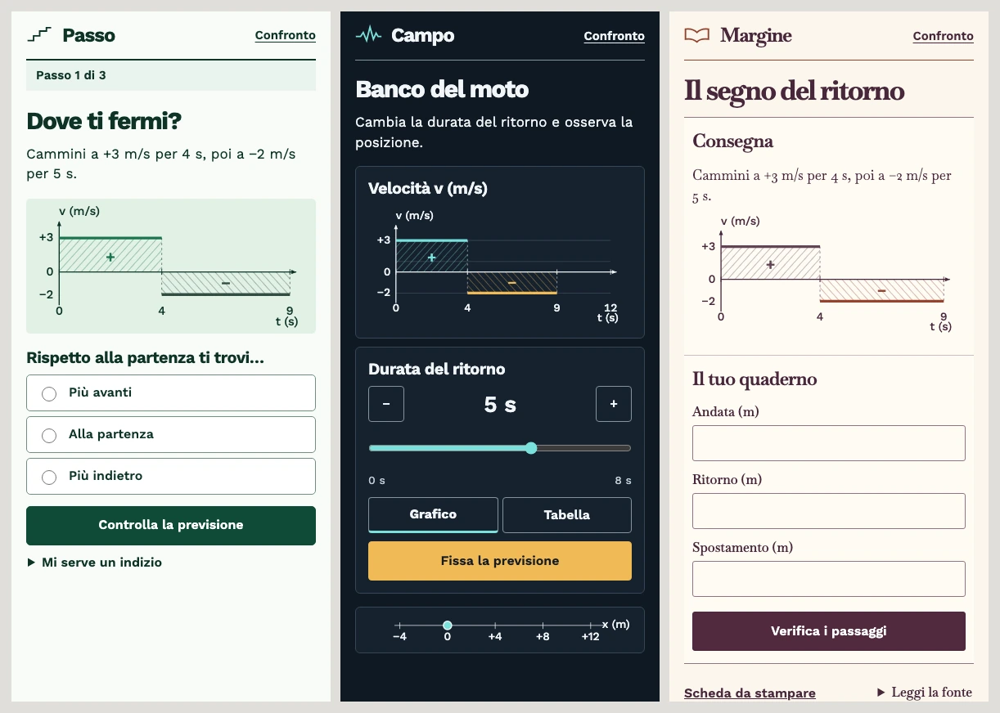

# Tre modi di studiare fisica

**Dossier di progettazione 1.0 · revisione 3 · 23 novembre 2026**

Materiale per la scelta di prodotto di Andrea Marro. La baseline è Officina di Fisica 1.1.0, pubblicata con la PR #339. I prototipi in questa cartella lavorano su uno stesso caso e su dati locali della demo. [Versione esaminata](https://github.com/AndreaMarro/ardesia/releases/tag/officina-di-fisica-v1.1.0)

**Per scegliere fra Campo, Passo e Margine**, apri il confronto annotato. Mostra lo stesso errore, il cambio da 5 a 7 secondi e il comportamento alla ricarica in 36 schermate desktop e mobile. La proposta da valutare riguarda solo il recupero del segno in C1-Q027. [Leggi il confronto con le schermate su GitHub](revisione/README.md) · [Sfoglia la galleria HTML](revisione/galleria.html) · [Unico incremento proposto](revisione/integrazione.md)

**Prova i tre concept.** Scarica lo ZIP, estrai `confronto.html` e aprilo nel browser. Sotto «Il ritorno basta?» trovi la traccia del sensore e tre ingressi. Scegli **Campo** per muovere subito il segnalino sulla pista in 3D. Il collegamento **Confronto** permette di passare da uno all’altro. Il file include interfaccia, grafici e caratteri e funziona offline. [Scarica i prototipi](prototipi-offline.zip?raw=true) · [HTML autonomo](confronto.html) · [Galleria desktop e mobile](verifica.md)

| Direzione | Che cosa fa lo studente | Prova che la distingue |
| --- | --- | --- |
| **Passo** | Prevede dove si fermerà, chiede eventualmente un indizio e recupera l’errore. | Apri l’indizio per contare caselle da un metro. Scegli «Più indietro» e confronta i quattro gruppi da tre con i cinque da due. [Desktop](prove/passo-desktop.webp) |
| **Campo** | Cambia la durata del ritorno, fissa una previsione e controlla la posizione su pista, grafico e tabella. | Muovi il tempo fino a 4 s prima della previsione. Dopo la misura puoi seguire anche il ritorno. A 5 s di ritorno finisci a +2 m, a 6 s sulla partenza. [Desktop](prove/campo-desktop.webp) |
| **Margine** | Scrive i contributi sul foglio o nei campi e rivede il primo passaggio incoerente. | Inserisci 12, 10 e 22 m. Nella somma leggi i due valori che hai scritto. Il quaderno riporta il focus al segno del ritorno. La scheda A4 reca l’ID e la revisione. [Desktop](prove/margine-desktop.webp) · [Scheda](prove/scheda-margine.pdf) |

### Raccomandazione

Sottoporre **Campo** alla prima prova con studenti. L’Officina ha già 181 laboratori. Nel test ospite di C1 «aree con segno» dà zero risultati e «grafici cinematici» ne dà uno. Rendere il fenomeno reperibile dal lessico e dall’errore dello studente è un’ipotesi concreta da verificare. Con i pesi dedicati al laboratorio, Campo ottiene **4,47/5**, Passo **4,39** e Margine **3,99**. Con i pesi dedicati al recupero vince Passo. Le voci didattiche e commerciali della matrice sono stime. [Matrice e sensibilità](decisione.md) · [Esiti della ricerca](prove/navigazione.json)

### Lettura del dossier

1. [Audit, product discovery e benchmark](scoperta.md) — percorsi reali, euristiche, jobs, alternative EdTech e AI-native.
2. [Tre sistemi di prodotto](sistemi-e-flussi.md) — architettura di marca, semantica dei token, componenti, compiti, stati e requisiti inclusivi.
3. [Modello didattico e multimodale](didattica-e-ai.md) — prerequisiti, evidenze, recupero, spaziatura, agenti editoriali e verificatori.
4. [Fattibilità e roadmap](fattibilita.md) — confini del monolite, contratti, impatto sul codice, rischi, unit economics e PR alternative.
5. [Decisione e protocollo con studenti](decisione.md) — criteri, soglie, pesi, controprove e condizioni per cambiare direzione.
6. [Collaudo e prove visive](verifica.md) — schermate misurate, Taste Skill, controlli WCAG automatici, riproduzione e limiti.

La scelta resta aperta. L’albero Git del prodotto coincide con quello della release. La consegna usa una PR di progettazione separata. Il test touch su un telefono fisico è rinviato secondo l’indicazione ricevuta.
