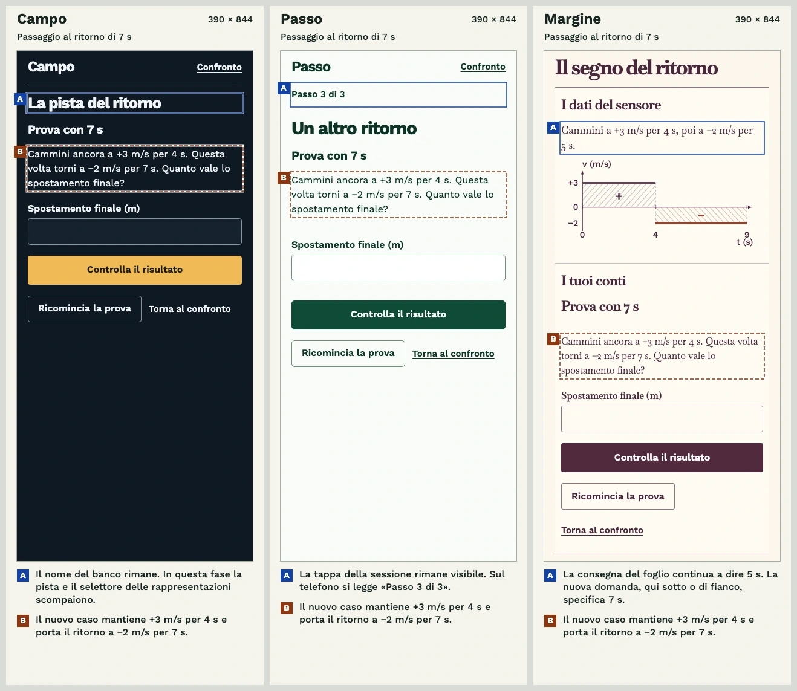

# Campo, Passo e Margine alla prova dello stesso errore

**Revisione comparativa del 23 novembre 2026 · C1-Q027, edizione 2 · decisione progettuale aperta.** Quando il carrello torna indietro più a lungo, supera davvero la partenza? Campo permette di controllarlo sulla pista. Passo fa contare i metri sopra e sotto l’asse. Margine conserva il calcolo di chi scrive e indica dove correggerlo. **Raccomandiamo Campo per un solo incremento di C1** a condizione che lo studente possa ritrovare la pista del caso che sta risolvendo e il motivo del proprio errore dopo un’interruzione. Entrambe le possibilità mancano nel passaggio decisivo del prototipo. [Specifica dell’incremento e integrazione](integrazione.md)



La **galleria** permette di cambiare momento e formato mantenendo i tre concept affiancati o, su uno schermo stretto, in sequenza. Ogni cattura si apre a risoluzione originale. I due richiami sono ripetuti anche in testo. Su GitHub si possono aprire direttamente le immagini nella tabella. Per provare le azioni, estrarre e aprire il file del prototipo offline. [Galleria HTML](galleria.html) · [Tre prototipi interattivi](../prototipi-offline.zip?raw=true) · [Confronto desktop dopo l’errore](desktop-base-errore.webp)

## Un caso, sei momenti osservabili

Nel problema iniziale il sensore registra +3 m/s per 4 s, poi −2 m/s per 5 s. Ogni rettangolo nel grafico velocità-tempo ha area in metri, perché (m/s) × s = m. Si guadagnano 12 m, se ne restituiscono 10 e ci si ferma a **+2 m** dalla partenza. Nel secondo problema cambia una sola quantità, la durata del ritorno. In 7 s si restituiscono 14 m, si arriva a **−2 m** e i metri percorsi in tutto sono 26. La velocità negativa indica il verso del secondo tratto. Il segno dello spostamento totale dipende dalla somma dei due tratti. [Quesito canonico](../../../../../officina-di-fisica/content/C1.json) · [Modello del confronto](../prototipi/moto.js)

| Momento osservato | Campo | Passo | Margine |
| --- | --- | --- | --- |
| 1 · Prima di rispondere | [Desktop](schermate/desktop-ingresso-campo.webp) · [Mobile](schermate/mobile-ingresso-campo.webp) | [Desktop](schermate/desktop-ingresso-passo.webp) · [Mobile](schermate/mobile-ingresso-passo.webp) | [Desktop](schermate/desktop-ingresso-margine.webp) · [Mobile](schermate/mobile-ingresso-margine.webp) |
| 2 · Verso sbagliato nel caso base | [Desktop](schermate/desktop-base-errore-campo.webp) · [Mobile](schermate/mobile-base-errore-campo.webp) | [Desktop](schermate/desktop-base-errore-passo.webp) · [Mobile](schermate/mobile-base-errore-passo.webp) | [Desktop](schermate/desktop-base-errore-margine.webp) · [Mobile](schermate/mobile-base-errore-margine.webp) |
| 3 · Apertura del caso da 7 s | [Desktop](schermate/desktop-trasferimento-campo.webp) · [Mobile](schermate/mobile-trasferimento-campo.webp) | [Desktop](schermate/desktop-trasferimento-passo.webp) · [Mobile](schermate/mobile-trasferimento-passo.webp) | [Desktop](schermate/desktop-trasferimento-margine.webp) · [Mobile](schermate/mobile-trasferimento-margine.webp) |
| 4 · Invio di +2 m nel caso da 7 s | [Desktop](schermate/desktop-segno-campo.webp) · [Mobile](schermate/mobile-segno-campo.webp) | [Desktop](schermate/desktop-segno-passo.webp) · [Mobile](schermate/mobile-segno-passo.webp) | [Desktop](schermate/desktop-segno-margine.webp) · [Mobile](schermate/mobile-segno-margine.webp) |
| 5 · Ricarica dopo il segno sbagliato | [Desktop](schermate/desktop-ripresa-campo.webp) · [Mobile](schermate/mobile-ripresa-campo.webp) | [Desktop](schermate/desktop-ripresa-passo.webp) · [Mobile](schermate/mobile-ripresa-passo.webp) | [Desktop](schermate/desktop-ripresa-margine.webp) · [Mobile](schermate/mobile-ripresa-margine.webp) |
| 6 · Ricarica dopo la correzione | [Desktop](schermate/desktop-correzione-campo.webp) · [Mobile](schermate/mobile-correzione-campo.webp) | [Desktop](schermate/desktop-correzione-passo.webp) · [Mobile](schermate/mobile-correzione-passo.webp) | [Desktop](schermate/desktop-correzione-margine.webp) · [Mobile](schermate/mobile-correzione-margine.webp) |

**Protocollo.** Contesto pulito per ogni concept e formato, ingresso dall’indice, stessa lingua, movimento ridotto, scala 1. Le prime due schermate si riferiscono al caso da 5 s. Nella seconda, Campo e Passo ricevono «Più indietro». In Margine si scrivono +12, −10 e un totale di −2 m. È lo stesso errore fisico espresso con i gesti previsti da ciascuna interfaccia. Solo Margine richiede di correggere il totale per procedere. La terza schermata mostra la nuova consegna da 7 s ancora senza risposta. La quarta usa per tutti l’identico input +2 m, la quinta ricarica la scheda, la sesta corregge in −2 m e ricarica di nuovo. Il caso base e la variante sono percorsi in una sola sessione per concept e formato.

**Condizioni di ripresa.** Chromium 148.0.7778.96, Playwright 1.60.0, desktop 1440 × 900 e telefono emulato 390 × 844, senza richieste HTTP del prototipo. L’ingresso è ripreso dall’alto. Nei passaggi successivi l’inquadratura raggiunge la consegna, il feedback o il campo pertinente, come farebbe chi lo consulta. Il file misure registra scorrimento e focus separatamente. I riquadri A e B provengono dalle coordinate dei componenti nel browser. La cornice e le note sono esterne al viewport. Le 18 strutture DOM, inclusi i valori dei campi, coincidono tra i due formati. [Misure delle 36 viste](misure.json) · [Azioni e punti di cattura](../verifica/confronto-visivo.mjs)

## Gerarchia, densità e leggibilità

| All’ingresso, desktop / mobile | Campo | Passo | Margine |
| --- | ---: | ---: | ---: |
| Titolo principale, px CSS | 32 / 26 | 51,8 / 30 | 68 / 34 |
| Parole e numeri del contenuto visibili | 50 / 50 | 51 / 41 | 54 / 54 |
| Controlli abilitati interamente in vista | 10 / 10 | 6 / 6 | 7 / 5 |
| Prima etichetta di asse o righello nella figura, px resi | 21,8 / 13,4 | 17,2 / 14,7 | 18,9 / 14,2 |
| Bordo inferiore dell’azione principale, px dall’alto | 425 / 694 | 766 / 681 | 597 / 773 |
| Testo delle formule dopo il primo errore, px CSS | 16 / 16 | 16 / 16 | 21,6 / 17 |

Il testo di base misura 16 px in tutti e tre. Il conteggio considera parole, numeri e unità nel riquadro del browser, esclusi testo dei grafici, contenuti richiusi, opzioni non aperte e testo riservato alla lettura assistita. I controlli comprendono la navigazione iniziale visibile. La misura dell’etichetta incorpora la scala del disegno. Sono misure di impaginazione. Il tempo per capire, lo sforzo percepito e la leggibilità per una persona richiedono osservazione. Nel trasferimento il conteggio del testo visibile diventa rispettivamente 44 / 44, 57 / 47 e 73 / 67. [Misure e coordinate](misure.json)

| Decisione d’interfaccia | Campo | Passo | Margine |
| --- | --- | --- | --- |
| Cosa attira l’occhio | Lo zero e il carrello dominano il banco scuro. Il titolo compatto lascia posto al righello. Sul telefono dieci controlli condividono l’attenzione. | La domanda in Work Sans apre una colonna di lavoro. Le caselle del grafico prendono rilievo con l’indizio. Dopo l’errore si leggono 100 parole/numeri sul telefono. | Titolo in Baskervville, righe di calcolo e superficie da quaderno. Il titolo da 68 px occupa spazio prima dei dati sul desktop. |
| Come si riconosce l’azione | La durata imposta l’esperimento, il cursore cambia l’istante di osservazione. Due scelte vicine riguardano entrambe il tempo. Pista, grafico e tabella offrono tre letture. | L’indizio si apre a richiesta. Si sceglie un verso e poi si controlla la previsione. Dopo l’errore rimangono due controlli in vista sul desktop. | Si scrive direttamente accanto a ciascuna operazione, con l’unità già stampata. La sottolineatura richiama la matita. Va verificato se comunica subito che si può digitare. |
| Come ci si orienta | Il nome del banco persiste, la pista scompare nella variante. Dal solo titolo è difficile capire come riesaminare la misura. | Nel desktop le tre tappe hanno un nome. Sul telefono «Passo 3 di 3» conserva la posizione nella sequenza, con meno contesto sul compito precedente. | Fonte, grafico e spazio di scrittura restano riconoscibili. Nel trasferimento la colonna del caso base convive però con la nuova consegna. Sul telefono si incontra il vecchio grafico per primo. |
| Come si leggono formule e segno | Tre righe collegano velocità, durata e posizione finale. La pista rappresenta il segno con il verso delle frecce e la tacca zero. «Due aree» richiede il cambio al grafico. | I gruppi di caselle permettono di contare 12 m sopra e 10 sotto l’asse e di controllare ogni termine della somma. L’asse verticale indica la velocità, quello orizzontale il tempo. | La somma riporta i due addendi digitati. Segno e unità restano vicini all’operazione. Un segno perso in una singola riga è localizzabile prima di proseguire. |
| Coerenza tra componenti | Previsione e misura hanno gesti diversi. Nel primo feedback il focus torna al cursore, mentre l’istruzione nomina una diversa vista. | Intestazione, tappa, domanda, aiuto e controllo seguono un ordine stabile. La variante riusa il campo numerico e il feedback degli altri concept. | Il quaderno conserva la relazione spaziale tra calcolo e correzione. La variante passa ad un campo numerico separato, con un secondo contesto visivo ancora esposto. |

## Quattro criteri osservabili per «assenza di AI slop»

| Criterio | Verifica ripetibile | Cosa mostrano le schermate |
| --- | --- | --- |
| Linguaggio visivo specifico | Coprire nome e marchio, chiedere quale gesto si può fare e da quale indizio lo si deduce. Annotare il gesto indicato prima del primo clic. | Lo zero graduato invita a misurare in Campo, le caselle contabili sostengono l’indizio di Passo, le righe compilabili collegano il quaderno di Margine al foglio. Il riconoscimento da parte degli studenti è da misurare. |
| Rappresentazione scientifica pertinente | Variare un parametro alla volta. Tutte le figure riferite al caso attivo devono avere assi, unità, durata e punto finale coerenti. Un caso di confronto deve essere identificato come tale. | Nel trasferimento Campo rimuove la pista e Passo rimuove il grafico. Margine mantiene il testo da 5 s e l’asse fino a 9 s accanto al caso da 7 s che termina a 11 s. Questa ambiguità è riproducibile. |
| Microcopy preciso | Per ciascun invito individuare nella vista corrente l’oggetto nominato e il gesto eseguibile. Per un errore deve essere possibile dire cosa riesaminare. | «Rivedi la previsione confrontando le due aree» in Campo incontra due frecce sulla pista. Passo riprende la scelta effettiva «Più indietro». Margine richiama gli addendi della riga errata. Tutti distinguono il modulo corretto dal segno sbagliato nel secondo caso. |
| Funzione di ogni elemento | Associare ogni componente principale a un’azione o a un’informazione necessaria. Osservare se toglierlo ostacola previsione, verifica, correzione o ripresa. | Righello, indizio e riga della somma hanno ciascuno un uso osservabile. Il titolo del banco da solo non ripristina il modello. In Margine il pannello conservato può indirizzare al dato sbagliato. Colore, carattere e mascotte richiederanno un confronto con i segni identificativi coperti. |

**Taste Skill 2.1.5.** Abbiamo eseguito il suo inspector in modalità app sui 18 stati a entrambe le risoluzioni, senza escludere regole. Risultato aggregato dei 18 rapporti, **0 FAIL e 27 WARN**. La stessa regola sullo stesso stato è contata una volta anche quando ricorre alle due larghezze. In Campo 5 segnalazioni riguardano la coppia di pannelli disallineati all’ingresso e lo spazio vuoto sul desktop nelle quattro viste finali. In Passo 10 riguardano titolo e spazio libero. In Margine 12 riguardano titolo e fondo crema. Il lint sorgente segnala separatamente una dichiarazione di ombra interna per la scelta selezionata. La verifica automatica parte dall’alto dei DOM congelati e non esercita i gesti. Non ha rilevato né il conflitto fra 5 e 7 s né la perdita del feedback. Dimensione dei titoli e colore del foglio meritano una prova di lettura prima di cambiare i token. [Documentazione ufficiale di Taste Skill](https://www.tasteskill.dev/docs) · [Rapporti per stato](taste.json) · [Lint](taste-lint.txt)

## Che cosa apprende lo studente, che cosa possiamo osservare

- **Correttezza della risposta.** Campo e Passo rivelano +2 m anche dopo la previsione errata e consentono di continuare. Il primo offre una misura da ispezionare, il secondo una spiegazione da contare. In Margine il focus torna al totale e i due contributi corretti restano scritti. Per proseguire occorre correggere proprio quella riga. Nel caso nuovo tutti respingono +2 m, riconoscono il modulo giusto e chiedono da che parte dello zero termina il moto.
- **Comprensione.** La conferma di −2 m spiega che −14 m di ritorno superano +12 m di andata. La frase appartiene all’interfaccia. Per rilevare comprensione chiedere allo studente di prevedere il lato d’arrivo, spiegare il segno con parole, disegno o indicazione sulla pista e distinguere lo spostamento dalla distanza. Annotare separatamente spiegazione spontanea, spiegazione con aiuto e solo numero corretto.
- **Consolidamento.** La ricarica dopo la correzione conserva il numero e la spiegazione. La ricarica dopo l’errore conserva +2 ma perde il messaggio e lo stato di errore, con focus sul documento. Una prova differita deve poter essere risolta senza leggere la soluzione precedente. A sette giorni proporre, per esempio, +3 m/s per 3 s e −2 m/s per 6 s. Attesi +9 − 12 = −3 m e una spiegazione del verso. Nessuno studio longitudinale è stato effettuato. [Confronto dopo l’invio](schermate/mobile-segno-campo.webp) · [Dopo la ricarica](schermate/mobile-ripresa-campo.webp) · [Rubrica e disegno del pilot](../decisione.md)

## Accessibilità cognitiva e controllo del ritmo

I bisogni di chi usa lettura assistita, ha difficoltà di decodifica, perde il punto dopo un’interruzione o preferisce lavorare su carta si possono osservare senza attribuire diagnosi. Le esigenze possono coesistere, anche in studenti con DSA o ADHD. L’interfaccia non dispone di profili diagnostici. Ritmo manuale, formati alternativi e aiuto esplicito offrono scelte locali. Personalizzare in base al comportamento richiederebbe evidenze ulteriori. Il protocollo usa scelta e autonomia, feedback orientato all’azione e più modi di rappresentare il contenuto secondo UDL 3.0. La verifica di focus, reflow, uso del colore e identificazione degli errori si appoggia a WCAG 2.2. [CAST, UDL Guidelines 3.0](https://udlguidelines.cast.org/) · [W3C, Making Content Usable for People with Cognitive and Learning Disabilities](https://www.w3.org/TR/coga-usable/) · [WCAG 2.2](https://www.w3.org/TR/WCAG22/)

| Bisogno o situazione | Osservazione | Ipotesi e prova con utenti |
| --- | --- | --- |
| Decodificare unità, segni e formule | La figura si riduce fino a una prima etichetta da 13,4 px su Campo mobile. Margine conserva l’unità accanto al campo. Passo offre il conteggio per caselle. | Chiedere di indicare tempo e velocità tramite il mezzo preferito, anche con zoom, tastiera o lettore di schermo. Annotare scambi di asse, segno o unità e aiuti richiesti. |
| Regolare l’attenzione e il ritmo | Nessun conto alla rovescia nella demo. Campo lascia manipolare il tempo, Passo lascia decidere quando aprire l’indizio, Margine quando verificare le righe. | Per alcuni la manipolazione potrebbe favorire la concentrazione, per altri i due controlli temporali potrebbero interferire. Chiedere prima di cambiare durata, poi di osservare un istante, e registrare il primo controllo azionato. |
| Riprendere con poca memoria di lavoro | Il campo conserva l’ultimo numero in tutti i concept. Si perde la diagnosi dopo un errore. L’indice di Passo conserva la tappa. Il foglio di Margine conserva anche dati precedenti. | Consentire una pausa scelta dalla persona. Al rientro chiedere quale caso è attivo e cosa resta da verificare. Registrare riprese autonome, rinunce, richieste di aiuto e riferimenti ai 5 s. |
| Scegliere come dimostrare il ragionamento | La pista può essere letta con dati alternativi nel caso base. Passo offre un indizio visivo. Margine consente carta e input da tastiera. Il trasferimento comune chiede un solo numero. | Accettare spiegazione orale, testuale, disegnata o data indicando il percorso. Conservare lo stesso criterio fisico e registrare la modalità scelta, incluso chi preferisce rinunciare alla scena. |

**Prova proposta.** Dodici studenti volontari, sei ordini bilanciati, varianti isomorfe con risultati diversi tra una direzione e l’altra. Registrare l’uso degli aiuti, permettere pause, raccogliere solo risultati aggregati. Soglie preliminari di usabilità, 10 su 12 trovano la rappresentazione pertinente entro 30 s e 10 su 12 riprendono autonomamente dicendo quale durata stanno usando. La prova a sette giorni e il confronto dimensionato con la pratica attuale misureranno l’apprendimento. Due valutatori distinguono segno errato, numero corretto da solo e numero corretto con spiegazione. Restano da svolgere le sessioni con studenti, la lettura con la tecnologia assistiva abituale e il collaudo touch su telefono fisico, rinviato dal committente. [Protocollo e sensibilità della decisione](../decisione.md)

## Decisione da prendere

**Campo è la prima direzione da sperimentare.** Permette di collegare direttamente il segno alla posizione rispetto alla partenza, anche a chi deve ancora imparare a leggere l’area di un grafico. La raccomandazione dipende dalla capacità di riusare quella rappresentazione quando cambiano i dati. Passo offre la spiegazione più facile da verificare contando e una tappa esplicita. Margine individua con maggiore precisione la riga da correggere. Se il pilot premia il recupero guidato o mostra che la pista interferisce con la spiegazione, la scelta va riesaminata. Nella matrice precedente la differenza a favore di Campo è di 0,08 su 5 con i pesi di laboratorio, mentre Passo è primo con i pesi di recupero. Le schermate aggiungono riscontri sul comportamento. I punteggi pedagogici restano ipotesi. [Matrice e analisi di sensibilità](../decisione.md)

Il destinatario della scelta è Andrea. Campo, Passo e Margine sono nomi di lavoro. Nome pubblico, mascotte Cric, colori, caratteri e architettura di marca rimangono rivedibili indipendentemente dalla scelta dell’interazione. L’unico incremento proposto porta la pista del caso attivo nel recupero del segno di C1-Q027. [Ambito, riuso e accettazione su GitHub](integrazione.md)

## Ripetere il confronto

La replica sui prototipi ha superato **24 percorsi in Chromium e WebKit, 80 scansioni axe e 153 campioni della legge del moto**. I rapporti della replica coincidono con quelli già versionati. La galleria ha superato 12 combinazioni di stato e formato per ciascuna delle quattro coppie browser/viewport. I controlli verificano immagini native, didascalie, selezione da tastiera, ricarica tramite indirizzo e assenza di scorrimento orizzontale. Le quattro scansioni axe della galleria hanno restituito zero violazioni automatiche. [Esiti dei prototipi](../prove/esiti.json) · [Testo al 200% e contrasto](../prove/leggibilita.json) · [Esiti della galleria](galleria-test.json)

Sullo stesso albero della release 1.1.0 è passata anche la suite canonica `node tests/browser.mjs`, da un database temporaneo, con l’esame C6 da 31 quesiti, l’assenza di feedback prima della consegna, i PDF e l’accesso autore. È passato il test di aggiornamento e riapertura di C1-Q027, eseguito con `python3 -m unittest discover -s tests -p test_signed_areas_upgrade.py` dalla cartella applicativa. [Output del browser](app-collaudo.txt) · [Controlli effettivi della suite](../../../../../officina-di-fisica/tests/browser.mjs) · [Test di edizione](../../../../../officina-di-fisica/tests/test_signed_areas_upgrade.py)

Dalla directory del dossier, con le dipendenze di sviluppo del prodotto installate da lockfile, i browser Playwright disponibili e il checkout ufficiale di Taste Skill al commit indicato in `taste.json`, impostare `TASTE_SKILL` alla sua cartella `skills/taste-skill`. `OFFICINA_DEPS` può puntare a una seconda installazione dello stesso lockfile. La directory temporanea raccoglie anche i PNG originali e i rapporti integrali dell’inspector. [Sorgente della versione di Taste Skill usata](https://github.com/Leonxlnx/taste-skill/tree/12af471f627f866411b4bd785b19646d3672784c/skills/taste-skill)

```sh
work=$(mktemp -d)
python3 prototipi/costruisci.py --check
node verifica/confronto-visivo.mjs "$work"
python3 verifica/taste-stati.py "$work" "$TASTE_SKILL"
node "$TASTE_SKILL/scripts/lint.mjs" --app prototipi
node verifica/tavole-confronto.mjs "$work" "$work/tavole"
node verifica/collaudo.mjs "$work/regressione"
node verifica/leggibilita.mjs "$work/lettura"
node verifica/galleria.mjs "$work/galleria.json"
```

Per ispezionare le sole immagini rigenerate, aprire `$work/tavole/galleria.html`. Nella copia del repository la galleria comprende anche i collegamenti alla revisione e al prototipo. I controlli sui prototipi includono tastiera, reflow, contrasto, ripresa, stati di errore e confronto del modello con un calcolo indipendente. [Controlli e limiti dei prototipi](../verifica.md)
