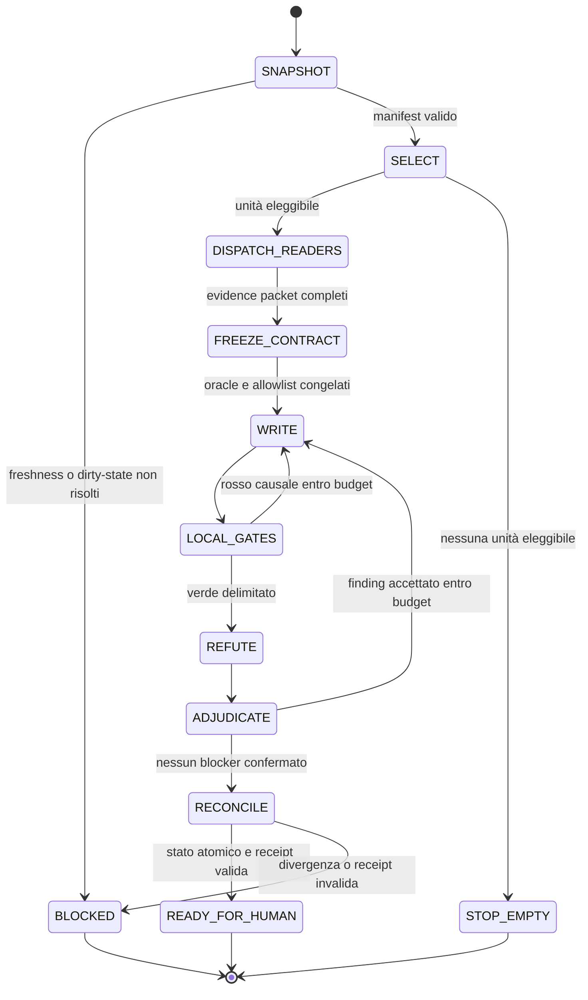

# ARDESIA Loop v6 — Convergence-first

## Decisione in una frase

Il prossimo loop non deve essere un prompt più lungo. Deve essere un controller
deterministico che, a ogni unità, prova la freschezza di GitHub e del vault,
congela un contratto verificabile, concede una sola lease di scrittura a Claude
Code, usa lettori/revisori eterogenei in parallelo e si arresta in
`READY_FOR_HUMAN`: mai merge o deploy autonomo.

Questo design è stato scelto da Andrea come opzione **A** il 31 luglio 2026. È
una specifica approvata, non la prova che il controller esista già.

Piano di implementazione:
[2026-07-31-ardesia-loop-v6-convergence.md](../plans/2026-07-31-ardesia-loop-v6-convergence.md).
Predecessore operativo:
[ARDESIA-LOOP-TWO-HINGE-2026-07-30.md](../../ops/ARDESIA-LOOP-TWO-HINGE-2026-07-30.md).

Il dossier delle fonti e delle inferenze vive nel repository canonico
`ardesia-knowledge`, alla nota
`50-Research/2026-07-31-ARDESIA-LOOP-V6-CONVERGENCE.md`.

## 1. Confine epistemico

### Misurato sul checkout pulito

`python3 bin/state/project_state.py`, eseguito sul base SHA indicato nel
frontmatter, ha prodotto:

| grandezza | valore |
|---|---:|
| `origin/main` locale | `4218bc2e` |
| lesson path nel corpus | 88 |
| scene `candidate` | 4 |
| scene certificate | 0 |
| spec Playwright presenti | 103 |
| golden path presente | sì |
| Playwright invocato in CI | sì |

La stessa esecuzione non ha potuto interrogare GitHub né la produzione per
assenza di rete. Non si usa quindi quel run per dichiarare numero o salute
corrente delle PR, required checks o SHA servita.

### Misurato nelle fonti di ingresso

L'audit GitHub del 31 luglio riporta 34 PR aperte nel suo istante di misura. Il
registro non versionato `ardesia-loop/loop-state.json`, hash
`1571a9ad03293148551bfaa2691bac645819e12a7253efc467039106b75b78d9`,
contiene 21 unità: 19 `open`, una `partial` e una
`green_in_isolation_only`. Sono fotografie, non stato vivo.

Il loop corrente ha due automi non coordinati:

1. il `/loop` conversazionale di Claude Code;
2. il control plane sul Mac mini.

Le rappresentazioni della conoscenza sono almeno quattro: Git del vault,
replica Obsidian, indice SQLite WikiLLM e clone del Mini. WikiLLM è un indice
derivato, non una nuova autorità.

### Non stabilito

- Il modello effettivamente servito a Hermes non è osservabile: la
  configurazione prova il modello richiesto, non quello risolto dal provider.
- L'aumento a `xhigh` è verificato nella configurazione delle sessioni nuove, ma
  non è ancora dimostrato che aumenti i finding confermati.
- Il controllo desktop di Hermes non è oggi un confine di sicurezza. Non va
  confuso con una sandbox.
- La quota UI/UX proposta sotto è un'ipotesi di governance da verificare su una
  finestra di 20 unità, non un risultato scientifico già ottenuto.

## 2. Problema causale

Il collo di bottiglia non è la scarsità di modelli. È l'assenza di un unico
protocollo meccanico che impedisca:

- lavoro su SHA, branch o vault stantii;
- più writer sullo stesso spazio di mutazione;
- promozione di una unità solo perché un revisore ha scritto `ACCEPT`;
- contesto crescente e contraddittorio;
- code che conservano prerequisiti già chiusi;
- loop che ripetono la stessa azione senza nuovo segnale;
- merge e deploy come effetto collaterale di un agente;
- sottoutilizzo sistematico della superficie docente e della UI reale.

Il pattern a due cardini resta valido: writer e refuter devono essere separati.
v6 aggiunge il terzo elemento che oggi manca: un controller che nessuno dei due
può persuadere.

## 3. Invarianti costituzionali

1. **Due autorità, nessuna terza.** Il repository ARDESIA è autorità per codice,
   test e prodotto. `ardesia-knowledge` è autorità per decisioni, evidenze e
   storia. Obsidian è la vista umana del secondo; WikiLLM è ricostruibile.
2. **Freshness prima del contesto.** Nessun agente riceve il task prima che il
   controller abbia fissato SHA, branch, dirty state, remote age e digest del
   vault.
3. **Una unità, una lease, un writer.** Solo Claude Code può mutare la slice
   assegnata. La lease dichiara file ammessi, base SHA, TTL e oracle.
4. **Parallelismo solo dove è commutativo.** Ricerca, lettura, critica e test
   isolati possono correre in parallelo. Le patch concorrenti sullo stesso
   sottoalbero no.
5. **L'oracolo è frozen prima della patch.** Writer e reviewer non possono
   cambiare acceptance, budget o stop condition della propria unità.
6. **Ogni claim ha una classe.** `MEASURED`, `INFERRED`, `PROPOSED` oppure
   `UNAVAILABLE`. Il silenzio non equivale a `MEASURED`.
7. **Un verde locale non è un verde globale.** La unità deve dichiarare test
   focused, adiacenti, build e ciò che non è stato eseguito.
8. **Nessuna auto-promozione.** Modelli, skill, repository donor e nuovi gate
   entrano come canary con rollback.
9. **Nessuna irreversibilità.** Il controller termina in `READY_FOR_HUMAN`.
   Push, PR, merge, deploy, spesa, installazioni e gestione credenziali restano
   approval-gated.
10. **AgentMemory resta spento.** `RETIRED_NO_READ_NO_WRITE`, senza probe,
    fallback o sincronizzazione.

## 4. Autorità e proiezioni

```text
GitHub ARDESIA exact SHA ───────┐
                               ├─> controller ─> context packet
Git ardesia-knowledge exact SHA┘
            │
            ├─> Obsidian: vista/modifica umana sullo stesso Markdown
            └─> WikiLLM: indice read-only, ricostruibile e con provenance
```

Una risposta WikiLLM è valida soltanto se restituisce almeno:

```json
{
  "vault_commit": "<40 hex>",
  "path": "50-Research/example.md",
  "content_sha256": "<64 hex>",
  "indexed_at": "<RFC3339>",
  "mode": "ro"
}
```

Se `vault_commit` non coincide con il commit congelato nel run manifest, la
risposta è `STALE_INDEX` e non entra nel context packet. Il controller può
chiedere una reindicizzazione; non può scrivere nell'indice come se fosse il
vault.

## 5. Macchina a stati



### Stati e output obbligatori

| stato | output persistente | condizione di uscita |
|---|---|---|
| `SNAPSHOT` | `run-manifest.json` | due SHA, remote age, dirty state, tool versions |
| `SELECT` | `unit-contract.json` draft | una unità open e non bloccata |
| `DISPATCH_READERS` | N evidence packet | tutti conformi allo schema o `UNAVAILABLE` |
| `FREEZE_CONTRACT` | contract hash | acceptance, falsificatore, budget e allowlist immutabili |
| `WRITE` | diff + work log | solo file in lease |
| `LOCAL_GATES` | exit code separati | focused, adjacent, typecheck/build come applicabile |
| `REFUTE` | verdict JSON | `not_checked` non vuoto |
| `ADJUDICATE` | ledger finding-per-finding | ogni finding riprodotto o falsificato |
| `RECONCILE` | state transition atomica | digest precedente combacia |
| `READY_FOR_HUMAN` | receipt + handoff | nessuna azione esterna automatica |

## 6. Il context packet

Gli agenti non devono rileggere a ogni giro tutto il vault, 34 PR e decine di
fonti web. Il controller costruisce un pacchetto bounded:

```json
{
  "run_id": "ardesia-v6-<timestamp>-<nonce>",
  "unit_id": "F5-9",
  "product": {
    "base_sha": "<40 hex>",
    "branch": "<name>",
    "diff_sha256": "<64 hex>"
  },
  "knowledge": {
    "commit": "<40 hex>",
    "selected_paths": ["..."],
    "selection_query": "...",
    "index_status": "FRESH|BYPASSED_FILE_FIRST"
  },
  "contract": {
    "goal": "...",
    "acceptance": ["..."],
    "falsifier": "...",
    "allowed_paths": ["..."],
    "forbidden_actions": ["merge", "deploy", "secret_write"]
  },
  "budget": {
    "wall_minutes": 45,
    "writer_attempts": 3,
    "review_rounds": 2,
    "max_changed_files": 5
  }
}
```

Ogni campo variabile contribuisce al digest. Il reviewer riceve il diff e il
contratto frozen, non la narrativa persuasiva del writer.

## 7. Ruoli e parallelismo

| ruolo | runtime iniziale | permessi | output |
|---|---|---|---|
| controller | script deterministico versionato | legge entrambe le autorità; scrive solo stato/receipt | transizioni |
| writer | Claude Code | lease su un solo worktree e massimo 5 file | diff e gate |
| audit prodotto | Codex/TERRA high o equivalente | read-only | evidence packet |
| refuter principale | Hermes + GPT-5.6 SOL `xhigh` richiesto | read-only su diff/vault | verdict JSON |
| secondo refuter | Codex SOL xhigh read-only | read-only | verdict indipendente |
| micro-worker canary | Pi | sandbox esterna, task bounded | ricerca o test isolato |
| UI critic canary | Hermes desktop o browser automation | profilo effimero, nessun segreto | screenshot, DOM, issue packet |
| decisione irreversibile | Andrea | umana | approvazione o stop |

Le identità modello non osservabili si registrano `inherited/unknown`.
L'allocazione 50/30/20 del vault resta rolling sulle unità accettate:
implementazione/test, audit/ricerca, orchestrazione/specialisti. Non è una
richiesta di tenere tre agenti sempre accesi.

### Politica di concorrenza

- Fino a tre lettori possono lavorare in parallelo sullo stesso contract hash.
- Un solo writer lease globale può essere `ACTIVE`.
- Test pesanti possono essere delegati, ma il loro risultato è valido solo su
  exact candidate SHA e ambiente registrato.
- Se due evidence packet propongono modifiche sovrapposte, il controller non
  fonde patch: le serializza come unità separate.
- Pi non riceve credenziali né accesso write. La sua assenza di permission
  prompt rende obbligatoria una sandbox esterna, non facoltativa.

## 8. Uso più completo di Hermes

Hermes deve passare da “un round di review” a tre funzioni separate, senza
accumularle nella stessa sessione:

1. **Refuter del diff.** Due passate indipendenti per unità ad alto rischio;
   ordine dei file e framing variati; finding deduplicati dopo, non prima.
2. **Auditor della memoria.** Confronta le provenance WikiLLM con il commit
   congelato e produce `STALE_INDEX`, non una sintesi se il dato è vecchio.
3. **Critico UI bounded.** Su profilo browser/desktop effimero esegue una
   missione osservabile: apertura, creazione lezione, ripresa in Continuità,
   export in Materiali. Registra screenshot e DOM, senza scrivere codice.

Prima del terzo uso sono bloccanti: rotazione della chiave Moonshot segnalata in
chiaro, allowlist di applicazioni e directory, profilo effimero, kill switch,
redazione dei log e test control-run che dimostri il rifiuto di una directory
non ammessa.

La memoria autonoma di Hermes non può cambiare il protocollo. Può proporre una
regola nuova in un receipt `CANDIDATE`; soltanto un test rosso/verde e una
ratifica la rendono gate.

## 9. UI/UX come lane bloccante

L'audit conferma che la copertura funzionale è molto più misurata della qualità
dell'esperienza docente. Il repository contiene molte spec E2E ma, su questo
base, nessun file `*.stories.*` tracciato; il corpus di esperimenti è 88 e i
certificati sono zero.

Per le prime 20 unità accettate, v6 applica una policy sperimentale:

- almeno 7/20 unità devono avere outcome primario UI/UX;
- ogni finestra mobile di tre unità contiene almeno una slice del viaggio
  docente, salvo incident response esplicitamente registrata;
- una slice UI non è verde con i soli test DOM.

Oracle minimo per una slice UI:

1. screenshot deterministico a viewport docente e, se rilevante, LIM;
2. percorso reale senza API di test interne al prodotto;
3. tastiera, focus visibile e target size;
4. assenza di regressione nelle tre superfici `Lezione`, `Continuità`,
   `Materiali`;
5. almeno un confronto con baseline visuale versionata;
6. `not_checked` che dichiari l'assenza di osservazione docente reale.

Metriche UI/UX:

```text
ui_share = unità UI/UX accettate / ultime 20 unità accettate
journey_pass_rate = step docente passati / step preregistrati
visual_escape_rate = regressioni visuali trovate dopo READY_FOR_HUMAN / unità UI
teacher_validation_rate = slice UI osservate da un docente / slice UI accettate
```

La soglia 7/20 si mantiene, modifica o elimina solo dopo la prima finestra; non
viene reinterpretata retroattivamente.

## 10. Arresto e anti-stagnazione

Il loop si arresta in uno dei casi seguenti:

- due iterazioni consecutive producono lo stesso
  `diff_sha256 + failing_gate + evidence_digest`;
- tre tentativi writer sulla stessa unità;
- due round di refutation senza nuova evidenza confermata;
- 45 minuti di wall time per unità, salvo override umano preregistrato;
- più di 5 file modificati;
- base SHA, vault SHA o contract hash cambiano;
- una dipendenza dichiarata chiusa risulta ancora aperta, o viceversa;
- un comando obbligatorio è `UNAVAILABLE`;
- il writer tenta un path fuori allowlist;
- qualsiasi azione irreversibile è richiesta.

`BLOCKED` è un risultato valido e informativo. Il controller non riscrive il
task per poter continuare.

## 11. Riconciliazione atomica

Il registro non si aggiorna con edit liberi. La transizione usa compare-and-swap:

```text
expected_registry_digest == current_registry_digest
AND candidate_sha == tested_sha
AND contract_hash == reviewed_contract_hash
AND lease_owner == writer_id
```

Solo allora:

1. la unità passa a `READY_FOR_HUMAN`;
2. viene creato il receipt append-only;
3. le dipendenze risolte sono ricalcolate;
4. le unità terminali sono spostate in archivio, non cancellate;
5. l'indice derivato può essere ricostruito.

Se una condizione fallisce, nessuna delle cinque scritture diventa visibile.

## 12. Interfaccia `/loop`

`/loop` resta l'innesco umano in Claude Code, ma deve diventare un adapter
sottile:

```text
/loop ardesia --controller v6 --units 1
```

L'adapter:

1. esegue preflight;
2. mostra unità selezionata, SHA e budget;
3. avvia il controller;
4. non contiene la logica di stato nel prompt;
5. restituisce il path del receipt e lo stato terminale.

Appendere altri paragrafi al prompt senza spostare i vincoli nel controller è
esplicitamente fuori design.

## 13. Donor e strumenti

### Ammessi come canary bounded

| candidato | uso ammesso | gate |
|---|---|---|
| Obsidian CLI ufficiale | ricerca/read, sync headless, screenshot/DOM dev | installazione separata; provenance e fail-closed |
| `Ar9av/obsidian-wiki` | donor per delta ingest e provenance | corpus sintetico; nessuna write al vault reale |
| Graphify | dipendenze di codice prima di file critici | confronto con `rg`/import graph congelato |
| Pi | micro-worker read-only o test isolato | sandbox esterna e zero credenziali |
| Figma/Storybook | oracle visuale e component contract | baseline versionata, no auto-accept |
| GitHub JSONL cache | prefetch deterministico di PR/check | exact query, timestamp, truncation flag |

### Differiti o respinti ora

| candidato | verdetto | ragione |
|---|---|---|
| Paperclip | defer | duplica il control plane prima di riparare quello esistente |
| Graphiti | canary solo sintetico | secondo stato persistente e costo di riconciliazione |
| Auto LLM Wiki / KarpathyWiki | reject operativo | superfici GUI o possibilità di write non necessarie |
| `ekadetov/llm-wiki` | reject | install/commit automatici incompatibili coi guardrail |
| `nashsu/llm_wiki` | defer | desktop/API/MCP aggiunge una seconda knowledge base |
| `domleca/llm-wiki` | defer | ingest locale pesante e beneficio non misurato qui |
| `pi-dynamic-workflows-oc-style` | reject | workflow trusted/unsandboxed con push/PR |
| LangGraph | defer | il problema osservato è correttezza del controller, non assenza di framework |
| nuovi modelli generici | reject per default | nessun collo di bottiglia misurato che li richieda |

## 14. Metriche di successo

Le metriche si calcolano su unità accettate, non su tentativi narrativi:

```text
goodput = READY_FOR_HUMAN senza rework entro 7 giorni / unità iniziate
first_pass_yield = unità che superano LOCAL_GATES al primo candidate / unità scritte
review_yield = finding confermati nuovi / round di review
divergence_rate = run bloccati per SHA/digest mismatch / run iniziati
stale_context_rate = evidence packet rifiutati come stale / packet totali
rework_rate = unità riaperte entro 7 giorni / unità accettate
cost_per_accepted = token e wall time / unità accettate
ui_share = unità UI/UX accettate / ultime 20
```

Target iniziali, esplicitamente ipotesi:

- `divergence_rate` può essere alto nella prima settimana: il gate sta
  rendendo visibile debito preesistente;
- dopo 20 unità, `stale_context_rate < 5%`;
- nessun run con due writer lease attive;
- nessuna azione irreversibile senza receipt di approvazione;
- `ui_share >= 35%`;
- riduzione del rework rispetto alle 20 unità precedenti, se il baseline è
  ricostruibile; altrimenti il primo blocco diventa baseline, non successo.

## 15. Falsificatori del design

v6 va ridotto o abbandonato se una finestra di 20 unità mostra, rispetto a una
baseline preregistrata:

- nessuna riduzione di rework o divergenza;
- tempo per unità superiore del 30% senza aumento di finding confermati o
  journey pass rate;
- più falsi blocchi da freshness che veri mismatch;
- evidence packet che richiedono comunque la rilettura manuale dell'intero
  vault nella maggioranza delle unità;
- la quota UI aumenta i file visivi ma non i journey completi;
- il secondo refuter non produce finding incrementali confermati su almeno
  cinque unità ad alto rischio.

## 16. Rollout

1. **Shadow.** Il controller legge e produce manifest/contract senza scrivere
   codice.
2. **Canary documentale.** Una unità docs-only completa tutte le transizioni.
3. **Canary codice a basso rischio.** Un solo writer, un solo refuter, nessuna
   automazione desktop.
4. **Parallel readers.** Si aggiungono audit prodotto e UI con evidence packet.
5. **Hermes UI.** Solo dopo il security gate e su profilo effimero.
6. **Valutazione 20 unità.** Confronto goodput, rework, costo, UI share e stale
   rate; ratifica o rollback.

Fino alla fine del canary, v5 resta storico e non viene cancellato. Nessuna
promozione avviene perché questo documento è stato approvato: serve evidenza di
esecuzione.
