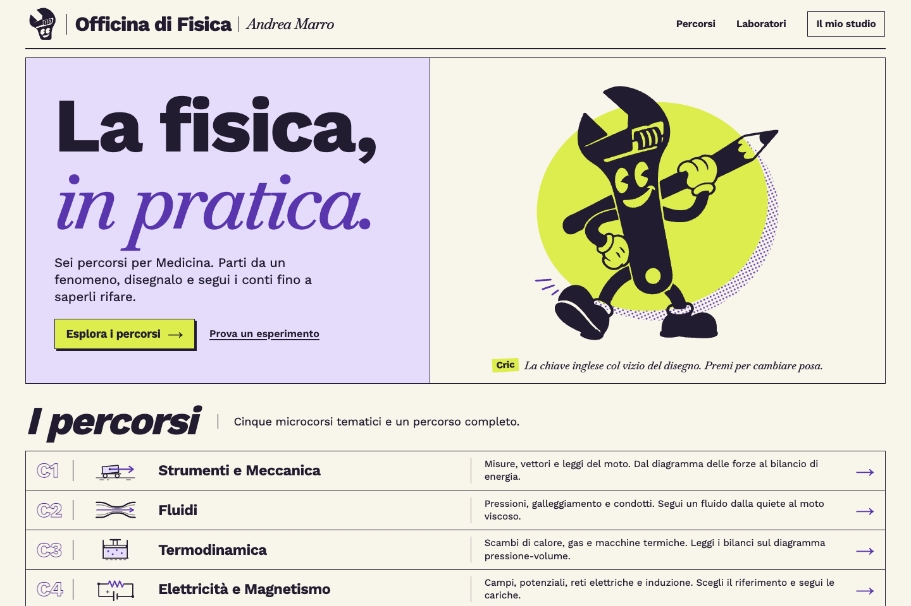

# Officina di Fisica

Dalla testata, **Cerca** apre i materiali per argomento o codice, per esempio `C1-Q027`. Puoi filtrare per percorso e tipo e tornare al risultato dopo aver consultato l’attività. [Ricerca e criteri di verifica](docs/verifica-prodotto/ricerca.md)

In **Il mio studio → Diario degli errori** ritrovi la risposta data, il passaggio da controllare e un caso diverso da provare. Scegli il percorso e il tempo disponibile. La sezione *Tentativi e aiuti* distingue i supporti usati, il successo autonomo su una famiglia diversa e il ripasso a distanza. [Percorso di recupero e verifiche](docs/verifica-prodotto/diario.md)


I sei percorsi di Andrea Marro per il semestre aperto di Medicina 2026/27. Il quaderno dello studente, il banco autore e il registro dei bonifici condividono una sola installazione. L’edizione si può usare su questo computer senza servizi esterni.



In copertina **Cric**, la chiave inglese con la matita in spalla, cambia posa con un tocco. **Prova un esperimento** apre subito la storia interattiva sul raggio di un tubo. Il marchio compatto e le due pose sono sorgenti vettoriali riutilizzabili. [Tavola di Cric](docs/verifiche/cric.png) · [Guida all’identità](docs/identita-visiva.md)

## Ritrovare l’edizione su GitHub

L’edizione 1.1 vive nella cartella `officina-di-fisica/` del ramo ufficiale omonimo di AndreaMarro/ardesia. Dalla home scegli **Laboratori 3D per capitolo** per raggiungere ciascuna delle 181 voci. La release contiene il pacchetto verificato della sola Officina e la sua impronta SHA-256. [Cartella canonica](https://github.com/AndreaMarro/ardesia/tree/officina-di-fisica/officina-di-fisica) · [Release 1.1](https://github.com/AndreaMarro/ardesia/releases/tag/officina-di-fisica-v1.1.0) · [Revisione tecnica, didattica e UX](docs/architettura/README.md)

In C1 scegli **Esercizi prioritari → Aree di segno opposto → Inizia il quesito**. Dopo un errore, **Prova il ritorno di 7 s** apre una variante con pista, tabella e ripresa della bozza. [Come provarla, schermate e collaudo](docs/recupero-c1-q027/README.md)

Il bundle Git storico nella cartella di distribuzione permette di recuperare l’edizione autonoma 1.0.0. Dopo averlo scaricato puoi eseguire `git clone Officina-di-Fisica-1.0.0.bundle Officina-di-Fisica`. Per lavorare direttamente sul branch di Ardesia scaricando la sola cartella del prodotto:

```sh
git clone --filter=blob:none --sparse --single-branch --branch officina-di-fisica https://github.com/AndreaMarro/ardesia.git ardesia-officina
cd ardesia-officina
git sparse-checkout set officina-di-fisica
cd officina-di-fisica
python3 app.py serve --open
```

## Aprire la piattaforma

**Su questo Mac**, apri **Avvia Officina.command**. Si apre la copertina nel browser. Tieni aperta la finestra del server finché lavori. **Area autore.command** apre il banco riservato con un collegamento locale monouso. Per riaprire il servizio in seguito bastano gli stessi due comandi. [Avvio](Avvia%20Officina.command) · [Accesso autore](Area%20autore.command)

**Dal terminale**, entra nella cartella che contiene questo file ed esegui:

```sh
python3 app.py serve --open
```

L’indirizzo predefinito è [127.0.0.1:8843](http://127.0.0.1:8843/). Il server richiede Python 3.10 o successivo con SQLite e scrypt. Per la rigenerazione dei PDF installa Chrome o Chromium. I PDF già compresi nella cartella `materials` si aprono senza avviare il server. Il browser deve supportare moduli JavaScript e importazione di JSON. Node.js serve soltanto per eseguire i test browser e matematici supplementari.

## Tre modi per entrare

- **Studiare subito.** In *Il mio studio* scegli *Apri un quaderno di prova*. Si aprono tutti i materiali con un profilo riservato alla sessione di quel browser. Questo ingresso è disponibile in modalità di verifica.
- **Ritrovare lo studio su un altro dispositivo.** Crea un account personale con email e password. Scegli il percorso, crea l’ordine di verifica e confermalo dal banco autore. Accedendo allo stesso server con le stesse credenziali ritroverai prove, note, letture e accessi.
- **Lavorare come autore.** Apri il comando dedicato sul computer del server. Il banco permette di modificare una spiegazione, legare un errore a un laboratorio, pubblicare una bozza, ripristinare una versione o rigenerare un fascicolo. [Guida alle operazioni editoriali e agli incassi](docs/guida-autore.md)

## Materiali

L’edizione comprende **56 lezioni, 117 esempi guidati e 606 quesiti con svolgimento**. In ogni esempio puoi leggere tutto lo svolgimento oppure scegliere **Un passaggio alla volta**, avanzare fra formule e figure e tornare al testo completo. I 13 fascicoli A4 raccolgono 411 pagine con indici cliccabili. C6 include le tre simulazioni da 31 quesiti.

Ognuna delle **181 voci delle lezioni** apre una simulazione 3D con una previsione, misure, calcolo guidato e due verifiche. La biblioteca comprende anche dieci banchi di approfondimento e cinque laboratori guidati. [Indice per lezione](docs/laboratori-3d/voci.md) · [Scene e prove su desktop, tablet e smartphone](docs/laboratori-3d/esperienze.md)

| Percorso | Cosa aprire |
|---|---|
| C1 · Strumenti e Meccanica | [Dispensa](materials/C1-dispensa.pdf) · [Esercizi e soluzioni](materials/C1-esercizi.pdf) |
| C2 · Fluidi | [Dispensa](materials/C2-dispensa.pdf) · [Esercizi e soluzioni](materials/C2-esercizi.pdf) |
| C3 · Termodinamica | [Dispensa](materials/C3-dispensa.pdf) · [Esercizi e soluzioni](materials/C3-esercizi.pdf) |
| C4 · Elettricità e Magnetismo | [Dispensa](materials/C4-dispensa.pdf) · [Esercizi e soluzioni](materials/C4-esercizi.pdf) |
| C5 · Onde, Ottica e Radiazioni | [Dispensa](materials/C5-dispensa.pdf) · [Esercizi e soluzioni](materials/C5-esercizi.pdf) |
| C6 · Fisica completa | I cinque moduli con gli stessi progressi, più [raccordi ed esempi](materials/C6-dispensa.pdf), [problemi misti](materials/C6-esercizi.pdf) e [tre simulazioni con correzione](materials/C6-simulazioni.pdf) |

I sorgenti sono record JSON e disegni SVG. La piattaforma compone lezioni, esercizi e volumi a partire dalle stesse schede. L’inventario elenca identificatori, famiglie, figure, controlli e voci del programma. [Inventario](docs/inventario.md) · [Matrice del syllabus](docs/inventario-copertura.csv) · [Archivio per record](docs/inventario-record.csv)

In ogni corso trovi **Errori e recupero**. Seleziona una competenza e una situazione per aprire il passaggio da controllare, lo svolgimento e la lezione o il laboratorio collegato. **Prova un caso diverso** propone un’altra famiglia di problemi sulla stessa competenza. C6 riunisce anche le situazioni di recupero dei cinque moduli.

## Manutenzione

Dopo il primo avvio le modifiche editoriali si salvano nel database privato. La directory predefinita è `var`. Conserva l’intera cartella dati, comprensiva di database, asset caricati e PDF rigenerati. Per copiarla come backup a servizio fermo, interrompi il processo con Ctrl+C, copia la cartella e riavvia. Per spostare l’installazione, copia anche il repository e avvialo puntando ai dati ripristinati. L’esportazione dell’area autore serve allo scambio dei contenuti e contiene riferimenti e allegati. [Moduli, contratto del lotto e ciclo di revisione](docs/architettura-e-formati.md)

Per rigenerare un singolo PDF dalle versioni pubblicate:

```sh
python3 app.py pdf --course C2 --book esercizi
```

Ometti i due filtri per rigenerare tutti i volumi. L’opzione `--pack` è riservata a chi prepara una nuova distribuzione dai JSON iniziali. L’area autore offre i medesimi controlli sui fascicoli dell’installazione in uso.

## Servizio condiviso e bonifici reali

L’edizione consegnata è locale e parte in **modalità verifica**. L’importo di 1,00 € è fittizio. Un ordine di verifica confermato dà accesso nell’ambiente di verifica. Gli ordini reali conservano una copia dell’offerta, dell’importo e delle istruzioni di bonifico valide al momento della richiesta.

Per aprire il servizio agli studenti, sono necessari un host sempre disponibile, un volume dati persistente, un indirizzo raggiungibile e HTTPS. Pubblica il servizio dietro un reverse proxy che conservi l’header Host del sito e termini TLS. Il valore `ASTRA_HTTPS=1` abilita cookie Secure. `ASTRA_DATA` seleziona la directory privata, `ASTRA_HOST` e `ASTRA_PORT` il binding. `ASTRA_CHROME` permette di indicare l’eseguibile di Chrome/Chromium per la stampa. Prima dell’apertura pubblica, configura le credenziali dell’autore sul server:

```sh
python3 app.py password-autore
```

Nell’area *Ordini e incassi* inserisci intestatario, IBAN, prezzi per offerta, condizioni e causale con `{ordine}`. Per vendere incontri precisa che cosa includono. La modalità reale si attiva solo quando i dati richiesti sono completi. Ogni accredito richiede il controllo di Andrea sul conto. La piattaforma registra la conferma e attiva gli accessi previsti dall’offerta. Per la pubblicazione restano a cura del titolare anche l’informativa applicabile al servizio e gli eventuali adempimenti fiscali.

## Riprodurre le verifiche

Su macOS puoi verificare un pacchetto scaricato con `python3 tests/installazione_mac.py /percorso/Officina-di-Fisica-1.0.0.zip`. La prova estrae una copia temporanea, avvia i due lanciatori e controlla il catalogo, i download e i ticket autore.

Le prove funzionali lavorano su database temporanei separati. Per il collaudo browser servono Node.js 22.12 o successivo e Chrome locale. Le verifiche globali dei PDF usano gli strumenti Poppler `pdfinfo`, `pdftotext`, `pdftoppm`, `pdffonts` e `pdftohtml`.

```sh
python3 tools/validate_bank.py
python3 tools/c12_audit.py
python3 tools/c34_audit.py
python3 tools/c56_audit.py
python3 tools/c56_varieta.py
python3 tools/audit_integrazioni.py
python3 tools/dimostra_lotto.py
python3 -m unittest discover -s tests
node tools/check-formulas.cjs
node --test tests/*.test.js
npm ci
npm run test:browser
node tests/browser-banchi.mjs
node tests/browser-esperienze.mjs
node tests/editor.mjs
python3 tools/verifica_pdf.py
```

[Verbale di collaudo](docs/collaudo.md) · [Controllo dei PDF](docs/verifica-pdf.md) · [Revisione dei fascicoli d’esame](docs/revisione-simulazioni.md) · [Identità visiva](docs/identita-visiva.md) · [Fonti ministeriali e licenze](docs/fonti-e-licenze.md)
