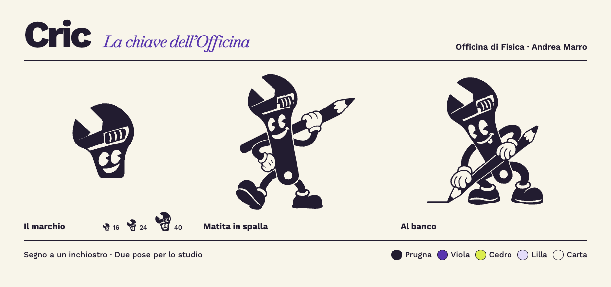

# Cric e il linguaggio grafico dell’Officina

Una chiave inglese arriva con una matita da falegname sulla spalla. Premendo la copertina, Cric si china al banco e traccia una linea. Questi due gesti introducono il lavoro che lo studente ritrova nei corsi, dal primo schizzo del fenomeno fino al controllo dei calcoli.

## Disegni e sorgenti

I due bozzetti in bianco e nero sono stati prodotti con ImageGen integrato, quindi vettorializzati e ridotti a contorni modificabili. Il marchio compatto della testata e della favicon è stato disegnato a mano come segno autonomo. Riprende la ganascia, la vite di regolazione e gli occhi di Cric. [Bozzetti e scelte di disegno](disegno-cric.md) · [Segno compatto](../static/identita/segno.svg) · [Cric in cammino](../static/identita/cric-in-cammino.svg) · [Cric al banco](../static/identita/cric-al-banco.svg)

Per cambiare il disegno, apri uno dei due master SVG con un editor vettoriale e salvalo conservando il suo `viewBox`. Dalla cartella dell’applicazione esegui questo comando.

    python3 tools/componi_identita.py

Il compositore sovrappone la posa, il disco cedro e il retino viola per la copertina. Aggiorna le due tavole e la raccolta dei gesti. Il marchio compatto si modifica direttamente nel suo file. [Compositore](../tools/componi_identita.py) · [Prima posa in copertina](../static/identita/copertina.svg) · [Seconda posa](../static/identita/copertina-attiva.svg) · [Gesti riutilizzabili](../static/identita/gesti.svg)

## Colori e tipi

| Colore | Valore | Uso |
|---|---|---|
| Carta | `#F8F5EA` | Fondo delle pagine e margini delle tavole |
| Inchiostro | `#221C30` | Testo, filetti, sagoma di Cric e circuiti schematici |
| Viola | `#5936AE` | Corsivo di copertina, frecce, quote e contorno del focus |
| Lilla | `#E4DCFA` | Fondo della pagina sinistra di copertina e richiami nello studio |
| Cedro | `#DCED4D` | Pulsante principale della copertina, disco della mascotte e voce di lezione selezionata |

Work Sans compone titoli, navigazione e controlli. Baskervville accompagna il ragionamento nelle lezioni e, in corsivo, distingue la seconda riga del titolo di copertina. Codici dei materiali e tempi usano il carattere monospaziato del sistema. Le formule sono composte con KaTeX e scorrono orizzontalmente nel loro riquadro quando lo schermo è stretto. Il rapporto di contrasto sRGB fra inchiostro e carta è 15,07∶1. Il viola sul lilla è 6,21∶1 e l’inchiostro sul cedro è 12,74∶1. [Stili dell’interfaccia](../static/style.css) · [Caratteri e licenze](../static/type/)

## Dalla copertina allo studio

La copertina apre due percorsi. *Esplora i percorsi* porta al catalogo. *Prova un esperimento* raggiunge direttamente il confronto fra due tubi e sposta il focus sul titolo dell’esperimento. Si fa una previsione, si confrontano due sezioni alla stessa scala e si regola il raggio con il cursore. A raggio dimezzato la portata scende al 6,25% con lunghezza, viscosità e differenza di pressione costanti. [Interazione pubblica](../static/js/anteprima.js) · [Tavola dopo la previsione](verifiche/esperimento-pubblico.png)

Le illustrazioni dell’indice identificano carrello, condotto, pistone, circuito, lente e quaderno completo. La riga intera porta al corso. Nei materiali di C6 l’indice espone i cinque moduli e i raccordi, con collegamenti agli stessi record dei microcorsi. Le schede mantengono figura, didascalia e calcolo nello stesso flusso di lettura. [Vignette dei sei percorsi](../static/materie.svg) · [Una lezione](verifiche/lezione.png) · [Una risposta con svolgimento](verifiche/risposta-spiegata.png)

Gli esempi si aprono con lo svolgimento integrale. Con *Un passaggio alla volta* la traccia resta visibile e sotto compare un gruppo di blocchi originali. *Avanti* e *Indietro* fanno scorrere il ragionamento. *Mostra tutto* ripristina formule, figure e paragrafi nella posizione iniziale. Nel problema del galleggiante si passa dal disegno della quota di equilibrio alla forza di richiamo e infine al periodo. Nelle lezioni che confrontano più figure, ciascun passaggio presenta una configurazione con il suo testo. L’edizione offre questa modalità in 117 esempi e in otto lezioni. Il quaderno registra la lettura soltanto quando lo studente la segna esplicitamente. [Il galleggiante per passaggi](verifiche/esempio-per-passaggi.png) · [Componente](../static/js/lettura.js) · [Verifica su tutti i blocchi](../tests/lettura.test.js)

Cric accompagna due azioni durante lo studio. Il personaggio con la matita sulla spalla segnala l’osservazione guidata in laboratorio. La posa al banco indica il passaggio da ricostruire nel recupero di un errore. Le istruzioni testuali rimangono disponibili accanto al disegno. Il gesto in copertina si attiva anche con Invio o Spazio, comunica lo stato al lettore di schermo e torna alla posa iniziale alla seconda attivazione. [Laboratorio su tablet](verifiche/laboratorio-tablet.png) · [Stili dei gesti e dell’esperimento](../static/identita/esperienza.css)

Nel banco autore, tabelle, campi, anteprime e pulsanti riprendono la tipografia e i margini dello studio. Per inserire una nuova figura didattica in una lezione, usa il blocco *Figura*, carica il disegno e scrivi una descrizione che indichi cosa osservare. [Area autore](verifiche/editor-lista.png) · [Guida alle modifiche](guida-autore.md)

## Controllo a schermo

L’installazione è stata aperta con Chrome su Mac. Il controllo della larghezza ha coperto copertina, catalogo, corso, laboratori, lezione e accesso a quattordici larghezze tra 320 e 2560 pixel CSS. Telefono e tablet sono stati verificati con viewport e input touch emulati. Le prove funzionali usano 1440 × 960, 810 × 1080 e 390 × 844 pixel e includono il cambio di posa, i comandi da tastiera, la scelta di una previsione e la lettura del risultato del cursore. [Copertina desktop](verifiche/copertina-desktop.png) · [Copertina telefono](verifiche/copertina-mobile.png) · [Prova riproducibile](../tests/browser.mjs)
