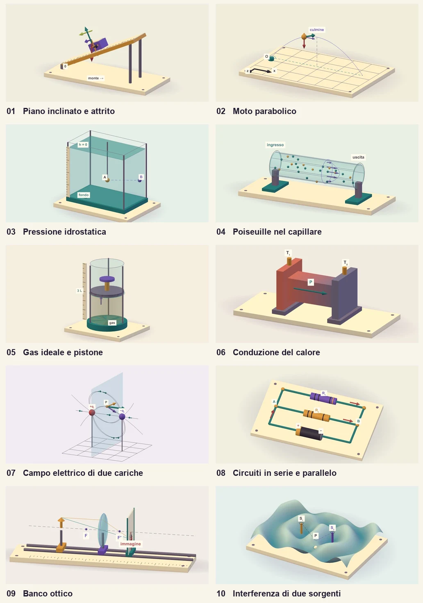

# Biblioteca dei laboratori 3D

Le 56 lezioni offrono una simulazione 3D per ciascuna delle 181 voci di programma. Dal paragrafo puoi prevedere un risultato, variare una grandezza, misurarne un’altra e mettere alla prova il calcolo con due esercizi corretti. Il catalogo ospita anche dieci banchi di approfondimento con 20 problemi e i cinque laboratori guidati dell’Officina. [Apri il catalogo locale](http://127.0.0.1:8847/#laboratori) · [Mappa delle 181 voci](voci.md) · [Schermate e collaudo delle voci](esperienze.md)

## Accesso e collegamenti

Dal menu principale scegli **Simulazioni 3D**. Puoi cercare una parola, come **lente**, oppure sfogliare le voci per corso e lezione. Ogni lezione ha un pulsante sotto il titolo. Nei laboratori guidati trovi i collegamenti alle simulazioni 3D della lezione. Nel banco ottico puoi aprire entrambi gli esperimenti sulle lenti e, al ritorno, riprendere con la distanza e le note che avevi impostato. [Le due simulazioni di ottica](http://127.0.0.1:8847/#laboratori/C5/C5-L10) · [Ricerca su smartphone](prove-voci/ricerca-lente-mobile.jpg) · [Banco ottico su desktop](prove-voci/banco-ottico-collegamenti-desktop.jpg)

Nell’anteprima sul Mac i due banchi C2 sono aperti subito. Per i corsi riservati, in modalità verifica il pulsante **Apri un quaderno di prova** apre il materiale richiesto. Per avviare la stessa versione da una copia del repository, eseguire `python3 app.py serve --port 8847` dalla cartella dell’app. I collegamenti locali qui sotto puntano a quell’istanza.

Tutte le voci hanno un ingresso nella propria lezione. In 77 voci trovi anche uno o più richiami ai dieci banchi estesi, per 79 osservazioni aggiuntive. Ai banchi estesi portano anche 26 esempi e 85 quesiti. Il ritorno dalla simulazione riapre il paragrafo di origine. Nelle prove con correzione differita gli aiuti compaiono dopo la consegna. Le osservazioni si possono salvare nel quaderno esistente. [Mappa delle 181 voci](voci.md)

Il catalogo editoriale dei banchi di approfondimento raccoglie 40 progetti, di cui dieci disponibili. [Catalogo degli approfondimenti](catalogo.md)

## Banchi, modelli e verifiche

Per ciascun banco le schermate mostrano lo stesso esperimento sui tre viewport. Le lezioni aggiuntive, gli esempi e i quesiti sono elencati per ID. Tutti usano geometrie procedurali originali e il renderer Three.js r180 con OrbitControls locale. I circuiti e la lente riusano anche i modelli C4 e C5 già presenti nell’app. [Origine del motore, dipendenze e licenze](fonti.md) · [Test scientifici](../../tests/banchi.test.js) · [Test browser](../../tests/browser-banchi.mjs)

### LAB3D-01 · Piano inclinato e attrito

Quanta trazione serve per impedire al blocco di scivolare? [Apri il banco](http://127.0.0.1:8847/#banco/LAB3D-01)

- **Modello.** Equilibrio normale, soglia statica e seconda legge lungo il piano. [Equazioni e letture](../../static/js/banchi/modelli/piano.js) · [Apparato tridimensionale](../../static/js/banchi/scene/piano.js)
- **Lezione principale.** C1-L005. Lezioni collegate nell’indice completo della voce · C1-L005, C1-L006, C1-L001, C1-L002. [Lezione nell’app](http://127.0.0.1:8847/#materiale/C1-L005/C1)
- **Esempi svolti.** C1-E009, C1-E011, C1-E003, C1-E010.
- **Esercizi della banca.** C1-Q050, C1-Q051, C1-Q052, C1-Q011, C1-Q016, C1-Q042, C1-Q044, C1-Q046, C1-Q049, C1-Q053, C1-Q058.
- **Controlli scientifici.** Soglia statica, segno nella partenza verso monte e valle, normale e accelerazione a 30°, distanza di arresto della misura.
- **Limiti del modello.** Blocco puntiforme inizialmente fermo, piano rigido, g uniforme, forza parallela e μd ≤ μs. La lettura termina dopo 0,8 m. La freccia di accelerazione indica il verso, le intensità si leggono in unità diverse da quelle delle forze.
- **Prove in browser.** Interazione, letture dopo rotazione, reset, rilascio WebGL e percorso con WebGL disattivato. [Desktop](prove/LAB3D-01-desktop.jpg) · [Tablet](prove/LAB3D-01-tablet.jpg) · [Smartphone](prove/LAB3D-01-mobile.jpg)

### LAB3D-02 · Moto parabolico

Quale componente della velocità cambia quando una pallina lascia la mano? [Apri il banco](http://127.0.0.1:8847/#banco/LAB3D-02)

- **Modello.** Composizione di moto uniforme orizzontale e verticale con g costante. [Equazioni e letture](../../static/js/banchi/modelli/volo.js) · [Apparato tridimensionale](../../static/js/banchi/scene/volo.js)
- **Lezione principale.** C1-L004. Lezioni collegate nell’indice completo della voce · C1-L004, C1-L003, C1-L008, C6-L01. [Lezione nell’app](http://127.0.0.1:8847/#materiale/C1-L004/C1)
- **Esempi svolti.** C1-E007.
- **Esercizi della banca.** C1-Q032, C1-Q034, C1-Q035, C1-Q033.
- **Controlli scientifici.** Tempo di volo e quota al culmine, gittata e conservazione dell’energia a tre azimut, limiti orizzontale e verticale.
- **Limiti del modello.** Pallina in gravità uniforme, partenza e arrivo alla stessa quota. La durata si annulla per un rilascio orizzontale dal piano di arrivo. Le scale spaziali si adattano al lancio.
- **Prove in browser.** Interazione, letture dopo rotazione, reset, rilascio WebGL e percorso con WebGL disattivato. [Desktop](prove/LAB3D-02-desktop.jpg) · [Tablet](prove/LAB3D-02-tablet.jpg) · [Smartphone](prove/LAB3D-02-mobile.jpg)

### LAB3D-03 · Pressione idrostatica

Due sonde alla stessa profondità leggono la stessa pressione? [Apri il banco](http://127.0.0.1:8847/#banco/LAB3D-03)

- **Modello.** p = p₀ + ρgh. [Equazioni e letture](../../static/js/banchi/modelli/stevino.js) · [Apparato tridimensionale](../../static/js/banchi/scene/stevino.js)
- **Lezione principale.** C2-L002. Lezioni collegate nell’indice completo della voce · C2-L002, C2-L001, C2-L003, C6-L05, C1-L001. [Lezione nell’app](http://127.0.0.1:8847/#materiale/C2-L002/C2)
- **Esempi svolti.** C2-E003, C2-E004, C2-E002.
- **Esercizi della banca.** C2-Q011, C2-Q012, C2-Q014, C2-Q004, C2-Q006, C2-Q019.
- **Controlli scientifici.** Pressione alla superficie e al fondo, inversione di h, conversione Pa/kPa e indipendenza della pressione relativa da p₀.
- **Limiti del modello.** Fluido omogeneo in quiete. Entrambe le sonde laterali hanno la profondità impostata, la terza presa si trova a 2 m.
- **Prove in browser.** Interazione, letture dopo rotazione, reset, rilascio WebGL e percorso con WebGL disattivato. [Desktop](prove/LAB3D-03-desktop.jpg) · [Tablet](prove/LAB3D-03-tablet.jpg) · [Smartphone](prove/LAB3D-03-mobile.jpg)

### LAB3D-04 · Poiseuille nel capillare

Quanto conta il raggio a pressione fissata e a portata fissata? [Apri il banco](http://127.0.0.1:8847/#banco/LAB3D-04)

- **Modello.** Poiseuille, profilo laminare e controllo di Reynolds. [Equazioni e letture](../../static/js/banchi/modelli/tubo.js) · [Apparato tridimensionale](../../static/js/banchi/scene/tubo.js)
- **Lezione principale.** C2-L007. Lezioni collegate nell’indice completo della voce · C2-L007, C2-L008, C2-L005, C6-L02, C6-L04, C1-L001. [Lezione nell’app](http://127.0.0.1:8847/#materiale/C2-L007/C2)
- **Esempi svolti.** C2-E014, C2-E015, C2-E016, C2-E013.
- **Esercizi della banca.** C2-Q071, C2-Q075, C2-Q076, C2-Q062, C2-Q063, C2-Q064, C2-Q065, C2-Q066, C2-Q067, C2-Q068, C2-Q072, C2-Q073, C2-Q074, C2-Q078.
- **Controlli scientifici.** Integrale numerico del profilo uguale a Q, velocità al centro e alla parete, due regolazioni della pompa, fattore 16 e Reynolds.
- **Limiti del modello.** Fluido newtoniano, tubo rigido con ingresso già sviluppato. In prossimità della transizione la soglia è indicativa. Sopra soglia vengono sospesi i traccianti e il profilo. L’asse e il raggio hanno scale grafiche distinte.
- **Prove in browser.** Interazione, letture dopo rotazione, reset, rilascio WebGL e percorso con WebGL disattivato. [Desktop](prove/LAB3D-04-desktop.jpg) · [Tablet](prove/LAB3D-04-tablet.jpg) · [Smartphone](prove/LAB3D-04-mobile.jpg)

### LAB3D-05 · Gas ideale e pistone

Come cambia la pressione quando il pistone dimezza il volume a temperatura costante? [Apri il banco](http://127.0.0.1:8847/#banco/LAB3D-05)

- **Modello.** pV = nRT in stati di equilibrio. [Equazioni e letture](../../static/js/banchi/modelli/gas.js) · [Apparato tridimensionale](../../static/js/banchi/scene/gas.js)
- **Lezione principale.** C3-L02. Lezioni collegate nell’indice completo della voce · C3-L02, C3-L07, C3-L01, C1-L001. [Lezione nell’app](http://127.0.0.1:8847/#materiale/C3-L02/C3)
- **Esempi svolti.** C3-E003, C3-E004.
- **Esercizi della banca.** C3-Q011, C3-Q012, C3-Q015, C3-Q013, C3-Q014, C3-Q016, C3-Q017, C3-Q018, C3-Q019, C3-Q020, C3-Q061.
- **Controlli scientifici.** Legge di Boyle, variazione isocora e delle moli, equivalenza fra kPa·L e joule.
- **Limiti del modello.** Stati di equilibrio di un gas ideale. La curva è l’isoterma dello stato selezionato. Il moto del pistone imposta un volume e non integra una dinamica molecolare.
- **Prove in browser.** Interazione, letture dopo rotazione, reset, rilascio WebGL e percorso con WebGL disattivato. [Desktop](prove/LAB3D-05-desktop.jpg) · [Tablet](prove/LAB3D-05-tablet.jpg) · [Smartphone](prove/LAB3D-05-mobile.jpg)

### LAB3D-06 · Conduzione del calore

Allungando la barra, come cambiano il gradiente e la potenza trasferita? [Apri il banco](http://127.0.0.1:8847/#banco/LAB3D-06)

- **Modello.** Fourier in regime stazionario, profilo lineare. [Equazioni e letture](../../static/js/banchi/modelli/calore.js) · [Apparato tridimensionale](../../static/js/banchi/scene/calore.js)
- **Lezione principale.** C3-L05. Lezioni collegate nell’indice completo della voce · C3-L05, C1-L001. [Lezione nell’app](http://127.0.0.1:8847/#materiale/C3-L05/C3)
- **Esempi svolti.** C3-E009, C3-E010.
- **Esercizi della banca.** C3-Q042, C3-Q044, C3-Q045, C3-Q047, C3-Q049.
- **Controlli scientifici.** Flusso per unità di superficie, potenza ai due estremi, isolamento a ΔT = 0, inversione di L, inversione del verso.
- **Limiti del modello.** Conduzione unidimensionale stazionaria con k costante, fianchi isolati e termostati ideali. In assenza di differenza termica la misura non determina lo spessore.
- **Prove in browser.** Interazione, letture dopo rotazione, reset, rilascio WebGL e percorso con WebGL disattivato. [Desktop](prove/LAB3D-06-desktop.jpg) · [Tablet](prove/LAB3D-06-tablet.jpg) · [Smartphone](prove/LAB3D-06-mobile.jpg)

### LAB3D-07 · Campo elettrico di due cariche

Tra due cariche, dove si annullano il campo o il potenziale? [Apri il banco](http://127.0.0.1:8847/#banco/LAB3D-07)

- **Modello.** Somma vettoriale dei campi e scalare dei potenziali. [Equazioni e letture](../../static/js/banchi/modelli/campo.js) · [Apparato tridimensionale](../../static/js/banchi/scene/campo.js)
- **Lezione principale.** C4-L02. Lezioni collegate nell’indice completo della voce · C4-L01, C4-L02, C4-L03, C1-L002, C1-L001. [Lezione nell’app](http://127.0.0.1:8847/#materiale/C4-L02/C4)
- **Esempi svolti.** C4-E003, C4-E001, C4-E005.
- **Esercizi della banca.** C4-Q014, C4-Q018, C4-Q011, C4-Q012, C4-Q013, C4-Q015, C4-Q017.
- **Controlli scientifici.** Sovrapposizione in tre dimensioni, cancellazione al punto medio, dipolo con V = 0 ed E ≠ 0, legge 1/r², sorgente spenta e singolarità.
- **Limiti del modello.** Cariche puntiformi nel vuoto. Sulla sorgente il valore è indefinito. Le linee usano passi finiti e l’equipotenziale è interpolata su un volume limitato. La lettura numerica alla sonda usa l’equazione analitica.
- **Prove in browser.** Interazione, letture dopo rotazione, reset, rilascio WebGL e percorso con WebGL disattivato. [Desktop](prove/LAB3D-07-desktop.jpg) · [Tablet](prove/LAB3D-07-tablet.jpg) · [Smartphone](prove/LAB3D-07-mobile.jpg)

### LAB3D-08 · Circuiti in serie e parallelo

Quali resistori condividono la tensione e dove si divide la corrente? [Apri il banco](http://127.0.0.1:8847/#banco/LAB3D-08)

- **Modello.** Ohm, rami, potenze e leggi di Kirchhoff. [Equazioni e letture](../../static/js/banchi/modelli/circuito.js) · [Apparato tridimensionale](../../static/js/banchi/scene/circuito.js)
- **Lezione principale.** C4-L06. Lezioni collegate nell’indice completo della voce · C4-L06, C4-L05, C6-L02, C6-L03. [Lezione nell’app](http://127.0.0.1:8847/#materiale/C4-L06/C4)
- **Esempi svolti.** C4-E011, C4-E012, C4-E009.
- **Esercizi della banca.** C4-Q055, C4-Q058, C4-Q059, C4-Q051, C4-Q052, C4-Q053, C4-Q054, C4-Q056, C4-Q057, C4-Q060.
- **Controlli scientifici.** Due topologie, correnti dei rami, maglie, potenze e generatore a U = 0. Cambio serie/parallelo provato anche nel browser.
- **Limiti del modello.** Resistori ohmici e sorgente ideali in corrente continua. Le frecce indicano il verso convenzionale, la velocità di deriva degli elettroni non è simulata.
- **Prove in browser.** Interazione, letture dopo rotazione, reset, rilascio WebGL e percorso con WebGL disattivato. [Desktop](prove/LAB3D-08-desktop.jpg) · [Tablet](prove/LAB3D-08-tablet.jpg) · [Smartphone](prove/LAB3D-08-mobile.jpg)

### LAB3D-09 · Banco ottico

In quale punto puoi raccogliere un’immagine su uno schermo? [Apri il banco](http://127.0.0.1:8847/#banco/LAB3D-09)

- **Modello.** Lente convergente sottile e ingrandimento con segno. [Equazioni e letture](../../static/js/banchi/modelli/lente.js) · [Apparato tridimensionale](../../static/js/banchi/scene/lente.js)
- **Lezione principale.** C5-L10. Lezioni collegate nell’indice completo della voce · C5-L10, C6-L06. [Lezione nell’app](http://127.0.0.1:8847/#materiale/C5-L10/C5)
- **Esempi svolti.** C5-E019, C5-E020.
- **Esercizi della banca.** C5-Q093, C5-Q094, C5-Q098, C5-Q091, C5-Q092, C5-Q095, C5-Q096, C5-Q097, C5-Q099, C5-Q100.
- **Controlli scientifici.** Intersezione indipendente delle rette, segno e ingrandimento, lente a 2f, immagine virtuale, schermo a fuoco e p = f.
- **Limiti del modello.** Lente sottile convergente, raggi parassiali. Altezza ingrandita di 7,7 volte rispetto alle ascisse. Lo schermo intercetta i raggi. Le immagini fuori dal banco e il caso all’infinito si leggono nei valori.
- **Prove in browser.** Interazione, letture dopo rotazione, reset, rilascio WebGL e percorso con WebGL disattivato. [Desktop](prove/LAB3D-09-desktop.jpg) · [Tablet](prove/LAB3D-09-tablet.jpg) · [Smartphone](prove/LAB3D-09-mobile.jpg)

### LAB3D-10 · Interferenza di due sorgenti

Le oscillazioni delle due sorgenti si sommano o si cancellano alla sonda? [Apri il banco](http://127.0.0.1:8847/#banco/LAB3D-10)

- **Modello.** Somma armonica con differenza di cammino e fase. [Equazioni e letture](../../static/js/banchi/modelli/onde.js) · [Apparato tridimensionale](../../static/js/banchi/scene/onde.js)
- **Lezione principale.** C5-L03. Lezioni collegate nell’indice completo della voce · C5-L03, C5-L01, C5-L02. [Lezione nell’app](http://127.0.0.1:8847/#materiale/C5-L03/C5)
- **Esempi svolti.** C5-E005, C5-E006.
- **Esercizi della banca.** C5-Q021, C5-Q023, C5-Q025, C5-Q022, C5-Q024, C5-Q028, C5-Q030.
- **Controlli scientifici.** Nodi e ventri, quadratura a 90°, periodicità, sfasamento di cammino, ampiezza ottenuta dal valore quadratico medio.
- **Limiti del modello.** Due onde armoniche coerenti di uguale ampiezza costante nel campo di misura. Si trascurano smorzamento e divergenza geometrica. L’altezza della superficie è amplificata, le letture sono in millimetri.
- **Prove in browser.** Interazione, letture dopo rotazione, reset, rilascio WebGL e percorso con WebGL disattivato. [Desktop](prove/LAB3D-10-desktop.jpg) · [Tablet](prove/LAB3D-10-tablet.jpg) · [Smartphone](prove/LAB3D-10-mobile.jpg)

Il circuito si può confrontare nei due collegamenti. Nel banco ottico si distinguono l’immagine sullo schermo e i prolungamenti tratteggiati dell’immagine virtuale. Per le onde si può fissare una sonda su un nodo e cambiare piano di osservazione. [Serie](prove/circuito-serie.jpg) · [Lente laterale](prove/lente-laterale.jpg) · [Lente virtuale](prove/lente-virtuale.jpg) · [Onde dall’alto](prove/onde-pianta.jpg) · [Sezione alla sonda](prove/onde-sezione.jpg)

## Architettura

I dieci record `bench` sono edizioni native in SQLite. Ogni record indica corso, competenza, prerequisiti, domande e collegamenti. Una lezione riceve solo i richiami ai paragrafi che la riguardano. Gli stati futuri del catalogo esistono nella documentazione editoriale. [Registro distribuito](../../content/banchi.json)

Il modulo di un singolo modello calcola grandezze in unità dichiarate, funzioni del tempo e curve. Le scene consumano queste letture senza modificare gli ingressi fisici. Il tempo di simulazione viene dai timestamp dei fotogrammi visibili. La riproduzione inizia su richiesta, anche con riduzione del movimento attiva. Con la camera ortografica puoi ruotare e ingrandire tramite mouse, touch e tastiera. La perdita del contesto passa alla tavola di misura con controlli, grafici, formule, verifica e trasferimento. [Gestione del banco](../../static/js/banchi/banco.js) · [Ciclo di vita WebGL](../../static/js/banchi/scena.js) · [Tavola su smartphone](prove/alternativa-mobile.jpg)

Le pagine di lettura caricano i collegamenti testuali. Il motore WebGL, il modello e la scena selezionata si caricano aprendo il banco. Un osservatore del viewport e lo stato di visibilità del documento sospendono il disegno e il tempo a banco nascosto. All’uscita vengono scollegati osservatori e controlli, eliminate geometrie, texture e materiali e rilasciato il contesto.

[Misure, comandi riproducibili ed esiti delle regressioni](collaudo.md)
