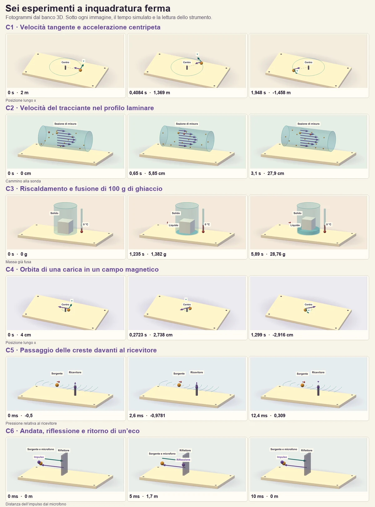

# I laboratori di ogni capitolo

Nella home di Cric scegli **Laboratori 3D per capitolo**. Puoi cercare un fenomeno per nome oppure aprire un corso e scegliere il capitolo. Dentro **Lezioni**, il pulsante accanto a ciascun titolo mostra quanti laboratori contiene. Nell’installazione di verifica il quaderno di prova dà accesso anche alle lezioni riservate. Nel testo della lezione, sotto il paragrafo che introduce il fenomeno, trovi il nome della voce e la domanda da esplorare. **Torna all’attività** riporta allo stesso passaggio. [Apri la biblioteca nell’app locale](http://127.0.0.1:8847/#laboratori) · [Indice di un capitolo](indice-capitolo.webp) · [Collegamento nel paragrafo su smartphone](voce-nella-lezione-mobile.webp)

Le 181 voci pubblicate nei 56 capitoli corrispondono una per una a 181 laboratori con un proprio identificatore, domanda, legge di misura e verifica. I laboratori condividono 57 tipi di apparato. In C6 lo studente trova anche tutti i capitoli dei primi cinque corsi, con gli stessi modelli e le stesse unità. [Indice delle singole voci e collegamenti](../voci.md) · [Misure verificate per tutte le voci](verifica.csv)

| Corso | Capitoli propri | Laboratori propri | Con orologio | A confronto di configurazioni | Schermate di ogni voce |
| --- | ---: | ---: | ---: | ---: | --- |
| [C1 · Strumenti e meccanica](http://127.0.0.1:8847/#laboratori/C1) | 10 | 42 | 14 | 28 | [Desktop](../prove-voci/C1.webp) · [Smartphone](C1-mobile.webp) |
| [C2 · Fluidi](http://127.0.0.1:8847/#laboratori/C2) | 10 | 41 | 4 | 37 | [Desktop](../prove-voci/C2.webp) · [Smartphone](C2-mobile.webp) |
| [C3 · Termodinamica](http://127.0.0.1:8847/#laboratori/C3) | 10 | 36 | 7 | 29 | [Desktop](../prove-voci/C3.webp) · [Smartphone](C3-mobile.webp) |
| [C4 · Elettricità e magnetismo](http://127.0.0.1:8847/#laboratori/C4) | 10 | 29 | 5 | 24 | [Desktop](../prove-voci/C4.webp) · [Smartphone](C4-mobile.webp) |
| [C5 · Onde, ottica e radiazioni](http://127.0.0.1:8847/#laboratori/C5) | 10 | 27 | 10 | 17 | [Desktop](../prove-voci/C5.webp) · [Smartphone](C5-mobile.webp) |
| [C6 · Raccordi del percorso completo](http://127.0.0.1:8847/#laboratori/C6) | 6 | 6 | 4 | 2 | [Desktop](../prove-voci/C6.webp) · [Smartphone](C6-mobile.webp) |
| **Totale delle voci distinte** | **56** | **181** | **44** | **137** | |

## Cosa fa lo studente

Durante **Prevedi** formula un’ipotesi. In **Osserva** legge un’indicazione scritta per il fenomeno e la confronta con la scena. In **Esplora** può cambiare il parametro, l’inquadratura e fissare una sua misura A. La misura B risponde al comando del banco. Le due tavole usano la stessa scala e riportano il valore e l’unità di ciascuna lettura. In **Comprendi** può aprire le sostituzioni numeriche e seguire la differenza B − A. In **Verifica** trova un problema di misura e uno di trasferimento. Complessivamente ci sono 181 previsioni e 362 problemi con correzione. I dieci banchi di approfondimento e i cinque laboratori guidati sono accessibili separatamente. [Banco su desktop](banco-desktop.webp) · [Banco su smartphone](banco-mobile.webp) · [Confronto delle due misure su smartphone](due-misure-mobile.webp)

I 44 modelli temporali espongono pausa, scelta dell’istante e velocità di riproduzione. Nel moto circolare, per esempio, la posizione cambia mentre la velocità rimane tangente. Nell’eco la parete resta ferma e si muove l’impulso. La scala dell’orologio è indicata anche per millisecondi, nanosecondi, femtosecondi ed emivite. Negli altri 137 laboratori lo studente confronta stati, geometrie o costruzioni. Nel banco della capillarità, per esempio, può portare l’angolo attraverso 90° e vedere il menisco passare dalla risalita alla depressione rispetto al serbatoio. [Moto circolare](http://127.0.0.1:8847/#banco/SIM-C1-L004-04) · [Eco](http://127.0.0.1:8847/#banco/SIM-C6-L01-01) · [Tre istanti dell’eco](eco-in-tre-istanti.webp) · [Capillarità](http://127.0.0.1:8847/#banco/SIM-C2-L010-03)



## Che cosa ha verificato il collaudo

- L’indice dei capitoli e la copertura delle lezioni coincidono. Sono stati controllati 362 valori di riferimento già presenti nei dati e 2.838 impostazioni ammesse dei controlli. Per gli apparati i test confrontano anche geometria, segni e unità con risultati ricavati separatamente, fra cui gli esempi qui sotto.
- Nel moto circolare la velocità è ortogonale al raggio e l’accelerazione punta verso il centro. Nell’urto anelastico di due carrelli uguali, di cui uno inizialmente fermo, dopo il contatto la distanza fra i centri resta costante e la velocità comune è la metà di quella iniziale con lo stesso segno. [Moto circolare, OpenStax](https://openstax.org/books/university-physics-volume-1/pages/4-4-uniform-and-nonuniform-circular-motion)
- Nel tubo laminare la sonda a metà raggio misura il 75% della velocità sull’asse. Alla parete lo spostamento del tracciante è zero. In un circuito di convezione con 10 g di fluido e portata di 2 g/s, in 5 s transitano 10 g. Nell’isoterma si conserva il prodotto pV e nell’adiabatica reversibile del banco si conserva il prodotto pV<sup>γ</sup>. [Processi termodinamici, OpenStax](https://openstax.org/books/university-physics-volume-2/pages/3-4-thermodynamic-processes)
- Per la particella carica che entra perpendicolarmente al campo, raddoppiare B dimezza raggio e periodo. Nella bobina il segno della fem è opposto alla derivata del flusso concatenato. [Moto di una particella in un campo magnetico, OpenStax](https://openstax.org/books/university-physics-volume-2/pages/11-3-motion-of-a-charged-particle-in-a-magnetic-field)
- Nel Doppler ogni cresta parte dalla posizione della sorgente al momento dell’emissione e raggiunge il microfono a un massimo del segnale. Con un ritardo di eco di 10 ms e una velocità del suono di 340 m/s, il segnale tocca la parete a 1,7 m dopo 5 ms e ritorna al microfono dopo 10 ms. [Velocità del suono, OpenStax](https://openstax.org/books/university-physics-volume-1/pages/17-2-speed-of-sound)

I controlli browser aprono ciascun laboratorio dal paragrafo della lezione, provano entrambe le misure, fissano e ripristinano il riferimento, risolvono i due problemi e tornano alla voce di partenza. La matrice comprende Chromium e WebKit con tre viewport WebGL (1440 × 960, 810 × 1080 e 390 × 844) e una quarta configurazione a 390 × 844 con WebGL disattivato. Il totale è di 1.448 percorsi. Per i 43 orologi delle simulazioni di lezione si confrontano anche fotogrammi a tempo imposto e a camera ferma. La suite dei cinque esperimenti guidati verifica separatamente l’induzione C4, che usa il motore temporale dei cinque esempi guidati. [Letture effettive nelle otto configurazioni](verifica.csv)

La prima esecuzione parallela ha raggiunto il timeout nel confronto del ciclo termodinamico C3 su Chromium mobile e nel ripristino della vista del dielettrico C4 su WebKit tablet. Il collaudo è ripreso dalle stesse voci con gli stessi controlli. Per completare la tabella sono state rilette nel browser le misure A e B dei percorsi già superati.

Durante le prove successive, il caricamento tardivo di due figure poteva spostare il collegamento mentre lo studente lo toccava. Con il download della figura ritardato apposta in WebKit, il link si spostava di 141 px nella lezione sull’energia di C1 e di 213 px nella lezione sul condensatore di C4. Lo spazio della figura ora è riservato all’apertura. Nelle stesse due prove lo spostamento misurato è stato di 0 px e il collegamento ha aperto il laboratorio giusto.

Le schermate provengono da browser su Mac con viewport e interazione touch emulati. La verifica della comprensione con studenti e le misure su dispositivi fisici richiedono una prova sul campo. [Cinque filmati delle esperienze guidate e confronto con l’interfaccia precedente](../movimento/README.md)

## Riprodurre i controlli

Dalla cartella dell’app, con le dipendenze di test e i browser Playwright installati, questi comandi avviano server su porte temporanee e usano archivi di prova separati.

```sh
python3 -m unittest discover -s tests -p 'test_*.py'
node --test tests/*.test.js
python3 tools/validate_bank.py
node tools/check-formulas.cjs
ASTRA_BROWSER=chromium ASTRA_SHOTS=var/capitoli/chromium node tests/browser-esperienze.mjs
ASTRA_BROWSER=webkit ASTRA_GALLERY=1 ASTRA_SHOTS=var/capitoli/webkit node tests/browser-esperienze.mjs
ASTRA_CLOCKS=1 ASTRA_VIEW=mobile ASTRA_BROWSER=chromium ASTRA_RESULTS=var/capitoli/orologi-chromium node tests/browser-esperienze.mjs
ASTRA_CLOCKS=1 ASTRA_VIEW=mobile ASTRA_BROWSER=webkit ASTRA_RESULTS=var/capitoli/orologi-webkit node tests/browser-esperienze.mjs
node tests/browser-banchi.mjs
ASTRA_BROWSER=chromium node tests/browser-movimento.mjs
ASTRA_BROWSER=webkit node tests/browser-movimento.mjs
node tests/browser.mjs
node tests/editor.mjs
```
