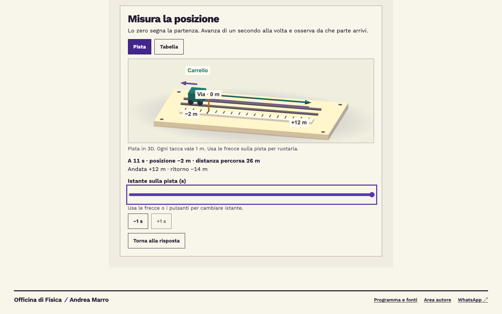
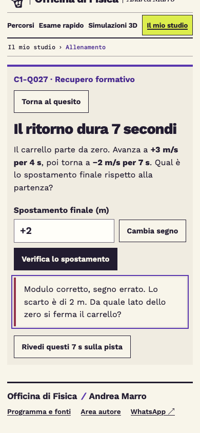
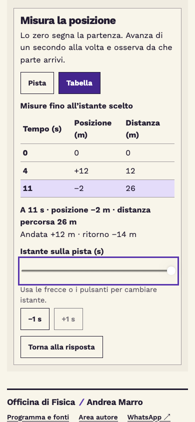

# Il ritorno di sette secondi

**Un quesito, una variante facoltativa.** Nell’allenamento di C1 apri **Esercizi prioritari → Aree di segno opposto → Inizia il quesito**. Dopo una risposta errata al quesito ufficiale, scegli **Prova il ritorno di 7 s**. La durata dell’andata è ancora 4 s. Il nuovo ritorno dura 7 s. Lo studente può fare una previsione, verificarla, osservare la pista un secondo alla volta e cambiare la risposta. [Specifica di Campo approvata nella PR 340](https://github.com/AndreaMarro/ardesia/blob/abb25af1a5c48a7ebd9b3ad9e0b22fcb3332f5ad/docs/proposte/officina-fisica/1.0/revisione/integrazione.md)

## Una lettura per il docente

Nel caso ufficiale il carrello avanza di 3 × 4 = 12 m e arretra di 2 × 5 = 10 m. Termina 2 m a destra della partenza. Nella variante avanza degli stessi 12 m e arretra di 2 × 7 = 14 m. La posizione finale è 12 − 14 = −2 m. Le distanze di andata e ritorno si sommano e danno 12 + 14 = 26 m.

| Istante | Posizione rispetto allo zero | Distanza percorsa | Cosa osservare |
| --- | --- | --- | --- |
| 0 s | 0 m | 0 m | La tacca della partenza è fissa. |
| 4 s | +12 m | 12 m | Il carrello inverte il verso. |
| 9 s | +2 m | 22 m | Qui terminava il moto ufficiale. Nella variante restano due secondi. |
| 10 s | 0 m | 24 m | Il carrello attraversa la partenza. |
| 11 s | −2 m | 26 m | Il carrello si trova a sinistra dello zero. |

L’invio di **+2** riceve «Modulo corretto, segno errato» e la domanda sul lato dello zero. L’invio di **26** richiama la distinzione tra distanza percorsa e spostamento. Con **−2** il riscontro ricompone i due tratti. Per osservare il ragionamento, il docente può chiedere «In quale secondo ripassi dalla partenza? Come lo sai?» e accettare la spiegazione a voce, su carta o indicando la pista.

## Ripresa, accesso e stati

| Stato visibile | Gesto e conseguenza al rientro nella stessa scheda |
| --- | --- |
| Bozza | Ogni modifica richiede **Verifica lo spostamento**, anche se si riscrive la stessa cifra. Il campo riprende il testo digitato. Si può rileggere l’ultimo invio separatamente. |
| Errore verificato | La ricarica riapre il caso con il numero e il motivo dell’errore. Si può aprire la pista e alternarla alla tabella. Vista e istante sopravvivono alla ricarica. |
| Correzione verificata | La ricarica ripristina la spiegazione. **Torna al quesito** riporta al comando di partenza e al medesimo indice, anche in un allenamento con più quesiti. |

Il server autorizza il tentativo con il cookie della sessione, il proprietario e il diritto attuale sul corso. Consegna i parametri della variante solo per un errore ufficiale inviato in pratica C1, edizione 2 di C1-Q027. Gli esami, anche conclusi, e le altre modalità seguono il loro flusso di valutazione. L’indice della bozza contiene un identificatore di sessione derivato, il tentativo, il quesito, l’edizione e la variante. Ogni invio formativo conserva separatamente l’esito e l’uso di aiuti precedente a quell’invio. Anche un aiuto consultato dopo l’invio viene ricordato.

La bozza usa `sessionStorage` nella scheda. Il logout pulisce le bozze del recupero e avvisa le schede aperte della stessa origine. Al riaccesso il server assegna una chiave di sessione distinta. Se il browser impedisce di salvare, un messaggio permette di proseguire in memoria. Il registro ufficiale mantiene l’invio originario e continua ad alimentare voti, esposizioni e padronanza. [Politica del server](../../server/application/formative.py) · [Persistenza e transizioni](../../static/js/recupero/bozza.js)

## Modello e rappresentazioni

`traiettoria({origin, legs})` accetta una posizione iniziale in metri e una sequenza di velocità costanti in m/s con durate positive in secondi. `at(t)` restituisce posizione, spostamento dall’origine, distanza cumulata e velocità, senza dipendere dal DOM o dal salvataggio. All’istante di inversione la posizione è continua e la velocità è quella del tratto che inizia. La pista 3D riusa il binario dell’Officina. La pista piana mostra la proiezione lungo un solo asse. Entrambe, la tabella e la lettura in parole interrogano lo stesso moto all’istante scelto. [Calcolo](../../static/js/recupero/cinematica.js) · [Pista e scala](../../static/js/recupero/pista.js) · [Interazione](../../static/js/recupero/campo.js)

## Risultati tecnici

| Verifica | Cosa viene osservato |
| --- | --- |
| Fisica | Confronto del modello delle due durate con un’integrazione indipendente a passi di mezzo secondo. Casi di sosta, origine traslata, decimali e tempi fuori dominio. |
| Ripresa e permessi | Errori, modifiche, invii assistiti e autonomi, cambio di quesito, secondo tentativo e logout da una seconda scheda. Il test HTTP esercita anche ospite, altro proprietario, nuova sessione e revoca del corso. |
| Registro e C6 | Confronto di tutti i campi di tentativo, attività ed esposizioni prima e dopo il percorso. La suite generale esegue anche l’esame C6. Il test HTTP verifica esclusione e punteggio sui tre fascicoli. |
| Browser e rendering | Chromium 1440 × 900 con WebGL2 e perdita forzata del contesto. Chromium 320 × 740 e WebKit 1440 × 900 e 390 × 844 con WebGL disattivato. A 4 e 11 s il test confronta anche la posizione del carrello nei pixel renderizzati. |
| Uso da tastiera | Avanzamento con frecce o pulsanti, campo con segno ASCII o tipografico, focus sul riscontro dopo l’invio, sul cursore alla ripresa della pista e sul campo al ritorno. Se il canvas ha il focus quando WebGL si interrompe, il cursore del tempo riceve il focus allo stesso istante. Etichetta e tabella verificate nell’albero di accessibilità. |
| Leggibilità | Dodici scansioni axe su errore ripristinato, pista e tabella, più controllo dell’overflow a 320 px con testo al 200%. Per il contrasto che axe demanda alla verifica visiva sull’SVG, le etichette hanno rapporto 14,1∶1 e le frecce 5,7∶1 e 7,5∶1 sul fondo. Unità, valori, senso delle frecce e testo rendono leggibile il moto anche senza il colore. |

Le schermate provengono dal percorso nell’applicazione. Il verbale JSON registra motore, viewport, istanti osservati e controlli che richiedono una lettura manuale. In GitHub Actions il job **collaudo** conserva anche gli altri fotogrammi nell’artefatto dell’esecuzione. [Misure per browser](prove/esiti.json) · [Suite browser](../../tests/browser-recupero-campo.mjs) · [Test del modello](../../tests/recupero-campo.test.js) · [Test HTTP](../../tests/test_workflows.py)

| Pista 3D a 11 s | Errore riaperto sul telefono emulato | Tabella allo stesso istante |
| --- | --- | --- |
| [](prove/pista-desktop.png) | [](prove/ripresa-mobile.png) | [](prove/tabella-mobile.png) |

A 320 px la pista alternativa mostra il righello, la partenza e i due tratti orientati. [Pista piana a 320 px](prove/pista-stretta.png)

Per ripetere il collaudo, dalla cartella `officina-di-fisica/` con Python 3.10+, Node 22 e i browser Playwright installati, eseguire i comandi seguenti. Il test browser crea un archivio temporaneo e scrive il verbale in `var/arch/browser/recupero/`. `ASTRA_RESULTS` sceglie un’altra destinazione e `ASTRA_CHROME` può indicare un eseguibile Chrome locale.

```sh
npm ci
npx playwright install chromium webkit
npm test
npm run test:contracts
python3 -m unittest discover -s tests -v
node tests/browser-recupero-campo.mjs
node tests/browser.mjs
```

## Validazione didattica da svolgere

I test accertano calcolo, resa e transizioni. L’efficacia dell’indizio, il carico di lettura e la capacità di spiegare il segno richiedono osservazioni con studenti. Pista, tabella, ritmo manuale e pausa sono disponibili a tutti, comprese persone con DSA o ADHD. Ogni persona può scegliere il supporto e la modalità di risposta. Il recupero usa esclusivamente le azioni esplicite compiute sul quesito.

1. **Orientamento e ripresa.** Nel pilot della PR 340, osservare se ciascuno trova la pista del caso attivo e, dopo una pausa scelta da lui, sa dire quanto dura il ritorno. Le soglie preliminari sono 10 partecipanti su 12 entro 30 s per la pista e 10 su 12 autonomi alla ripresa. Annotare richieste di aiuto e modalità preferita.
2. **Comprensione immediata.** Raccogliere distintamente il numero, la spiegazione del verso e gli aiuti consultati. Due valutatori osservano se lo studente colloca lo zero fra 9 e 11 s e distingue i 26 m percorsi dallo spostamento di −2 m.
3. **Consolidamento.** A sette giorni proporre un caso nuovo, per esempio +3 m/s per 3 s e −2 m/s per 6 s. Registrare separatamente soluzione (−3 m), spiegazione e aiuto. Per il confronto con la pratica attuale occorre un campione dimensionato.

La revisione del docente, le sessioni con studenti e il collaudo touch con tecnologia assistiva abituale su telefono fisico sono aperti. Il committente ha rinviato la prova sul dispositivo reale. [Protocollo di valutazione](https://github.com/AndreaMarro/ardesia/blob/abb25af1a5c48a7ebd9b3ad9e0b22fcb3332f5ad/docs/proposte/officina-fisica/1.0/revisione/README.md#accessibilit%C3%A0-cognitiva-e-controllo-del-ritmo)
