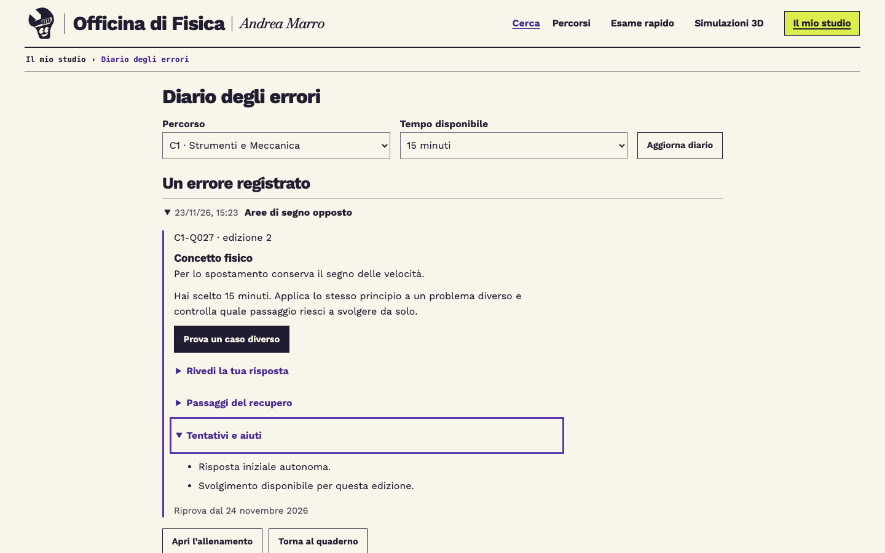
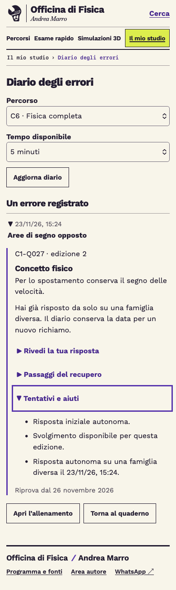

# Diario degli errori dei sei percorsi

## Contratto di accettazione

Base `f31ef847e4772a59c3ba7a0576a9c14ded0cfefa`. La raccolta di 513 quesiti di studio permette già di consultare gli svolgimenti e provare un'altra famiglia. Il quaderno propone fino a cinque raccomandazioni. Il nuovo diario si apre da **Il mio studio** e da **Errori e recupero** e ricostruisce gli errori effettivamente commessi dal lettore. [Base canonica](https://github.com/AndreaMarro/ardesia/commit/f31ef847e4772a59c3ba7a0576a9c14ded0cfefa)

| ID | Invariante | Controprova prima del merge |
| --- | --- | --- |
| D1 | Ogni risposta errata conservata nel quaderno autorizzato ritrova la versione su cui si è risposto, la spiegazione del passaggio, un prerequisito, una rappresentazione e un problema di famiglia diversa. C6 compone i corsi attraverso gli ID originali. | Enumerare i 513 quesiti e i 56 obiettivi di lezione, confrontare le destinazioni con le edizioni distribuite, eseguire un percorso reale per ciascun corso. |
| D2 | Aiuti, letture e soluzioni viste, prova assistita, successo autonomo su altra famiglia e richiamo differito conservano significati separati. Il diario distingue gli errori concettuali, di procedimento, algebra, calcolo, unità e interpretazione secondo la scheda editoriale. | Sequenze datate con risposta ripetuta, indizio, famiglia distinta e richiamo prima e dopo la scadenza. Un successo da solo dà evidenza della risposta data. |
| D3 | Lo studente può scegliere il tempo disponibile e aprire a ritmo manuale ciascun passaggio. La raccomandazione spiega la scelta in base allo storico della competenza, ai prerequisiti, alla difficoltà e alla data. | Cambiare disponibilità, confrontare un primo errore con errori ricorrenti, tornare allo stesso caso e aprire il retest. |
| D4 | Il diario rilegge il registro ufficiale. Ricarica, secondo client, altre edizioni, ritiro di un materiale, logout e revoca rispettano i confini dell’account. Una prova sigillata in corso rimane riservata. Dopo la consegna dell’esame il recupero parte dalla competenza e usa quesiti di studio. | Due account con accesso al medesimo corso, archivio precedente all’incremento, esame iniziato e consegnato, tentativo ritirato. Confrontare i record di valutazione prima e dopo le letture. |
| D5 | La richiesta di nuovo esercizio deriva dalla risposta errata autorizzata. Due invii identici avviano un solo tentativo. L’assenza di alternative viene dichiarata. | Forzare tentativo altrui, domanda originaria, famiglia già vista e richiesta duplicata. Verificare il nuovo quesito senza aprire una chiave di correzione. |
| D6 | Contratto API additivo, un solo registro, massimo 12 errori per pagina. Pista, figura o tabella restano raggiungibili con tastiera e con WebGL disattivato. | Browser Chromium e WebKit, 320 px e desktop, axe sugli stati principali. Con 200 risposte storiche il p95 locale su 20 letture deve restare sotto 400 ms, risposta entro 24 KiB per pagina. |

Il tempo consigliato è una scelta organizzativa del lettore. La categoria identifica il passaggio da controllare previsto dall’autore. Una spiegazione autonoma e il trasferimento fuori dall’app richiedono osservazione didattica separata.

## Dall’errore al richiamo

Una scheda del diario appartiene a una risposta inviata. Il lettore ritrova la consegna, la propria risposta e l’edizione storica. La categoria e il consiglio provengono dalla scheda dell’autore. Un errore di calcolo su un caso concreto può avere diverse cause, quindi lo studente può aprire liberamente la spiegazione, il prerequisito o il modello. Nei fascicoli consegnati compare la sola competenza con un percorso di studio. La selezione del tempo disponibile consente di alternare rilettura e applicazione. [Regole pure](../../server/domain/error_diary.py) · [Scelta e autonomia nelle UDL Guidelines](https://udlguidelines.cast.org/engagement/interests-identities/choice-autonomy/)

Ogni nuovo tentativo ordinario mantiene le regole ufficiali di correzione. Il diario rilegge il registro di correzione, gli indizi aperti e la disponibilità dello svolgimento. Vedere che uno svolgimento è disponibile non permette di stabilire se sia stato letto o compreso. Il richiamo è suggerito dopo un giorno dall’errore, oppure tre giorni dopo una risposta autonoma corretta in una famiglia diversa. Questi intervalli sono una baseline editoriale. Una risposta corretta successiva alla scadenza registra un ripasso. Per distinguere un ulteriore trasferimento occorre anche una terza famiglia risolta senza aiuto. Per cinque obiettivi propri di C6 sono pubblicate solo due famiglie. In quel caso rimane possibile ripassare, e il diario dichiara quando il materiale disponibile è già comparso.

**Scelta del modello.** BKT stima la probabilità di apprendimento di una competenza latente. PFA usa successi e insuccessi per modellare la prestazione. FSRS affronta la pianificazione temporale del richiamo. Applicarli qui richiederebbe, rispettivamente, competenze e parametri calibrati, un insieme di tentativi con esiti futuri tenuti fuori dalla stima, e dati longitudinali di richiamo. La policy corrente spiega il suggerimento con eventi osservabili, la disponibilità e la difficoltà del caso. Lo studio di calibrazione deve confrontare ciascun candidato con questa baseline sullo stesso insieme di studenti tenuti fuori dalla stima. [Corbett e Anderson](https://doi.org/10.1007/BF01099821) · [Pavlik, Cen e Koedinger](https://pact.cs.cmu.edu/koedinger/pubs/AIED%202009%20final%20Pavlik%20Cen%20Keodinger%20corrected.pdf) · [ts-fsrs 6.0.1](https://github.com/open-spaced-repetition/ts-fsrs/releases/tag/v6.0.1)

## Riscontro sul codice

Il contratto D1–D6 è stato fissato in `38ea09af`. Le misure qui sotto sono state eseguite su `9b5dc7e4dab8aa8777108e6657d71d14c1ff0686`. Il verbale sulla PR identifica separatamente la candidata, il suo albero integrato e le relative esecuzioni. [Codice eseguito](https://github.com/AndreaMarro/ardesia/commit/9b5dc7e4dab8aa8777108e6657d71d14c1ff0686)

| ID | Baseline → modifica | Rischio | Test indipendente ed evidenza | SHA | Esito |
| --- | --- | --- | --- | --- | --- |
| D1 | Cinque suggerimenti sintetici → scheda paginata per risposta | Edizione sbagliata o materiale assente | Confrontati via HTTP 513 ID, consegne ed edizioni contro i JSON distribuiti, 43 pagine e 56 obiettivi. Per ognuno verificati prerequisito, spiegazione, figura e disponibilità di altra famiglia. [Misure](prove/diario-prestazioni.json) | `9b5dc7e4` | PASS |
| D2 | Esiti e aiuti nei registri → cronologia distinta per aiuto, trasferimento, ripasso, ulteriore famiglia a distanza | Scambiare la ripetizione per autonomia | Prove al secondo prima e sulla soglia, famiglia già vista, aiuti e scadenza trascorsa senza invio. [Controprove](../../tests/test_error_diary.py) | `9b5dc7e4` | PASS |
| D3 | Recupero generico → scelta di 5 o 15 minuti, spiegazione del suggerimento e avanzamento manuale | Perdita del contesto o salto automatico | Browser dal primo errore a un altro problema. Il secondo chiede la posizione con `x₀ = −12 m`, `v = 2,5 m/s` e `t = 8 s`. Il test calcola separatamente `−12 + 5 × 8 / 2 = 8 m` e legge il feedback visibile. Ritorno via tastiera al collegamento della seconda scheda tra due errori uguali. [Percorso ripetibile](../../tests/browser-diario.mjs) | `9b5dc7e4` | PASS |
| D4 | Registro 1.1.0 → proiezione per lettore, corso ed edizione | Accesso altrui, perdita del tentativo, divulgazione di esame aperto | Stesso archivio, cookie e risposta −2 m di C1-Q027 della release 1.1.0. Confronto integrale di tentativo e risposte prima/dopo. Verificati revoca, secondo account, seconda sessione autorizzata, ritiro, esame aperto e consegnato, logout in un’altra scheda. [Flussi HTTP](../../tests/test_workflows.py) | `9b5dc7e4` | PASS |
| D5 | Retest di corso → avvio dal singolo errore con chiave idempotente | Doppio tentativo o riuso di materiale riservato | Due richieste simultanee, una riapertura dopo aver risposto, problema di famiglia distinta e studio dopo la consegna del fascicolo. [Flussi HTTP](../../tests/test_workflows.py) | `9b5dc7e4` | PASS |
| D6 | Schema e pagine precedenti → due operazioni OpenAPI, 12 errori per pagina, una sola scheda aperta | Lentezza, reflow o supporti irraggiungibili | Su 200 errori, 20 letture HTTP, 13.842 byte e p95 46,29 ms. Quaderno preesistente, stesso carico e 5 suggerimenti, p95 37,94 ms prima e 32,13 ms dopo. Cinque configurazioni, 15 scansioni axe, zoom nativo 200% 1280→640 px, controlli da 44 px, tavola SVG. [Browser](prove/diario-browser.json) · [Misure](prove/diario-prestazioni.json) | `9b5dc7e4` | PASS |
| H1 | Dati di collaudo → studio con persone | Interpretare le scansioni come validazione didattica o di accessibilità | Osservare se lo studente sa spiegare il segno con parole proprie, affrontare una famiglia nuova e riprenderla a distanza. Prove touch fisiche rinviate su richiesta. | — | NOT TESTED |

La conservazione riguarda gli stessi 991 oggetti e gli stessi alberi Git di contenuti, materiali e migrazioni. Il servizio aggiunge solo letture sull’archivio per visualizzare il diario. Il pulsante di retest passa attraverso il servizio di studio esistente. Per richiamare il nuovo contratto occorrono la sessione e il diritto al percorso. [Schema JSON](../../contracts/error-diary-v1.schema.json) · [OpenAPI](../../contracts/openapi.json)

## Schermate e verifica visiva

Su desktop la scheda attiva ha un solo comando principale. Su smartphone la risposta, i passaggi e gli aiuti si aprono individualmente. La rappresentazione torna al punto in cui la si era aperta anche quando più errori rimandano allo stesso modello. La revisione con Taste Skill ha portato a centrare la colonna su desktop e a mantenere un’ampiezza di lettura distinta dalla barra dei filtri. Il rapporto grezzo segnala il viola, la carta crema e, a 1280 px, la firma in corsivo. Sono scelte grafiche della versione distribuita, riportate per consentire un nuovo confronto. [Rapporto Taste](prove/diario-taste.json) · [Procedura su sessione di prova e zoom nativo](prove/diario-taste-zoom.mjs)

Dalla directory dell’applicazione, `python3 tools/misura_diario.py` esegue il benchmark e il confronto HTTP di tutti i quesiti di studio. `node tests/browser-diario.mjs` produce cinque sequenze in un archivio temporaneo. La CI pubblica screenshot, esiti e pacchetto della stessa esecuzione. Valutazioni DSA o ADHD individuali, osservazione con lettore di schermo personale e miglioramento dell’apprendimento richiedono prove con partecipanti.
