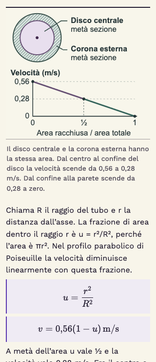

# C2 · Misurare pressione, portata e profilo di velocità

Base canonica `5b70dce18d690af08d7d5264a346349334e9d93a`. Il registro copre 178 voci di fluidi. Sono previste nuove edizioni di due esempi, undici quesiti e due esperienze. Le restanti 163 voci hanno una decisione di conservazione motivata. [Registro per ID](revisione-c2.tsv)

Nel collaudo precedente, a 320 px, dodici delle diciotto formule dei tredici materiali interessati eccedono la larghezza disponibile. L’eccedenza massima è 326 px. Il problema riguarda per esempio le quattro unità SI scritte su un’unica riga nell’inversa di Poiseuille. Il testo della sonda cita un fattore due e mostra il risultato, lasciando da ricostruire la ponderazione per area. Il manometro chiede un dislivello con segno e il blocco galleggiante misura una percentuale immersa.

| ID | Baseline e intervento | Rischio | Accettazione e controllo indipendente |
| --- | --- | --- | --- |
| F1 | Due esempi su taglio fra piastre e viscosità dal flusso in un tubo. | Una legge può essere applicata senza verificarne le condizioni, oppure un esponente può perdersi nella conversione del raggio. | Esplicitare regime stazionario, fluido newtoniano, aderenza alle pareti, condizioni al contorno e differenza fra gradiente longitudinale di pressione e gradiente trasversale di velocità. Controllare la forza per bilancio di potenze e la viscosità integrando un profilo di velocità per ricostruire la portata. |
| F2 | Undici quesiti su pressione, spinta, tempo di riempimento, velocità assiale e velocità media di sezione, resistenze e interfaccia. | Media su una linea al posto della media di sezione, segno assegnato alla pressione assoluta, forza doppia per una sola superficie. | La tavola sul tubo mostra il disco e la corona di uguale area. Un controllo geometricamente indipendente sulla sezione verifica che da 0,56 m/s sull’asse si ottengono 0,28 m/s in media. Integrare la pressione sullo sportello e ricomporre i bilanci per tutte le risposte numeriche interessate. |
| F3 | Manometro e galleggiamento. | Invertire i due livelli, confondere volume emerso e immerso o indicare una posizione unica per il corpo a densità uguale al liquido. | Entrambi i segni e lo zero devono concordare con il bilancio alla stessa quota. Spinta e peso devono coincidere nelle posizioni ammesse del comando di densità. Verificare il ritorno dal banco al paragrafo, letture reali e tavola 2D. |
| F4 | Catalogo e prime edizioni con soluzioni e figure già pubblicate. | Sostituire la versione di un vecchio tentativo, rimuovere disegni o far variare voti e permessi. | Registro di 15 revisioni, confronto di tutti i 991 ID, 606 risposte e 181 esperimenti. L’assemblatore C1/C2 deve rigenerare le schede distribuite. Conservare tutte le figure precedenti. I soli fascicoli modificabili sono i due di C2. |
| F5 | Formule lunghe e lettura a tappe. | Perdere il coefficiente, la potenza o l’unità su telefono. | Tutti i 13 materiali a 320 px con zero formule eccedenti. Tastiera, quattro profili Chromium/WebKit, zoom nativo 200%, riduzione del movimento e alternativa senza WebGL. Confrontare screenshot e pagine PDF. |
| F6 | Edizioni degli esercizi e accessi. | Alterare il quaderno registrato con la vecchia installazione. | Vecchio e nuovo tentativo C2-Q062, secondo utente, due avvii, archive e misure riconciliati su candidata e merge. Registrare separatamente le prestazioni locali e le verifiche con studenti e telefono fisico. |

Le proprietà di equilibrio idrostatico, viscosità e flusso laminare sono confrontate con gli enunciati sull’equilibrio del fluido e sulla legge di Poiseuille. [Pressione e fluidi in equilibrio](https://openstax.org/books/university-physics-volume-1/pages/14-2-measuring-pressure) · [Viscosità e flusso laminare](https://openstax.org/books/university-physics-volume-1/pages/14-7-viscosity-and-turbulence)

## Collaudo dei fluidi nella versione distribuita

Il contratto originale precede la modifica ai materiali. Il rilascio Vercel parte dal merge 7f6d0ffe della PR #350. Il catalogo C2 su quella base è identico a quello usato per redigere il contratto. Nella copia di prova b2d87657 sono cambiati 15 materiali su 991 e solo i fascicoli C2 di teoria ed esercizi. La sezione del tubo mostra perché un anello esterno pesa di più nella portata media. Il manometro mantiene il verso del dislivello e il galleggiante confronta le densità con la frazione immersa. [Materiali coinvolti](prove/edizione-c2/differenze.json) · [Tentativo v1 riaperto dopo v2](prove/edizione-c2/riapertura-locale.json) · [Quattro profili di collaudo locale](prove/edizione-c2/edizioni.json)

[Manometro 3D](prove/edizione-c2/chromium-1440-manometro-3d.png) · [Galleggiamento nella tavola piana](prove/edizione-c2/chromium-320-galleggiante-tavola.png)

### Pubblicazione compatibile con i tentativi già svolti

1. Prima di cambiare i materiali live, conservare i PDF dell’edizione servita. Eseguire il comando `python tools/conserva_fascicoli.py C2 --materiali /percorso/edizione-precedente/materials` dal nuovo checkout, usando le credenziali dell’archivio di destinazione. Il comando confronta le impronte e salva le copie private sotto la chiave dell’edizione. Registra anche l’impronta dei PDF eventualmente rigenerati dall’autore.
2. Pubblicare il runtime che contiene sia le figure precedenti sia la nuova sezione del tubo. Con l’archivio ancora a v1, fascicoli e soluzioni precedenti rimangono leggibili. Eseguire quindi `python tools/prepara_archivio_cloud.py --provision` dal nuovo checkout. La migrazione canonica aggiorna le sole prime edizioni integre e conserva i tentativi consegnati.
3. Verificare in preview e poi in produzione l’inventario per ID, i due PDF e un tentativo C2-Q062 della versione precedente. Eseguire `node tests/browser-fluidi-https.mjs` con `OFFICINA_BASE_URL`, `OFFICINA_COMMIT_ATTESO` e `ASTRA_RESULTS`. Il test usa i controlli del manometro e del galleggiante in 3D e senza WebGL, confronta tutti i tredici svolgimenti a 320 px e controlla la SHA prima e dopo il percorso. Per una preview protetta la chiave opzionale è `VERCEL_AUTOMATION_BYPASS_SECRET`.

Le prove con studenti e smartphone fisico rimangono distinte dal collaudo tecnico.
