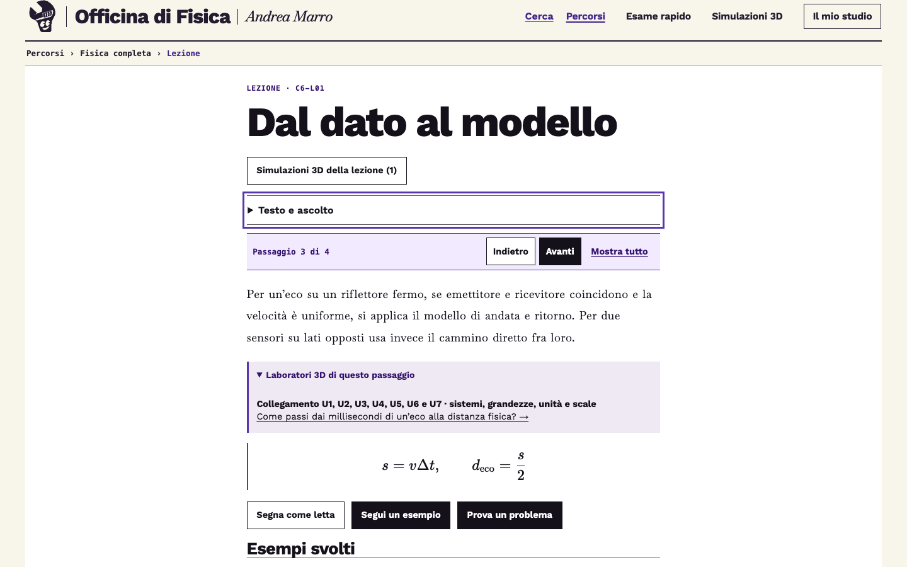
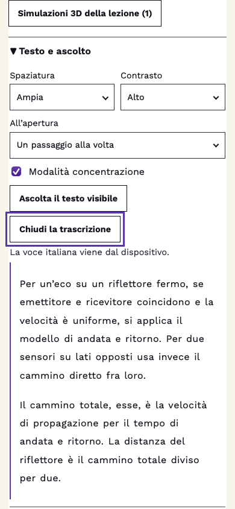

# Lettura e ascolto dei materiali

## Contratto prima della modifica

Sul lettore canonico le 56 lezioni e i 117 esempi pubblicati condividono i blocchi editoriali con formule KaTeX in HTML e MathML. Il controllo progressivo esiste per 8 lezioni, tutti i 117 esempi e 123 svolgimenti. La lezione C6-L01 comprende cinque blocchi e una formula. Le figure e i collegamenti ai laboratori devono continuare a seguire il loro passaggio.

| ID | Requisito e rischio | Prova |
| --- | --- | --- |
| L1 | Lo studente sceglie testo continuo o a passaggi e può tornare al testo intero. In ogni lezione ed esempio i blocchi rimangono nell’ordine originale. I laboratori restano associati al loro paragrafo. | Enumerare 56 lezioni e 117 esempi confrontando la sequenza con l’edizione, avanzare a mano, riaprire l’intero testo e seguire il collegamento a un banco. |
| L2 | Densità, contrasto, concentrazione e ritmo sono scelte esplicite del lettore. Si possono ripristinare i valori di partenza. Il quaderno personale ritrova le preferenze da un secondo client. | Profilo appena creato, modifiche parziali concorrenti, ricarica, secondo client, altro account e ritorno all’ospite. Confronto integrale dei dati di lettura e valutazione. |
| L3 | L’ascolto comincia soltanto su richiesta e usa una voce italiana indicata dal browser come locale. Lo studente può fermarlo, cambiare passaggio o lasciare l’attività. | Provare voce locale, elenco tardivo, sole voci remote, assenza del servizio, annullamento in navigazione e mancata esposizione dei quesiti sigillati. |
| L4 | La lettura audio segue testo e figure visibili, e pronuncia la struttura matematica. Il MathML editoriale rimane accessibile. | Verificare con un oracolo italiano frazione, potenza, segno meno e delta. Controllare l’ordine dei blocchi e il caricamento esclusivamente locale dei dati linguistici, anche senza voce installata. |
| L5 | Il comando per le preferenze occupa una sola riga da chiuso. Tastiera, movimento ridotto, zoom e uso a 320 px preservano i comandi e la lettura. L’orologio facoltativo segnala la fine solo a chi lo avvia. | Chromium e WebKit, viewport desktop/mobile, axe in stati distinti, controllo del focus, cronometro senza avanzamento automatico e riconciliazione visiva con Taste Skill. |
| L6 | Il lettore iniziale mantiene gli stessi contenuti e carica l’eventuale motore vocale solo su richiesta. Compatibilità delle edizioni e transazioni delle preferenze. | Nessun asset del motore durante la lettura ordinaria. Budget aggiuntivo a richiesta inferiore a 1 MiB per motore e mappe italiane. Verificare migrazione, ripresa da dati 1.1.0 e collaudo sul merge. |

La validazione con studenti, l’intelligibilità con tecnologie assistive personali e i gesti su un telefono fisico hanno una verifica separata.

Baseline `c0cf5478d954804c8f8a2db3007662f5eae093db`. Percorso riprodotto sul lettore C6-L01 a 1440 × 900 in Chromium e 390 × 844 in WebKit. La lettura a voce alta rimane una scelta personale. La sua disponibilità dipende dalle voci italiane locali esposte dal browser.

Il contratto del profilo accetta esclusivamente densità, contrasto, concentrazione e modalità di avanzamento. L’identità deriva dalla sessione. Il salvataggio di un campo preserva le scelte già salvate per gli altri campi. Un reset esplicito ripristina l’intero profilo. Per l’ospite si usano solo preferenze del browser. I tempi di lettura, il testo ascoltato e le scelte di accessibilità restano separati da tentativi, competenze e registri ufficiali.

## Uso

In ogni lezione ed esempio la riga **Testo e ascolto** raccoglie le preferenze. **Un passaggio alla volta** si può usare anche dal testo. Le frecce cambiano passaggio soltanto quando le attiva il lettore. **Mostra tutto** ripristina la sequenza intera. Al ritorno da una simulazione il focus ritrova il suo collegamento. La stampa comprende tutti i blocchi anche durante un passaggio.

Il contrasto alto usa carta bianca e inchiostro scuro. La modalità concentrazione nasconde l’indice laterale e conserva i laboratori nel testo. Il timer dura cinque minuti e segnala la fine con un messaggio. La pagina protegge lo spazio di lettura anche senza voce, con MathML e trascrizione. Una lezione rimane disponibile durante un’interruzione del caricamento delle mappe vocali. Il lettore può riprovare l’azione.

## Implementazione e limiti

- Il contratto pubblico espone le quattro preferenze del quaderno. Una scrittura richiede la sessione corrente e il valore pubblico `draftSession` nell’intestazione `X-Officina-Session`. SQLite unisce le sole modifiche richieste nella transazione di scrittura. Il ripristino elimina la riga del profilo. L’ospite conserva scelte separate sul dispositivo.
- Il testo, le didascalie e le formule provengono dagli stessi blocchi visibili nel lettore. Per l’espressione dell’eco la lettura editoriale si applica soltanto al TeX esatto presente nell’annotazione MathML. Una formula cambiata torna alla verbalizzazione strutturale. Per le altre formule il lettore carica su richiesta il motore italiano Mathspeak e le sole mappe `base` e `it`. La distribuzione include motore, mappe e licenza Apache 2.0. Il controllo di igiene della prima candidata ha rilevato spazi di fine riga nelle mappe distribuite da SRE. La copia servita elimina quegli spazi. Il confronto dei valori JSON decodificati, le impronte originali e quelle delle copie distribuite sono riportate nella provenienza. [Provenienza e impronte](prove/lettore-sre.json) · [Release ufficiale SRE 4.1.5](https://github.com/Speech-Rule-Engine/speech-rule-engine/releases/tag/v4.1.5)
- L’avvio dell’ascolto richiede un comando esplicito e una voce che il browser dichiara italiana e locale. Cambio di passaggio, chiusura dei controlli, navigazione e uscita interrompono la lettura. La trascrizione resta disponibile con sole voci remote. [Contratto Web Speech](https://webaudio.github.io/web-speech-api/#dom-speechsynthesisvoice-localservice)
- Dopo migrazione l’archivio conta 19 tabelle. Nel collaudo di ritorno, a scrittori fermi su una copia, `BEGIN IMMEDIATE; PRAGMA user_version=3; COMMIT;` consente all’eseguibile precedente di riaprire il quaderno. La tabella delle preferenze resta presente e la migrazione 004 la riutilizza al successivo aggiornamento. L’operazione reale richiede uno snapshot coerente dell’archivio e il confronto dei registri prima della riapertura.
- Lo studente sceglie densità, passo, tempo e formulazione in parole senza fornire dati clinici. L’utilità di questi controlli con specifici studenti deve ancora essere osservata. [CAST, personalizzazione della presentazione](https://udlguidelines.cast.org/representation/perception/customize-display/) · [W3C, redistribuzione dei contenuti](https://www.w3.org/WAI/WCAG22/Understanding/reflow.html)

## Verifiche per requisito

Baseline `c0cf5478`. Contratto `4875fc1f`. La prima prova di sorgente è riferita a `6e90bc08f3d2ed822a3076e149eae9a817075743`. Dopo le controprove su selettori mobili, disponibilità della voce e rientro dal banco, la sorgente ricollaudata è `46e4ef5d93d3ed5a3d46416ef3c68bcd6f98fb25`. L’esecuzione CI successiva alla pubblicazione della PR è associata all’albero provato da GitHub. Il verbale di integrazione registra separatamente la SHA ufficiale.

| ID | Baseline → modifica | Rischio | Prova e risultato tecnico |
| --- | --- | --- | --- |
| L1 | 8 su 56 lezioni con passaggi → 56 su 56 e tutti i 117 esempi | Perdere un blocco o staccare il banco dalla spiegazione | PASS. Confronto DOM per tutte le 173 edizioni, 352 formule e 129 figure. C6-L01 conserva il terzo passaggio, il collegamento e il focus dopo il ritorno dalla tavola 2D. [Verbale browser](prove/lettore-browser.json) |
| L2 | Nessun profilo personale di lettura → quattro scelte persistenti | Mescolare utenti o perdere un aggiornamento concorrente | PASS. Due sessioni apportano modifiche disgiunte, una terza conserva le proprie scelte. Verificati richieste invalide, reset, sessione precedente, riavvio, storico e voti. [Test HTTP](../../tests/test_workflows.py) |
| L3 | Nessun ascolto selezionabile → ascolto italiano locale, interruzione e trascrizione | Partenza involontaria, lettura dopo uscita o invio a un servizio esterno | PASS. Voce del sistema disponibile sul Mac in WebKit. Il doppio controllato verifica voci tardive e remote, navigazione, cambio utente e fallimento con ripresa. Esame C6 sigillato verificato senza aiuti attivi. [Test browser](../../tests/browser-lettore.mjs) |
| L4 | Formula solo tipografica e MathML → verbalizzazione selezionabile | Lettura errata di segno, frazione, esponente o tragitto | PASS tecnico. Frazione, potenza e segno verificati in due motori. La distanza dell’eco è controllata per tutti i 21 valori del banco con un calcolo inverso indipendente. A 20 ms il percorso è 6,8 m e la parete dista 3,4 m. [Controprova eseguibile](prove/lettore-eco.mjs) |
| L5 | Controlli limitati → impostazioni richiudibili, timer, testo integrale stampabile | Perdita di focus o pagina più larga dello schermo | PASS tecnico. Cinque configurazioni, 15 scansioni axe. Verificati zoom nativo 200%, larghezze 320 e 390, tastiera, movimento ridotto e timer senza avanzamento. [Taste Skill e zoom](prove/lettore-taste.json) |
| L6 | Archivio v3 e lettore senza motore vocale → migrazione 004 e motore facoltativo | Cambiare i dati preesistenti o rallentare l’apertura | PASS tecnico. Copia 1.1.0 riaperta con lo stesso cookie e la risposta originaria, confronto integrale delle 18 tabelle precedenti e andata e ritorno di versione. Motore e mappe 850.433 byte grezzi su richiesta, zero richieste SRE nell’apertura ordinaria. [Misura prima/dopo](prove/lettore-costo.json) |
| L7 | Su C1-Q034 la bozza svaniva al ritorno dal banco → ripresa in memoria dopo nuova autorizzazione | Sovrascrivere una consegna concorrente o mostrare dati di un’altra sessione | Il test sul banco e il percorso browser confrontano risposta numerica, scelta, altra sessione e invio concorrente. [Percorsi riproducibili](../../tests/browser-lettore.mjs) |

Dieci aperture locali per versione hanno dato mediana 182 ms e p90 367 ms nella base, mediana 205,5 ms e p90 252 ms nella prima candidata. Il confronto descrive questo Mac e una prova corta. Le misure dei singoli browser sono nel verbale. Taste ha esaminato l’applicazione autentica a 100% e 200%. Il suo controllo colore segnala `FAIL palette-purple` e avvisi per crema, tipi e bordi dell’identità esistente. La verifica manuale ha controllato separazione delle opzioni dal testo, collegamento all’esperimento, chiarezza della frase sull’eco e leggibilità dei controlli a larghezza ridotta. [Misure e osservazioni grezze](prove/lettore-taste.json)

| Chromium desktop | WebKit mobile |
| --- | --- |
|  |  |

**Da validare con persone.** Intelligibilità delle voci individuali e dei simboli specialistici, comprensione della differenza fra cammino e distanza, effetto di ritmo e spaziatura sul carico percepito, riuso a distanza e utilizzo con tecnologie assistive personali. Il test touch su telefono fisico è rinviato. L’esito automatico di axe riguarda gli stati eseguiti.

### Controprova di continuità rilevata nel collaudo

L7, prima della correzione. Sul ramo ufficiale `c0cf5478`, digitare `37` in C1-Q034, entrare nel banco collegato e usare **Torna all’attività** lascia il campo vuoto. Il test già presente in `browser-banchi.mjs` ha riprodotto il difetto anche sulla prima candidata. Criterio aggiuntivo: mantenere in memoria solo la risposta di allenamento aperta e ancora da inviare. All’uscita dal banco ricontrollare sessione, permesso, tentativo, posizione, ID ed edizione sul server. Una risposta già registrata altrove prevale sempre. Nessuna scrittura nei voti, nel registro tentativi, nello storage del dispositivo o nella cronologia del browser. Coprire risposta numerica, scelta, sessione cambiata e invio concorrente.

Sul caso L7 lo stesso percorso conferma ora il valore `37` al rientro autorizzato. La scelta multipla rimane selezionata. Se il secondo client ha già inviato `19`, la schermata mostra la consegna `19` e il voto del server. Se cambia quaderno, il tentativo richiede nuovamente l’accesso. La prova estesa dei dieci banchi verifica anche 30 scene WebGL e 10 tavole di riserva. Il selettore del collaudo punta alla dicitura **Segui lo svolgimento**, che apre ancora le equazioni. **Testo e ascolto** è disponibile all’interno. Il verbale dei cinque profili registra le altezze effettive dei selettori aperti e la disponibilità rilevata delle voci. [Verbale per SHA](prove/lettore-browser.json)

Le schermate di confronto provengono dalla stessa lezione C6-L01. [Prima, Chromium desktop](prove/lettore-prima-desktop.png) · [Prima, WebKit mobile](prove/lettore-prima-mobile.png)
